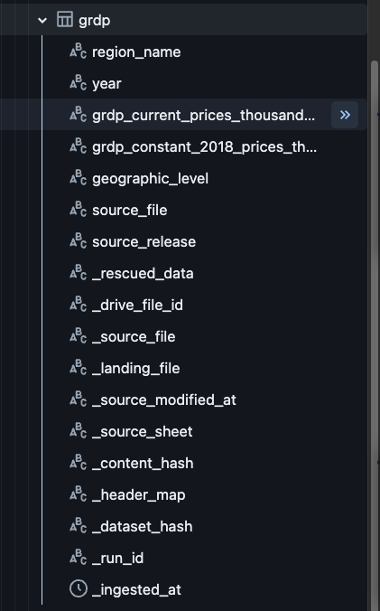

# Journal - 2026-10-13 - Current and Constant GRDP Tell Different Stories

## Today in one sentence

I learned that GRDP growth must be interpreted with its price basis: current-price growth includes price changes, while constant-price growth is designed to show changes in real economic output.

## What I learned

- Today I completed a read-only profiling pass for `pondolens.dev_bronze.grdp` covering **95 records from 2021–2025**. The grain is one geography × year × source release, with **18 regional rows and one national row per year**.
- The table stores two different measures:
  - `grdp_current_prices_thousand_php` — the value using prices from the reported year.
  - `grdp_constant_2018_prices_thousand_php` — the value after holding prices at the 2018 price level.
- Both measures are valid, but they answer different questions. Current prices describe the peso value recorded for that year. Constant prices are better for comparing output across years because they reduce the effect of price changes.
- This means a large current-price increase does not automatically mean production increased by the same amount. Part of the increase may come from inflation or other price movements. When I want to discuss real regional economic growth, the constant-price measure is the safer default.
- The source unit is **thousand Philippine pesos**. I should preserve that unit explicitly. Converting to pesos would require multiplying by 1,000, while converting to million pesos would require dividing the thousand-peso value by 1,000. The conversion must be documented rather than guessed from the size of the numbers.
- The required fields, years, and numeric values passed the completed checks. The profiling found no missing required values, invalid years, invalid amounts, zero amounts, duplicate keys, missing geography-year combinations, label issues, rescued rows, or missing checked lineage fields.
- Regional sums matched the national total for both current-price and constant-price GRDP in all five years. This is a strong reconciliation result, but the national rows should still be kept separate from regional rows. Summing the national value together with the 18 regions would double count the economy.
- I recomputed year-over-year growth instead of trusting the published percentages without checking them. All **152 computed growth values** matched the original workbook at two decimal places:
  - 19 geographies;
  - 4 annual comparisons from 2022 through 2025;
  - 2 GRDP measures.
- Growth for 2021 is correctly not applicable within this profiling window because 2020 is outside the ingested scope. Writing zero would incorrectly imply that there was no growth; NULL with a clear status communicates that the comparison cannot be calculated from the available years.
- One result stood out: **Western Visayas in 2022** exceeded the proposed 20% review threshold for current-price growth at **25.22%**, while constant-price growth was **10.23%**. Both values matched the source.
- That result is a good example of why a threshold should create a **review flag**, not automatically quarantine a valid record. The value is large, but it is supported by the source and the regional totals still reconcile with the national total.
- The gap between 25.22% current-price growth and 10.23% constant-price growth also shows why the price basis must appear beside every growth metric. Calling both values simply “GRDP growth” would hide an important difference in meaning.
- The profiling source release is identified as `2026-04`. Keeping `source_release` in the grain is important because official economic statistics can be revised. A newer release may contain updated historical values for the same region and year.
- The source includes Negros Island Region and assigns Sulu to Zamboanga Peninsula throughout 2018–2025. This is a source-specific geographic convention. Before joining GRDP with population or budget data, I still need to confirm that the other dataset uses compatible regional boundaries.
- The Bronze schema preserves both measures and detailed lineage: source file, Drive file identity, landing file, selected sheet, content hash, dataset hash, run ID, and ingestion time. That evidence helps me trace a value back to the exact source snapshot used by the pipeline.
- For Silver, I should convert the year to an integer, convert the two GRDP measures to documented decimal types, standardize geography labels only through a verified mapping, and retain `source_release`. Growth is better calculated in Gold because it is a derived analytical metric, not a raw source fact.
- The proposed `quality_flags` field should record review states such as the verified large Western Visayas change. It should not replace the original amount or turn a source-verified observation into an error.

## Terms I am still learning

- **GRDP** — Gross Regional Domestic Product, the value of goods and services produced within a region.
- **Current prices** — values measured using the prices that existed during each reported year.
- **Constant prices** — values recalculated using one base year's prices so changes across years better reflect real output.
- **Price basis** — the pricing method used for a monetary series, such as current prices or constant 2018 prices.
- **Nominal growth** — growth measured at current prices, which can include both output and price changes.
- **Real growth** — growth measured at constant prices to reduce the effect of inflation.
- **Source release** — the publication version of an official dataset; later releases may revise earlier years.
- **Reconciliation** — checking whether regional components add up to the published national total.
- **Review threshold** — a value used to call attention to an unusual observation without automatically declaring it invalid.
- **First-year NULL** — a missing growth result caused by the absence of the prior year, not by bad source data.

## What confused me

- At first, I thought the two GRDP columns were almost duplicates expressed in different formats. They are not. They represent the same economy under different price assumptions and can produce very different growth rates.
- The 25.22% Western Visayas current-price increase looked suspicious because it exceeded the proposed threshold. Recomputing the growth and comparing it with the workbook showed that the value is source-verified, so “large” does not mean “wrong.”
- I had to separate a **review flag** from a **quarantine rule**. A review flag asks for interpretation. Quarantine means the record should not be used. This case needs the first, not the second.
- I am still unsure which boundary version should become the team's common analytical geography. The GRDP source includes NIR and places Sulu in Zamboanga Peninsula, but population and budget sources may use different arrangements.
- The source provides both national and regional rows. I need every downstream query to filter by `geographic_level` so a national total is never accidentally added to its regional components.
- I also need to verify whether the 2018 constant-price basis should remain in the Silver column name permanently or be represented through a separate `base_year` field for easier future revisions.

## One small next step

- [ ] Build one comparison query for 2022–2025 that displays regional current-price growth, constant-price growth, their percentage-point gap, and a documented review flag, while excluding the national row from regional ranking.

## Git checkpoint

- [x] I created or updated a file
- [x] I wrote a commit
- [x] I pushed my changes

## Decisions or assumptions (optional)

- I will use constant-price GRDP when describing real economic growth across years.
- I will label current-price growth as nominal growth and constant-price growth as real growth.
- I will preserve the original thousand-PHP unit and document any conversion factor.
- I will retain national rows for reconciliation but exclude them from regional rankings and regional sums.
- I will keep `source_release` in the Silver grain so revisions remain distinguishable.
- I will use NULL, not zero, for 2021 growth because the prior year is outside the selected scope.
- I will record Western Visayas 2022 as a source-verified large change, not as an invalid record.
- I will not join GRDP to population or budget data until regional boundaries are verified as compatible.
- I will calculate year-over-year growth in Gold instead of overwriting source amounts in Bronze or Silver.

## Evidence from today (optional)

This inspected screenshot shows the PondoLens Bronze GRDP schema. It includes both GRDP measures, `geographic_level`, `source_release`, rescued data, hashes, run lineage, and the ingestion timestamp. The image contains no credentials, private URLs, account names, Drive identifiers, or local file paths.

- [GRDP profiling notebook on the PondoLens `dev` branch](https://github.com/ItsYangCoder/ph-government-budget-analysis/blob/dev/databricks/notebook/profiling/rhea_grdp_profiling.ipynb)
- [PondoLens `dev` branch](https://github.com/ItsYangCoder/ph-government-budget-analysis/tree/dev)
- [Committed schema screenshot](https://github.com/ItsYangCoder/ftw-b12-journal/blob/main/assets/2026-10-13-grdp-price-basis-schema.png)

## Reflection (optional)

- The most useful lesson today was that data profiling is not only about finding broken rows. It can also reveal when two correct columns tell different stories.
- Recomputing all 152 growth values made the conclusion stronger than simply trusting the workbook. It confirmed that the unusual Western Visayas result was a real source value, not a calculation mistake.
- I also understand the purpose of a quality flag more clearly now. A good flag keeps an unusual value visible and reviewable without changing it just to make the dataset look normal.
- The GRDP table looks structurally clean, but the geography question still prevents a careless join. This is another reminder that technical completeness and analytical compatibility are separate.
- I want my Silver and Gold layers to make the price basis obvious enough that a dashboard user cannot accidentally describe nominal growth as real growth.

## Mood or meme (optional)

- Same region, same year, two growth rates—because prices also have a plot twist. 📈
