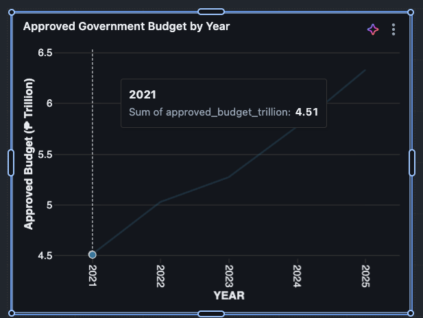

# Journal - 2026-10-16 - Rank Departments After Aggregation

## Today in one sentence

I learned that a reliable Top 5 budget chart must rank department totals after the regional fact rows have been aggregated to the reporting grain.

## What I learned

The Gold fact table is intentionally detailed: one row represents a fiscal year, a geography, and a particular budget item. That grain is useful because it preserves regional detail, but it also means a department can appear in many rows. If I sort the raw fact rows and take the first five, I get the five largest rows—not necessarily the five departments with the largest total appropriations.

The verification output makes the difference concrete. Each fiscal year covers 17 regions and 35–37 departments, but contains 595–629 fact rows:

| Fiscal year | Regions | Departments | Fact rows | Appropriation (₱ billions) |
|---|---:|---:|---:|---:|
| 2021 | 17 | 36 | 612 | 2,170.886421 |
| 2022 | 17 | 37 | 629 | 2,409.353618 |
| 2023 | 17 | 36 | 612 | 2,550.376993 |
| 2024 | 17 | 35 | 595 | 2,876.971627 |
| 2025 | 17 | 35 | 595 | 3,024.216967 |

Those counts show why the dashboard needs a deliberate reporting layer. For a “Top 5 departments per year” view, I should join the fact table to the year and particular dimensions, identify the department-level grouping field, filter out rows whose appropriation is NULL, group by fiscal year and department, and calculate `SUM(appropriation_amount)`. Only then should I apply a ranking window such as `DENSE_RANK() OVER (PARTITION BY fiscal_year ORDER BY appropriation_amount DESC)`.

The partition matters. Ranking within each fiscal year answers “Which departments received the highest allocations in this year?” Ranking one total across 2021–2025 answers a different question: “Which departments received the largest cumulative allocation over five years?” Both can be valid, but the dashboard title and filter must say which question it answers.

I also learned not to turn missing appropriations into zero just to make the chart work. Rows such as Automatic Appropriations, Debt Interest Payments, and National Tax Allotment appeared with NULL appropriation values in the ranking output. NULL means the value is absent or not represented at that grain; zero would mean a measured allocation of nothing. Converting one into the other could create a false bottom-five result. These rows need investigation or an explicit exclusion rule, not silent replacement.

Finally, the Top 5 chart measures allocation concentration, not program performance or public need. It can show where budget is concentrated, but it cannot prove that a department performed well, that a region needed less, or that an indicator changed because of the budget. Those comparisons require a clear indicator definition, compatible geography and year, and careful wording that avoids causal claims.

## Terms I am still learning

- **Reporting grain** — the level represented by one row in the result. Here, the source fact grain is more detailed than the department-level dashboard grain.
- **Aggregation** — combining detailed rows into a summary, such as summing regional appropriations for one department and year.
- **Window ranking** — assigning an order to already aggregated rows with a function such as `DENSE_RANK` or `ROW_NUMBER`.
- **Partition** — the group within which a window function restarts; partitioning by fiscal year creates a separate Top 5 for every year.
- **NULL** — a missing or unavailable value, which is not automatically equivalent to zero.

## What confused me

The remaining modeling question is whether `dim_particular.category` is consistently the correct department/agency grouping while `particular` is the lower-level line item. The query output suggests that some labels are special appropriation classes rather than ordinary departments, so I should validate the dimension values before using the field as the chart label.

I also need to keep the scope of the annual totals honest. They are totals produced by the regional fact dataset after its own cleaning and matching rules; I should not label them as complete national GAA totals unless I verify that the source coverage supports that statement.

## One small next step

I will build one validation table with `fiscal_year`, department, `fact_rows`, and `appropriation_billions`, then compare its ranked Top 5 with the Databricks dashboard for one selected year before polishing the visual.

## Git checkpoint

- [x] Reviewed the verified Gold fact-table grain and annual row-count summary.
- [x] Recorded the NULL-appropriation issue instead of treating missing values as zero.
- [ ] Create and validate the department-level ranking view.
- [ ] Confirm that the dashboard Top 5 matches the validation table for one year.

## Decisions or assumptions (optional)

- I will rank after aggregation, never directly from the regional fact rows.
- I will partition the Top 5 by fiscal year unless the visual is explicitly labeled as a five-year cumulative ranking.
- I will exclude NULL appropriation values from ranking while preserving them for a separate data-quality check.
- I will treat the department/category mapping as an assumption until the dimension values are validated.
- The newly found contracts CSV files are candidate evidence sources only; they are not part of this analysis until they are profiled and ingested.

## Evidence from today (optional)

- [Gold regional expenditure fact notebook](https://github.com/ItsYangCoder/ph-government-budget-analysis/blob/dev/databricks/notebook/04_gold/fact_regional_expenditure.ipynb)
- [Current development comparison](https://github.com/ItsYangCoder/ph-government-budget-analysis/compare/main...dev)

I reused this safe repository chart because it gives the annual allocation context without exposing workspace URLs, account details, or personal information. The fresh dashboard screenshots available today contained private interface details, so they were not copied into the journal.

## Reflection (optional)

This exercise reminded me that a polished chart can still answer the wrong question if I skip the grain check. The useful work happens before the colors and labels: define the entity being ranked, aggregate to that entity, decide the time scope, and make missing values visible. A small validation table beside the dashboard is less impressive visually, but it is what makes the final ranking defensible.

## Mood or meme (optional)

“Rank the totals, not the rows.”
