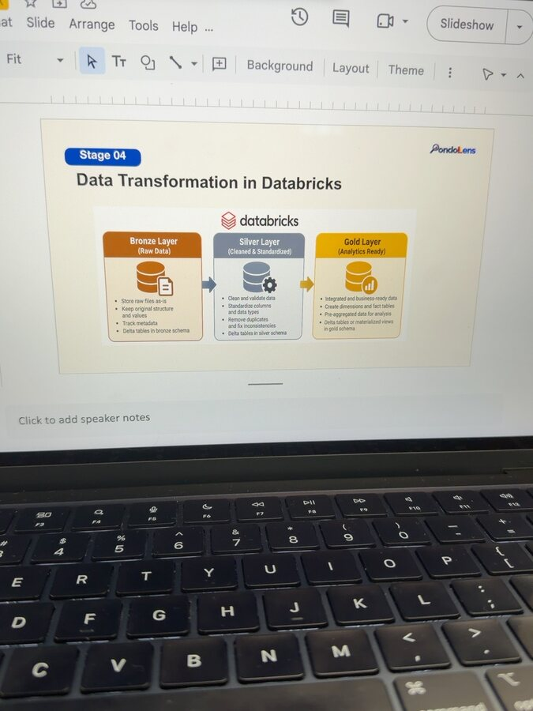

# Journal - 2026-10-17 - Explaining the Medallion Pipeline Accurately

## Today in one sentence

I learned that a simple pipeline story is only useful when the words “raw,” “clean,” and “analytics-ready” still match what the system actually does.

## What I learned

Today I worked on explaining the PondoLens data methodology for a non-technical presentation. The visible flow is easy to follow: official DBM and PSA reports are collected, Python converts difficult source formats into structured tables, the Google Drive API transfers the files to Databricks, and the data moves through Bronze, Silver, and Gold before it reaches the dashboard.

The important lesson is that every arrow represents a different responsibility. The API is a transport mechanism. It can list files, read metadata, and download bytes from Google Drive, but it does not clean a column, remove a duplicate, or decide the grain of a table. Python conversion changes the representation of the source. Databricks then stores, validates, standardizes, models, and serves the data. Keeping those responsibilities separate makes the explanation easier to trust.

The word **raw** needs special care in this project. Some official sources begin as PDFs or wide Excel workbooks. If Python converts them before Databricks loads them, the Bronze Delta rows are not literally the untouched PDF pages. They are the earliest structured representation used by the pipeline. To make that design auditable, the original source file should remain in the landing area, while Bronze preserves source values together with lineage such as the source filename, file identifier, reporting year, sheet or page context, ingestion timestamp, and processing key.

This gives each medallion layer a clear contract:

| Layer | Simple explanation | Technical responsibility |
|---|---|---|
| Bronze | Keep the evidence | Preserve the earliest ingested representation and its source metadata with minimal business interpretation. |
| Silver | Make records consistent | Standardize names, types, years, regions, units, hierarchy, and quality rules without hiding rejected or unmatched records. |
| Gold | Prepare answers | Join dimensions and facts, define the reporting grain, calculate trusted measures, and produce tables designed for specific analytical questions. |

The boundaries also protect the analysis. A dashboard should not invent logic that belongs in Silver or Gold. For example, department rankings require aggregation at the department-and-year grain before the Top 5 is selected. Regional comparisons need compatible region labels and years. Budget and development indicators can be compared for patterns, but the Gold layer does not automatically prove that budget caused an indicator to improve.

For the presentation, I can translate the layers without removing those limits: Bronze is the evidence copy, Silver is the consistent working data, and Gold is the question-ready data. That language is easier for a general audience, but it still reflects the engineering design.

## Terms I am still learning

- **Medallion architecture** — an organization pattern that moves data through Bronze, Silver, and Gold as its quality and business meaning become more controlled.
- **Landing area** — the location where source files arrive before they are transformed into pipeline tables.
- **Lineage** — information that shows where a record came from and which processing steps produced it.
- **Layer contract** — the rules describing what a layer accepts, guarantees, and is responsible for.
- **Grain** — what one row represents, such as one year, region, and budget item.

## What confused me

My open question is where the project should draw the exact boundary between conversion and Bronze ingestion. A PDF must be parsed before its cells can become Delta rows, but calling the converted rows “raw files as-is” can be misleading. I need to confirm that the original files are retained and that the structured Bronze records carry enough metadata to trace a value back to its source.

I also need to keep the spoken explanation consistent with the implemented pipeline. A polished slide can accidentally promise more than the notebooks guarantee—for example, saying that Silver “removes duplicates” without explaining which business key defines a duplicate.

## One small next step

- [ ] Revise the methodology script so each layer has one simple sentence, then add one sentence explaining that original source files and lineage are preserved before cleaning.

## Git checkpoint

- [x] Reviewed the current PondoLens data-methodology and medallion-layer slide.
- [x] Inspected the selected screenshot for credentials, private URLs, and personal information.
- [ ] Update the technical pipeline documentation with the final presentation wording.
- [ ] Verify the wording against the current Bronze, Silver, and Gold notebooks.

## Decisions or assumptions (optional)

- I will describe the API as transporting data, not transforming it.
- I will distinguish the original source file from the earliest structured Bronze representation.
- I will use “question-ready” instead of implying that Gold data is automatically correct for every analysis.
- I will avoid causal language when comparing regional spending with GRDP, unemployment, water, electricity, or internet-access indicators.
- I will keep the presentation simple, but not remove lineage, grain, or scope from the technical explanation.

## Evidence from today (optional)

- [PondoLens repository](https://github.com/ItsYangCoder/ph-government-budget-analysis)
- [Current development branch](https://github.com/ItsYangCoder/ph-government-budget-analysis/tree/dev)
- [Bronze, Silver, and Gold implementation folders](https://github.com/ItsYangCoder/ph-government-budget-analysis/tree/dev/databricks)

This screenshot came from the PondoLens methodology presentation I reviewed today. It shows the layer descriptions that prompted the question of what “raw” means when document conversion happens before Databricks.

## Reflection (optional)

Explaining the pipeline to a non-technical audience forced me to notice a detail that is easy to ignore while coding: simple words are still technical claims. If I say Bronze is raw, I should know which original evidence is preserved. If I say Silver is clean, I should be able to name the rules. If I say Gold is ready, I should be able to name the question and grain. The presentation becomes clearer when every short sentence has an engineering definition behind it.

## Mood or meme (optional)

“Simple enough to explain, precise enough to defend.”
