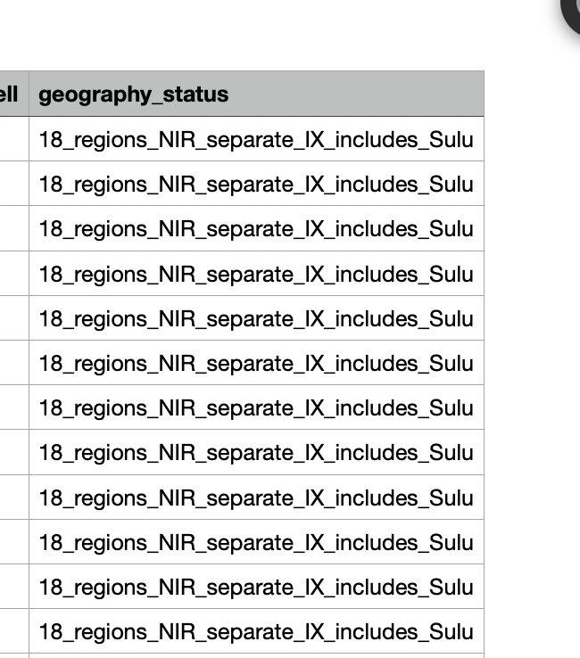

# Journal - 2026-10-18 - Validate the Source Before Ingestion

## Today in one sentence

I learned that finding a downloadable data file is only the beginning; I still need to prove its source, time period, geographic coverage, grain, and definitions before it belongs in the pipeline.

## What I learned

Today I was looking for regional classroom and education data that could support the PondoLens analysis. A local Parquet file named `School-Unique-v2.parquet` was available, but the filename alone did not answer the important questions: What school year does it represent? Does it include every Philippine region? Which education levels are covered? Is it an official government extract, a transformed copy, or a third-party dataset?

This is a useful distinction in data engineering: **file accessibility is not data readiness**. Parquet is a good analytical format because it stores columns and types efficiently, but the format does not prove that the contents are complete, current, official, or appropriate for the business question. A well-structured unofficial file can still be unsuitable, while a difficult official PDF may still be the authoritative evidence.

I also separated a file-access problem from a data-quality problem. The initial Pandas error came from pointing `read_parquet()` at the wrong path or filename. Listing the Downloads folder revealed the exact filename. Fixing that path only proves that Python can open the file; it does not validate the dataset itself.

Before ingestion, I need a small source-qualification check:

| Check | Question it answers |
|---|---|
| Provenance | Who published the data, and can I trace it to an official page or document? |
| Reference period | Is the value for calendar year, fiscal year, or school year? |
| Geographic coverage | Are all regions present, and which PSGC boundary version is used? |
| Population or school scope | Does it cover public schools only, all basic education, or selected levels? |
| Grain | Does one row represent a school, division, region, level, or year? |
| Metric definition | Is “classroom ratio” published directly, or derived from classrooms and enrollment? |
| Completeness | Are any regions, years, or required fields missing? |
| Comparability | Did definitions or regional boundaries change between 2021 and 2025? |

The year label requires special attention. A document called the **2025 Philippine Statistical Yearbook** can contain tables whose observations come from earlier years. The publication year is not automatically the data year. The same problem appears with school statistics: School Year 2023–2024 is not the same time key as fiscal year 2024. If I join them without an explicit rule, the dashboard may look aligned even when the reference periods are different.

Regional coverage is also more than counting distinct labels. The current PondoLens sources already require decisions about NCR, BARMM, NIR, Central Office, Nationwide, and changing regional boundaries. An education file with 17 regions may use an older boundary system; a file with 18 labels may include a national total rather than 18 comparable regions. The source manifest should record the geography version and any exclusions before Silver mapping begins.

For a classroom-pressure measure, I should also avoid accepting a precomputed ratio without its definition. If the source supplies classroom count and enrolled learners, I can preserve both components and calculate a transparent ratio:

`learners_per_classroom = enrolled_learners / usable_classrooms`

But even that formula is only meaningful when “usable classroom,” school level, modality, and reporting period are defined consistently. A ratio calculated from incompatible denominators would be precise-looking but misleading.

## Terms I am still learning

- **Data provenance** — evidence showing where a dataset came from, who published it, and how it reached the pipeline.
- **Reference period** — the exact time represented by a value, such as fiscal year 2024 or School Year 2023–2024.
- **Coverage** — the people, places, institutions, and time periods included in a dataset.
- **Grain** — what one row represents, such as one school per school year or one region per education level.
- **Schema-on-read** — interpreting a file’s columns and types when it is opened; a readable schema does not replace business validation.

## What confused me

The biggest unresolved question is the identity of `School-Unique-v2.parquet`. I do not yet have verified evidence for its publisher, reference year, or regional coverage. I should not label it as a 2021–2025 official regional classroom dataset until those facts are confirmed.

I also need to determine whether the education measure should be a classroom count, a learner-to-classroom ratio, a completion rate, or another outcome. These measures answer different questions. Classroom count describes infrastructure supply, while completion rate describes an education outcome; neither automatically explains why DepEd received a certain budget.

## One small next step

- [ ] Profile the Parquet file by printing its schema, row count, distinct year values, distinct regions, education levels, null counts, and source metadata before deciding whether to ingest it.

## Git checkpoint

- [x] Located the exact Parquet filename shown by the terminal.
- [x] Recorded the dataset year, provenance, and regional coverage as unverified instead of presenting them as facts.
- [ ] Add the source to the ingestion manifest.
- [ ] Create a Bronze table only after the source-qualification checks pass.

## Decisions or assumptions (optional)

- I will not treat a downloadable file as official without a traceable government source.
- I will keep publication year, fiscal year, calendar year, and school year as separate concepts.
- I will preserve numerator and denominator columns when a ratio can be derived.
- I will record the geography version before mapping regional labels.
- I will not use the education file in a presentation claim until its coverage and definitions are verified.

## Evidence from today (optional)

- [PondoLens repository](https://github.com/ItsYangCoder/ph-government-budget-analysis)
- [PSA OpenSTAT](https://openstat.psa.gov.ph/)
- Local verification showed the available filename as `School-Unique-v2.parquet`; its business metadata remains unverified.

I reused this safe repository screenshot because it demonstrates why geography metadata belongs in source profiling. No new relevant image attachment was available today; the new Philippine Statistical Yearbook item was a PDF rather than a screenshot.

## Reflection (optional)

It is tempting to feel finished when I finally find a file that downloads and opens. Today’s work reminded me that this is exactly when the careful questions should begin. A pipeline can process the wrong dataset perfectly. Taking a few minutes to verify provenance, period, coverage, and grain is less visible than building a dashboard, but it protects every result that comes after it.

## Mood or meme (optional)

“Downloaded” is not the same as “validated.”
