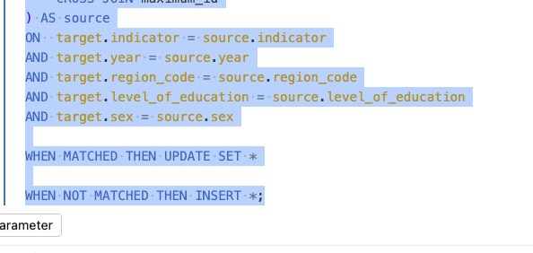

# Journal - 2026-10-19 - Completion Rate Needs a Complete Business Key

## Today in one sentence

I learned that a Silver upsert is only safe when its business key preserves every dimension that makes a completion-rate record unique.

## What I learned

Today the completion-rate Silver transformation was added and merged through [PondoLens PR #40](https://github.com/ItsYangCoder/ph-government-budget-analysis/pull/40). The transformation covers 2021–2025 and maps the data to standardized regions while keeping education level and sex as separate analytical dimensions.

The most important part of the design is the business key used by the SQL `MERGE`:

`indicator + year + region_code + level_of_education + sex`

This key describes the grain of the Silver table. One row is not simply “the completion rate of a region in a year.” It is the value for one indicator, year, standardized region, education level, and sex category. If I omit `level_of_education`, elementary and secondary observations could overwrite each other. If I omit `sex`, male, female, and combined values could collapse into one record. A successful `MERGE` would still be technically valid SQL, but it would destroy valid analytical detail.

The upsert has two familiar branches:

- `WHEN MATCHED THEN UPDATE` refreshes values for a business key that already exists.
- `WHEN NOT MATCHED THEN INSERT` adds a newly observed key.

That makes the operation repeatable only when the source key is unique before the merge. The supplied Databricks staging results showed 855 rows, including 657 numeric rates and 198 missing rates, with no unmapped locations and no duplicate business keys. These are useful gates because they check the assumptions that the merge relies on instead of waiting for a dashboard problem.

The missing rates also need to remain visible. A missing completion rate is not the same as zero percent. Zero would mean the source measured a complete absence of completion; missing means the value was not reported, unavailable, suppressed, or otherwise not usable. Preserving a missing-value status allows downstream analysis to distinguish “no result” from “a result of zero.”

PR #40 also introduced full-snapshot behavior. This means the selected Silver scope is expected to match a complete Bronze snapshot, so records that disappear from the source scope may be deleted from the target. That is different from a simple append-only pipeline. It requires an operational rule: never run the deletion step from a partial source extract. Otherwise, valid Silver records could be removed just because the input batch was incomplete.

The validation evidence also has a clear boundary. Eighteen offline unit tests passed, and the supplied Databricks staging results were recorded. However, the final SQL migration, ID allocation, and deletion behavior were not executed during the merge review. The repository CI checks Python and notebook syntax; it does not prove Databricks SQL runtime semantics. The merge is verified as code integration, not as final production execution.

The ID design starts at 8,000,001 and uses a maximum-based allocation approach. This can preserve existing IDs during controlled upserts, but it assumes one writer. Concurrent writers could calculate the same next range, and deleting the highest IDs could allow numbers to be reused. That is acceptable only if the operational limits are explicit and enforced.

## Terms I am still learning

- **Business key** — the real-world columns that uniquely identify a record, independent of its generated numeric ID.
- **Grain** — the exact meaning of one row; here it includes indicator, year, region, education level, and sex.
- **Upsert** — an operation that updates matching records and inserts new ones.
- **Full snapshot** — a source extract expected to contain every record in a defined scope, not just recent changes.
- **Missing-value status** — a field explaining why a metric has no numeric value instead of silently converting it to zero.

## What confused me

The completion-rate SQL is stored in the current `dbt` folder, but PR #40 states that it is executable Databricks SQL rather than a dbt `SELECT` model. I need to keep that distinction clear because the folder name alone can make the implementation look more mature as dbt than it currently is.

I also still need to verify the time meaning of `year`. Education statistics may represent a school year, while budget data uses a fiscal year. Using the same integer in both tables does not automatically make their reporting periods equivalent.

## One small next step

- [ ] Run the final Silver SQL twice in Databricks against a complete Bronze snapshot, then confirm that row counts, IDs, missing statuses, and deletion behavior remain correct on the second run.

## Git checkpoint

- [x] PR #40 was merged into `dev` on October 19, 2026.
- [x] Eighteen offline unit tests passed.
- [x] Supplied staging results recorded 855 rows, 657 numeric rates, 198 missing rates, zero unmapped locations, and zero duplicate keys.
- [ ] Execute the final migration and ID allocation in Databricks.
- [ ] Verify the full-snapshot deletion behavior with an intentional controlled test.

## Decisions or assumptions (optional)

- I will use all five business-key fields in the completion-rate `MERGE`.
- I will preserve missing rates and their statuses rather than replacing them with zero.
- I will run snapshot deletion logic only after confirming that the Bronze input is complete for the selected scope.
- I will treat the current ID allocator as single-writer.
- I will not describe the SQL as a dbt model until it follows a real dbt model workflow.
- I will verify how school years align with fiscal years before joining completion rates to budget measures.

## Evidence from today (optional)

- [PondoLens PR #40 — Completion rate Silver SQL and documentation](https://github.com/ItsYangCoder/ph-government-budget-analysis/pull/40)
- [PondoLens development branch](https://github.com/ItsYangCoder/ph-government-budget-analysis/tree/dev)

This inspected screenshot shows the exact fields used to match completion-rate records during the Silver `MERGE`. It contains no credentials, private URLs, or personal information.

## Reflection (optional)

This work made the idea of grain feel practical. A business key can look like a small technical detail, but it decides whether the pipeline preserves or silently destroys meaning. The five-key match is longer than using only year and region, but that extra precision protects the education-level and sex breakdowns that the analysis may need later.

I also need to stay honest about what “merged” means. The code is now on `dev`, tests passed, and staging evidence exists. Runtime migration and rerun behavior are still separate checks. Recording that boundary makes the next step clear instead of pretending the pipeline is finished.

## Mood or meme (optional)

“A short key is not always a smart key.”
