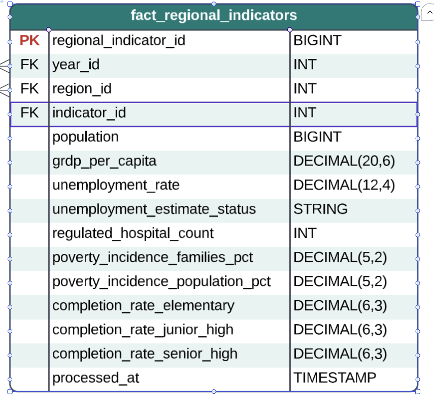

# Journal - 2026-10-20 - A Fact Table Needs One Clear Grain

## Today in one sentence
- I reviewed the proposed `fact_regional_indicators` design and learned that combining many useful measures is safe only after every column has a documented year-and-region grain, filter, and missing-value rule.

## What I learned
- A fact table needs a clear **grain** before it needs more columns. The screenshot shows `year_id`, `region_id`, and `indicator_id` beside population, GRDP per capita, unemployment, hospital, poverty, and completion-rate measures. Those fields look compatible because they are all regional indicators, but their source tables do not automatically describe the same kind of row.
- Population and GRDP per capita can often be reduced to one value per year and region. Other sources carry extra dimensions. Completion rate has education level and sex. Hospital data has hospital type. Poverty has separate families and population measures, and its verified source covers 2021, 2023, and 2025 rather than every year. If I join these sources before choosing one record from each extra dimension, a single region-year can become several rows. That is a **fan-out join**: one row on one side matches several rows on the other side, multiplying facts and making totals or averages unreliable.
- A wide row can still work, but it needs a contract for every measure. For example, `completion_rate_elementary` should say whether it uses `Both Sexes`; `regulated_hospital_count` should say which hospital type is represented; and poverty must keep families and population as different measures. These choices are business meaning, not only SQL details.
- Missing years should stay missing. Poverty data exists for alternating years in the profiled source, while completion-rate observations cover 2021–2025 but include recognized missing markers. Filling those gaps with zero would change “not observed” into “observed as none.” A left join from a complete year-region scaffold can preserve the row while leaving the unavailable measure as `NULL`.
- The screenshot also exposed a modeling question: if the row is one `year_id × region_id` snapshot containing many measure columns, then I need to understand what `indicator_id` identifies. If `indicator_id` is part of the grain, the table sounds like a long indicator fact and most measure columns may be redundant or mostly null. If the table is intentionally wide, the key may instead be the region-year pair plus a surrogate row ID. The key and the columns must tell the same story.
- Validation should prove the intended grain, not only that the SQL ran. I would check one row per chosen natural key, compare row counts before and after every join, and verify that each source contributes at most one row per target key after filtering. This is how the model protects the dashboard from quiet duplication.

## Terms I am still learning
- **Grain** - the exact real-world meaning of one row, such as one region in one year.
- **Fan-out join** - a join where one source row matches multiple rows and unexpectedly multiplies facts.
- **Scaffold** - a complete set of expected keys, such as all valid year-region combinations, used as the base for left joins.
- **Wide fact table** - a fact table with several named measure columns in one row.
- **Long fact table** - a fact table where a measure or indicator identifier and value are stored as rows instead of separate measure columns.
- **Semi-additive measure** - a value that can be combined across some dimensions but not all; rates usually cannot be summed across regions or categories.

## What confused me
- I still need to confirm whether `indicator_id` is meant to be part of the `fact_regional_indicators` natural grain or only a relationship carried for reporting. The current diagram shows both a single indicator foreign key and many indicator-specific columns, so those two design ideas need to be reconciled.
- I also need an explicit rule for each source’s extra dimensions. For completion rate, the choice of sex and education level affects uniqueness. For hospitals, the choice between Government, Private, or Total changes the meaning of the count.

## One small next step
- [ ] Create a grain-contract table with one row per target measure: source table, source grain, selected filters, target column, available years, missing-value rule, and a SQL uniqueness check for `year_id × region_id`.

## Git checkpoint
- [x] I created or updated a file
- [x] I wrote a commit
- [x] I pushed my changes

## Decisions or assumptions (optional)
- I will treat the diagram as a proposed analytical model, not as proof that the joins or Databricks table have already been implemented.
- I will not convert unavailable indicators to zero or carry values into years that are not present in the source.
- I will not sum rates such as poverty, unemployment, or completion percentages across regions. They require an appropriate denominator or an official aggregate.
- Before choosing a wide or long design, I will make the row grain and the purpose of `indicator_id` explicit.

## Evidence from today (optional)
- 
- This inspected screenshot from my shared project files shows the proposed regional-indicator fact table. I cropped only the surrounding editor area; the table names, keys, fields, and data types are unchanged. No credentials, private URLs, or personal details are visible.
- The same project material includes verified source-grain differences: poverty is split into families and population and covers 2021, 2023, and 2025, while completion rate includes education level, sex, and recognized missing observations. Those differences are why the target grain needs a written contract.
- Previous related reflection: [Completion Rate Needs a Complete Business Key](./2026-10-19-completion-rate-business-key.md).

## Reflection (optional)
- The schema is visually compact, but the difficult reasoning is hidden behind each measure. I am learning that dimensional modeling is less about fitting columns into one table and more about protecting meaning when datasets meet.
- My main open question is now concrete: should this be one wide region-year snapshot, or one long row per indicator? Answering that before writing the final join will save more time than debugging duplicated dashboard numbers later.

## Mood or meme (optional)
- A clean ERD is a promise; the grain checks are the proof. 🧩
