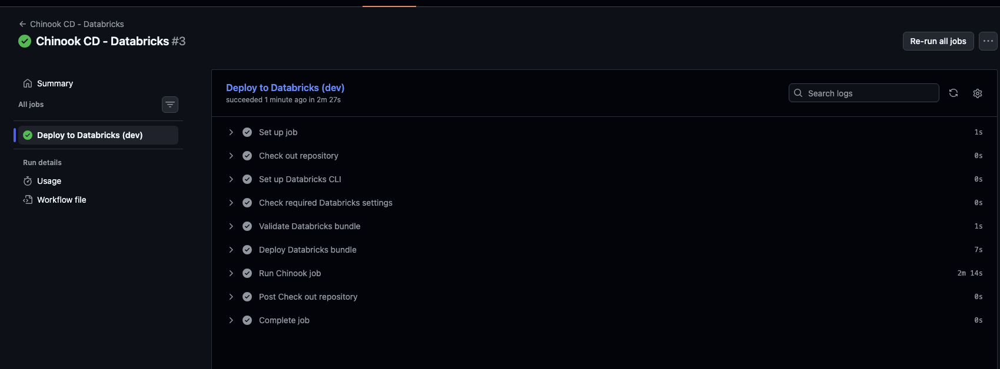

# Journal - 2026-10-21 - Passing CI Is Not a Recovery Plan

## Today in one sentence
- I learned that stronger CI can prevent many bad changes from merging, but production readiness also needs a written way to inspect, contain, and recover from a pipeline that fails after some tables have already changed.

## What I learned
- Today, [PondoLens PR #63](https://github.com/ItsYangCoder/ph-government-budget-analysis/pull/63) merged a meaningful CI improvement into `main`. The workflow now runs all ingestion unit tests and a separate offline dbt job. The recorded validation was 37 unit and materialization tests, successful dbt parsing and offline compilation for 19 models, and 235 test definitions. This is stronger evidence than checking only a small profiling-test subset.
- The same PR clearly keeps an important boundary: its dbt validation uses pinned dependencies and a placeholder profile without Databricks secrets or a warehouse connection. That means CI can catch project structure, dependency, compilation, and offline test problems, but it does not prove that a connected `dbt build` will succeed against Unity Catalog, permissions, real source data, and the Databricks SQL warehouse.
- [PondoLens PR #64](https://github.com/ItsYangCoder/ph-government-budget-analysis/pull/64) also improved operational safety by refreshing repository guides, verifying 56 documentation links, and removing a personal credential-file path default. Secret-based authentication remains the default, while file authentication now requires an explicit absolute path. This reduces accidental environment-specific behavior.
- A **green CI check** and a **recovery plan** answer different questions. CI asks, “Should this change be allowed to merge?” A recovery runbook asks, “What do we do when a real run has already started changing state and then fails?” A pipeline can pass every offline check and still fail because of permissions, warehouse availability, unexpected source data, a mapping problem, or a downstream model.
- A multi-step pipeline is not automatically one transaction. Bronze ingestion, Silver merges, Gold models, and dbt tests may commit work at different times. If Gold fails after Bronze and Silver succeed, rerunning everything blindly may be safe for some idempotent steps but risky for others. The operator first needs to know the last successful task, which tables changed, the run ID or processing timestamp, and whether another writer is active.
- I now see a useful recovery sequence:
  1. Stop overlapping writers and preserve the failed run evidence.
  2. Identify the failed command and the last successful command.
  3. Inspect affected tables using row counts, audit fields, natural-key checks, and Delta history.
  4. Classify the failure as before-write, partial-write, or post-write validation failure.
  5. Choose a documented action: fix and rerun the whole idempotent step, resume from a safe boundary, or restore a table only when evidence supports it.
  6. Re-run reconciliation and data-quality checks before calling the pipeline healthy.
- The current repository search did not find a committed failure-recovery or runbook document on `main`. I should therefore treat recovery guidance as an open production-readiness task, not something already completed.

## Terms I am still learning
- **Runbook** - a practical set of steps an operator follows during a known incident or failure.
- **Blast radius** - the tables, jobs, dashboards, and users that may be affected by one failure.
- **Idempotent rerun** - repeating a step produces the same correct result instead of duplicating or corrupting data.
- **Checkpoint** - recorded state that shows what work completed and where safe processing can continue.
- **Compensating action** - a deliberate operation that corrects or reverses an earlier committed change when a full transaction rollback is unavailable.
- **RPO and RTO** - recovery point objective is how much data loss is acceptable; recovery time objective is how quickly service should return.

## What confused me
- I still need to map the real transaction boundary of each PondoLens stage. Some SQL uses `MERGE`, some dbt models may rebuild tables or views, and Bronze ingestion has its own checkpoints. “Rerun the job” is not precise enough until each step’s behavior is known.
- I also need to confirm whether the Databricks job is configured to stop immediately on the first failing task and which run metadata is retained for reconciliation. The shared logs show dbt commands being launched, but they do not by themselves prove the final connected build and recovery behavior.

## One small next step
- [ ] Add `docs/operations/failure-recovery-runbook.md` with a before-write / partial-write / post-write decision table, the exact inspection queries, and one controlled failure test in the dev catalog.

## Git checkpoint
- [x] I created or updated a file
- [x] I wrote a commit
- [x] I pushed my changes

## Decisions or assumptions (optional)
- I will describe PR #63 as offline CI validation, not as proof of a successful connected production dbt run.
- I will not recommend deleting or restoring a Delta table until the failed run, affected version, and downstream impact are identified.
- Recovery tests should run only in the dev catalog with one writer and disposable or restorable test data.
- A recovery runbook should name safe rerun boundaries per stage rather than use one generic instruction for the entire pipeline.

## Evidence from today (optional)
- [PR #63 — full ingestion tests and offline dbt validation](https://github.com/ItsYangCoder/ph-government-budget-analysis/pull/63)
- [PR #64 — repository guide and credential-default cleanup](https://github.com/ItsYangCoder/ph-government-budget-analysis/pull/64)
- [Merge commit for the CI improvement](https://github.com/ItsYangCoder/ph-government-budget-analysis/commit/b1eaa6a9575e41eed4a0372603226754fa53cb99)
- 
- This existing, inspected journal asset shows a successful Databricks deployment path. I reused it because it is safe and directly illustrates the happy path that a failure-recovery runbook must complement. Today’s new Databricks screenshots were excluded because they displayed workspace URLs, account details, or job identifiers.

## Reflection (optional)
- My takeaway is that a production-ready pipeline needs evidence for both success and failure. Tests and green checks reduce the chance of a bad deployment, while a recovery runbook reduces uncertainty after something still goes wrong.
- The documentation gap is fixable because the pipeline already has useful building blocks: validation queries, stable business keys, audit timestamps, ingestion checkpoints, and a dev environment. The next improvement is to connect those pieces into one operational decision path.

## Mood or meme (optional)
- Green checks say “the expected path works”; a runbook says “we still know what to do when it does not.” 🧯
