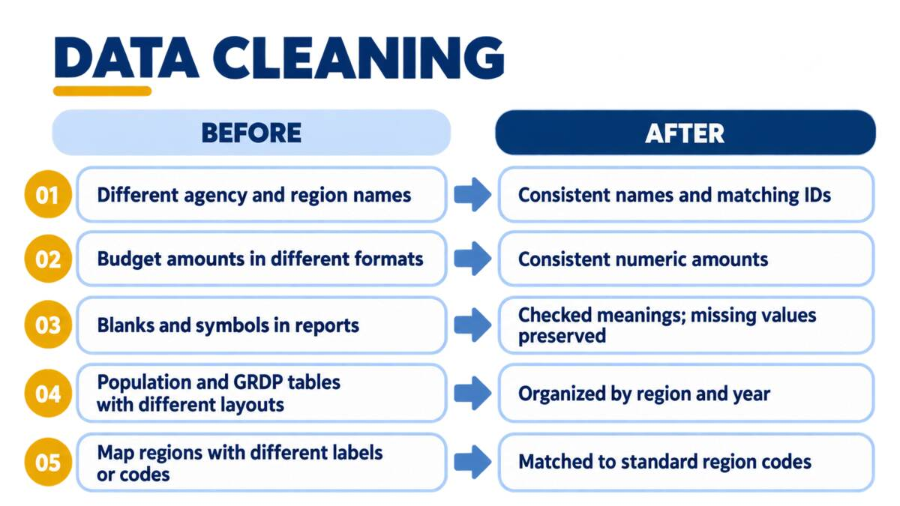

# Journal - 2026-10-23 - Cleaning Should Preserve Meaning, Not Just Values

## Today in one sentence
- While preparing the PondoLens data-methodology story, I learned that trustworthy cleaning is not only about making values consistent; it must also preserve what the source originally meant.

## What I learned
- A renamed agency is an **entity-resolution** problem, not just a spelling correction. In the regional obligations data, labels such as `Office of the Press Secretary` and `Presidential Communications Operations Office` are standardized to `Presidential Communications Office (PCO)`. Without that mapping, the same office could appear as separate agencies across years and produce misleading comparisons.
- The Silver model keeps both meanings: `particular` is the approved standard name used in the business key, while `particular_as_stored` keeps the cleaned source label. This gives the dashboard one consistent identity without erasing lineage back to the report.
- Stable IDs depend on stable business meaning. The obligations grain is one `year + category + particular + region_code` row. The model renames an existing agency only after checking that the new name will not collide with another row, then keeps the existing `obligation_id`. This is safer than treating every label change as a new agency.
- Missing-value handling also needs source-specific semantics. In this model, a blank and a dash are not reported numeric zeros. The current calculation rule stores their amount as zero so totals can reconcile, but it separately stores `value_status = 'blank'` or `'dash'`. A real reported zero has `value_status = 'numeric'`. The status column is what prevents three different source meanings from becoming indistinguishable.
- This changes how I should explain the slide. “Missing values were preserved” is directionally correct but incomplete. A more accurate explanation is: *we checked what each symbol meant, applied the documented calculation rule, and preserved the original status for interpretation*. That is still simple English, but it does not hide the implementation.
- I also learned that a cleaning rule is not automatically universal. PondoLens documents this zero-plus-status treatment for DBM regional obligations. I should not copy the rule into population, GRDP, or another dataset unless that source’s documentation supports the same meaning.

This presentation graphic summarizes the visible “before and after,” while the model documentation and SQL explain the important details behind those short labels.

## Terms I am still learning
- **Canonical name** - one approved name used to represent the same real-world entity across different source labels.
- **Entity resolution** - deciding whether differently named records refer to the same agency, place, or other real-world thing.
- **Semantic missingness** - the meaning behind a value being absent; blank, dash, not applicable, and not collected may require different treatment.
- **Data lineage** - the information that lets me trace a cleaned value back to its source file, source label, and processing step.
- **Business key** - the columns that identify the real-world record; here it is year, category, standardized particular, and region code.

## What confused me
- The presentation phrase “kept missing values” can sound as if the numeric column stays `NULL`, but the implemented obligations rule stores zero and preserves the distinction in `value_status`. I need to explain both parts together so a listener does not assume either that missing values were discarded or that every zero was reported by DBM.
- I still want to understand when an organizational change should keep one canonical agency ID and when it represents a genuinely different institution. A name change alone can be mapped, but a change in mandate or structure may require a new identity and an effective-date rule.

## One small next step
- [ ] Add one speaker-note example that contrasts a reported numeric zero with a dash or blank, including the resulting `expenditure_amount` and `value_status`, so the methodology explanation stays simple and technically exact.

## Git checkpoint
- [x] I created or updated a file
- [x] I wrote a commit
- [x] I pushed my changes

## Decisions or assumptions (optional)
- I will describe the agency mapping as a verified PondoLens rule, not claim that every historical government reorganization should share one ID.
- I will say that missing-value meaning was preserved through `value_status`; I will not say blanks and dashes are the same as reported numeric zero.
- I will keep the source label alongside the canonical name because standardization should improve comparison without removing traceability.
- I am treating today mainly as a learning and communication reflection. I found no newer project commit than the recent dashboard and data-health work, so I am not claiming that I changed the transformation code today.

## Evidence from today (optional)
- [Regional obligations Silver guide](https://github.com/ItsYangCoder/ph-government-budget-analysis/blob/main/docs/silver/regional_obligations.md) - documents the table grain, agency-name mapping, `particular_as_stored`, and dash/blank status rule.
- [Regional obligations SQL](https://github.com/ItsYangCoder/ph-government-budget-analysis/blob/main/dbt/models/silver/regional_obligations.sql) - implements the approved agency map, collision check, stable-ID merge, and `value_status` logic.
- [PondoLens README](https://github.com/ItsYangCoder/ph-government-budget-analysis/blob/main/README.md#how-the-data-moves) - explains how Bronze retains source values and Silver applies dataset-specific cleaning and checks.
- [Today’s cleaned methodology graphic](../assets/2026-10-23-semantic-data-cleaning.jpg) - a safe Library image used for the presentation work; it contains no account details, private URLs, credentials, or personal information.

## Reflection (optional)
- Turning the cleaning work into presentation language made me notice how much judgment is hidden behind a short phrase like “clean and standardize.” The technical work is not only removing commas or fixing capitalization. It is deciding which records mean the same thing and how to keep important differences visible.
- The difficult part was balancing simplicity with accuracy. I want the audience to understand the method quickly, but I do not want a clean slide to erase the difference between a source dash and a real zero.
- I feel more confident explaining why lineage and status columns matter. They are not extra metadata; they are what let a cleaned table remain honest about its source.

## Mood or meme (optional)
- Today’s reminder: clean data should be easier to use, not easier to misunderstand. 🧼🔍
