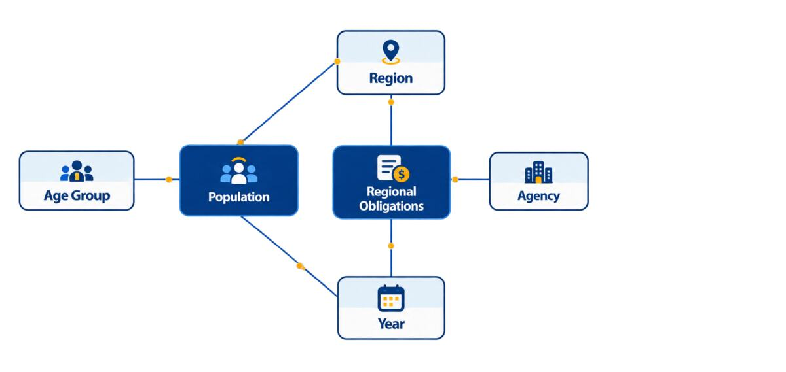

# Journal - 2026-10-25 - Knowledge Transfer Is Part of Pipeline Reliability

## Today in one sentence
- Reflecting on the technical help I shared during FTW made me realize that a pipeline is not truly maintainable if its important rules exist only in the original developer’s head.

## What I learned
- Data Engineering is not finished when the code runs. A teammate should also be able to understand what the pipeline does, which inputs it expects, what one output row means, how to verify a run, and what to do when only part of the process succeeds.
- Teaching a technical concept is a useful test of my own understanding. If I cannot explain a table’s grain, keys, missing-value rules, or safe rerun behavior in simple language, I may know the commands without fully understanding the system.
- PondoLens already shows several layers of knowledge transfer. The README gives the high-level path from source files to Bronze, Silver, Gold, and the dashboard. The data-model guide defines the facts, dimensions, keys, and grain. The ingestion guide explains failure recovery. The validation record separates what was proven by connected dbt builds from what still needs separate evidence.
- These documents solve different problems. A diagram helps someone form a mental model, but it cannot replace exact table definitions. A successful test count proves that specific checks passed, but it does not explain how to recover from a partial write. A runbook gives operational steps, but it still needs links to the relevant models and expected validation results.
- **Operational handoff** should make hidden assumptions visible. In PondoLens, examples include using one writer, running dbt with one thread, checking the first failure, inspecting tables already updated, preserving IDs, avoiding an unreviewed full refresh, and keeping dashboard refreshes paused until the recovered data is validated.
- Evidence must travel with the explanation. The validation record documents two connected builds with 19 successful models and 235 passed data tests, but it also states that the tested Git commit and run URLs were not captured. That limitation is important knowledge for the next person; passing numbers without provenance are weaker release evidence.
- Knowledge transfer also protects data meaning. A teammate needs to know that obligations are commitments rather than cash payments, population values are projections, fact tables have different grains, and Region/Year keys do not automatically solve historical boundary differences. These are analytical contracts, not optional presentation details.
- The practical goal is not to make every person memorize the whole repository. It is to leave a clear path from overview → model definition → execution steps → validation evidence → recovery procedure, so someone can find the right level of detail when needed.

This simplified model is useful for teaching the main relationship, while the linked documentation provides the exact table names, grains, limitations, and recovery rules needed for a real handoff.

## Terms I am still learning
- **Knowledge transfer** - deliberately sharing the context, decisions, procedures, and evidence another person needs to continue the work.
- **Bus factor** - the number of people whose absence would leave a project without enough knowledge to operate or maintain it.
- **Runbook** - a step-by-step operational guide for running, diagnosing, or recovering a system.
- **Data contract** - an agreed definition of a dataset’s schema, grain, keys, meaning, and quality expectations.
- **Reproducibility** - the ability for another person to follow the same inputs and process and obtain a verifiable result.
- **Tacit knowledge** - useful knowledge that someone understands from experience but has not yet written down.

## What confused me
- I am still learning how much detail belongs in the main README versus a specialized guide. Too little detail makes a handoff unsafe, while too much detail can make the starting point difficult to follow.
- A document can become outdated even when it was correct when written. I want to understand the best way to make documentation changes part of code review, especially when SQL column names, run commands, or recovery behavior change.
- It is also difficult to know when a verbal explanation has become too simple. For example, saying “Region and Year connect the data” is useful, but it needs a follow-up warning that each fact must first be aggregated to a compatible grain.

## One small next step
- [ ] Add a short handoff checklist to one PondoLens guide covering: required inputs, target schemas, run command, expected validation evidence, known limitations, and the first recovery link.

## Git checkpoint
- [x] I created or updated a file
- [x] I wrote a commit
- [x] I pushed my changes

## Decisions or assumptions (optional)
- I will treat documentation, validation evidence, and recovery instructions as engineering deliverables, not as optional work after coding.
- I will keep presentation explanations short, then link them to precise repository documentation instead of placing every technical detail on a slide.
- I will avoid saying a pipeline is fully handed over until another person can locate the inputs, run it safely, interpret the result, and follow the recovery path.
- No newer PondoLens code commit was visible today, so this is a learning reflection based on today’s knowledge-sharing story and the repository’s current documentation—not a claim that I changed the production pipeline.

## Evidence from today (optional)
- [PondoLens README](https://github.com/ItsYangCoder/ph-government-budget-analysis/blob/main/README.md) - provides the project overview, pipeline stages, setup path, and documentation index.
- [Data-model guide](https://github.com/ItsYangCoder/ph-government-budget-analysis/blob/main/docs/data_model.md) - records the fact constellation, table grains, shared dimensions, reporting rules, and interpretation limits.
- [Pipeline failure and recovery guide](https://github.com/ItsYangCoder/ph-government-budget-analysis/blob/main/docs/ingestion.md#pipeline-failures-and-recovery) - explains partial-write risks, investigation, safe reruns, and validation before resuming refreshes.
- [dbt validation record](https://github.com/ItsYangCoder/ph-government-budget-analysis/blob/main/dbt/VALIDATION.md) - records connected and offline checks while stating the limits of the available evidence.
- [Existing safe data-model graphic](../assets/2026-10-24-fact-constellation-relationships.jpg) - reused because today’s new Library images are personal graduation/story photos rather than technical evidence.

## Reflection (optional)
- Looking back at the technical help I shared with classmates made me see that teaching is not separate from engineering. Explaining the work forces me to identify assumptions that code alone may not reveal.
- The encouraging part is that useful knowledge can spread: one person learns a concept, applies it, and can then help someone else. That is a healthier project than one where every question returns to a single developer.
- The part I want to improve is making the handoff durable. A conversation can solve today’s problem, but a clear example, validation record, and runbook can help the next person even when I am not available.

## Mood or meme (optional)
- If only one person knows how the pipeline works, that person is part of the infrastructure. 🧠➡️📚
