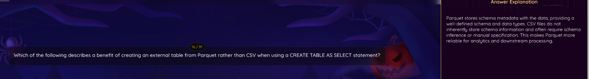

# Journal - 2026-10-28 - Databricks Questions Get Easier When I Know the Feature Boundary

## Today in one sentence
- I learned that I can eliminate Databricks exam distractors more reliably by identifying which component owns the capability instead of choosing the option with the most familiar words.

## What I learned
- My first step should be to translate the question into a smaller technical request: **What capability is being tested, and which Databricks component provides it?** In one practice question, I considered “the ability to distribute complex data” as a Delta Lake benefit. That sounds plausible because the whole platform is distributed, but distributed computation belongs mainly to Apache Spark. Delta Lake is the storage layer that adds reliable tables and supports using the same data for batch and streaming workloads. [What is Delta Lake?](https://docs.databricks.com/aws/en/delta)
- This gives me a useful elimination rule: match every option to its real owner. Notebook collaboration belongs to the workspace and notebook experience. Query-failure alerts belong to Databricks SQL monitoring. Using Python, SQL, Scala, or R belongs to Spark and platform APIs. Distributed execution belongs to Spark compute. Batch and streaming access to the same reliable table is a Delta Lake capability. The exam often mixes true platform features, but only one answers the component named in the question.
- I also clarified **Delta Live Tables**. DLT is the older product name and API used in many reviewers. Current Databricks documentation calls the product **Lakeflow Spark Declarative Pipelines**. I declare datasets and transformations in SQL or Python, while the pipeline analyzes dependencies and manages execution order. Lakeflow adds production features such as expectations, event logs, and incremental processing. [Apache Spark Declarative Pipelines](https://docs.databricks.com/aws/en/ldp/concepts/spark-declarative-pipelines)
- “Declarative” means I describe the result and rules instead of manually scripting every execution step. In a medallion design, I can declare how Bronze becomes Silver and how Silver becomes Gold; the pipeline builds the dependency graph. This is different from Lakeflow Jobs, where I explicitly orchestrate tasks such as notebooks, Python scripts, or dbt commands. My PondoLens work helps me understand the layers, even though today I studied the pipeline concept rather than implementing a new Lakeflow pipeline.
- The Parquet-versus-CSV question showed the same boundary method at the file-format level. Parquet stores column types and schema metadata with the file. CSV is plain text, so readers usually need an explicit schema or inference. “Parquet can be partitioned” is not the best distinguishing benefit because partitioned directory layouts are not exclusive to Parquet. Creating an external table over Parquet also does not automatically convert it into a Delta table. [External tables on Databricks](https://docs.databricks.com/aws/en/tables/external)
- In a PondoLens-style example, a CSV source might arrive with every value represented as text unless the ingestion code supplies types. A Parquet source can preserve fields such as year as an integer and an amount as a numeric type. After ingestion into Delta, the table gains Delta-specific reliability features. The important lesson is not to mix the source file format, the processing engine, and the table format into one concept.

## Terms I am still learning
- **Feature boundary** - the line between what one component is responsible for and what belongs to another component.
- **Declarative pipeline** - a pipeline where I define datasets and transformations while the engine determines dependencies and execution order.
- **Dependency graph** - the upstream and downstream relationships that determine which dataset must be processed first.
- **Self-describing format** - a format such as Parquet that stores schema and type metadata with its data.
- **External table** - a table registered in a metastore while its data files remain in an external cloud-storage location.
- **Distractor** - a multiple-choice option that may be technically true somewhere in the platform but does not answer the exact component or scenario in the question.

## What confused me
- The practice material still says Delta Live Tables, while current documentation says Lakeflow pipelines and uses newer APIs. I need to recognize both names without assuming every legacy syntax example is the current recommended pattern.
- Several answer choices can be true statements about Databricks as a whole. My confusion happens when I do not first narrow the scope to the named component.
- I still need to become faster at separating Apache Spark, Delta Lake, Parquet, Lakeflow pipelines, Lakeflow Jobs, and Databricks SQL because they work together in real projects and therefore sound interchangeable in short questions.

## One small next step
- [ ] For the next ten mock questions, write the named component beside the question and label each option with its actual owner before choosing an answer.

## Git checkpoint
- [x] I created or updated a file
- [x] I wrote a commit
- [x] I pushed my changes

## Decisions or assumptions (optional)
- I will use elimination only after restating what the question is asking; I will not eliminate an option merely because its wording looks unfamiliar.
- I will learn both the older DLT terminology used by reviewers and the current Lakeflow terminology used by Databricks documentation.
- I am treating today as a study and learning entry. I found no new PondoLens repository commit to claim as implementation work.
- I selected a privacy-safe crop rather than uploading the full browser screenshot.

## Evidence from today (optional)
- Today’s conversation included the direct question, “What is Delta Live Tables?”, followed by practice on identifying the capability owned by Delta Lake.
- I proposed “the ability to distribute complex data” during elimination and then worked through why distributed processing points to Spark, while Delta Lake supports batch and streaming use of reliable tables.
- The inspected screenshots covered Lakeflow/DLT, Spark SQL concepts, Delta Lake capabilities, PySpark table access, and Parquet versus CSV.
- The PondoLens repository head remains [`d684dff`](https://github.com/ItsYangCoder/ph-government-budget-analysis/commit/d684dff932dea289a8435fa2d1666990797e500f), dated October 22, 2026. This entry does not claim a new project change today.

## Reflection (optional)
- The difficult part was not memorizing more product names. It was reading the subject of the question carefully enough to avoid choosing a real feature that belongs to the wrong layer.
- Connecting each feature to a project example makes the distinction easier to remember. Bronze, Silver, and Gold describe the data flow; Spark performs distributed computation; Delta stores reliable tables; and a declarative pipeline can manage the dependency graph between those datasets.
- I want to get faster at asking, “What exactly is the question looking for?” before reading the options.

## Mood or meme (optional)
- 
- This screenshot captures the main lesson: an option can sound useful, but the strongest answer is the capability that uniquely distinguishes the component being tested.
