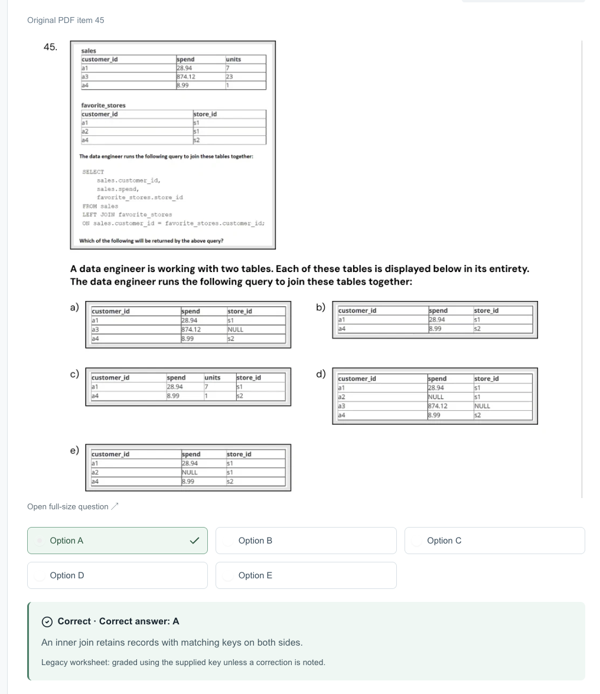

# Journal - 2026-10-29 - SQL Semantics Matter More Than an Answer Key

## Today in one sentence
- I learned to verify what the SQL operator actually does before trusting a reviewer explanation, especially when the query, expected rows, and answer key contradict one another.

## What I learned
- Today’s disputed question used `sales LEFT JOIN favorite_stores`. A left join preserves every row from the left table, then adds matching columns from the right table. When no right-side match exists, the right-side columns become `NULL`. [Databricks join documentation](https://docs.databricks.com/aws/en/sql/language-manual/sql-ref-syntax-qry-select-join)
- The `sales` table contained customers `a1`, `a3`, and `a4`. The `favorite_stores` table contained `a1`, `a2`, and `a4`. Therefore, the result must retain the three left-side customers: `a1` matches `s1`, `a4` matches `s2`, and `a3` remains with a `NULL` store. That is why Option A matches the query.
- The supplied explanation said that an inner join keeps only matching keys. That statement is true by itself, but it does not describe the query shown. If the query had used an inner join, `a3` would disappear and only `a1` and `a4` would remain. This is a useful reminder that a correct option can still be paired with a wrong explanation.
- I can verify join questions without memorizing the picture. First, identify the preserved side. Second, mark which keys match. Third, keep or remove unmatched rows according to the join type. Finally, add `NULL` only for missing columns from the non-preserved side.
- This connects directly to PondoLens. The Gold regional-expenditure result distinguishes `MATCHED`, `APPROPRIATION_ONLY`, and `OBLIGATION_ONLY` records. An inner join would hide unmatched budget records and make the execution-gap analysis look more complete than the source data really is. Preserving unmatched rows is not just an exam detail; it is part of honest data modeling.
- A second disputed item involved the SQL higher-order `FILTER` function. Its structure is `FILTER(array_expression, element -> boolean_condition)`. If the source array is `employees`, the filtering expression must read from `employees`; `exp_employees` is the new output alias, not the source. The intended pattern is `FILTER(employees, e -> e.years_exp > 5)`. [Databricks FILTER function](https://docs.databricks.com/aws/en/sql/language-manual/functions/filter)
- Both examples teach the same habit: trace the data from the actual input through the operator. The label on an answer key is secondary evidence. The code, tiny sample data, and official function contract are stronger evidence.

## Terms I am still learning
- **Left outer join** - keeps every row from the left table and adds matching right-side data; unmatched right-side columns become `NULL`.
- **Inner join** - keeps only rows whose join keys match on both sides.
- **Null extension** - filling columns from the non-matching side of an outer join with `NULL`.
- **Higher-order function** - a function such as `FILTER` that takes another function, usually a lambda, to process array elements.
- **Lambda expression** - a small unnamed function such as `e -> e.years_exp > 5`.
- **Minimal counterexample** - the smallest input that proves a rule or exposes a mistake; the unmatched `a3` row is enough to distinguish the left join from the inner join.

## What confused me
- The reviewer marked Option A as correct but explained inner-join behavior. The result and the explanation pointed to different join types.
- Some practice materials may preserve an old answer key even when a correction is known. I need a repeatable verification method so I do not learn the wrong rule from a confident-looking explanation.
- With higher-order functions, I still need to slow down and distinguish the input array, the temporary lambda variable, the condition, and the output alias.

## One small next step
- [ ] Recreate the disputed join with two small `VALUES` tables in Databricks SQL or DuckDB and verify that the result has three rows, with `a3` retained and its `store_id` set to `NULL`.

## Git checkpoint
- [x] I created or updated a file
- [x] I wrote a commit
- [x] I pushed my changes

## Decisions or assumptions (optional)
- When a reviewer explanation conflicts with the SQL, I will trust reproducible operator semantics and official documentation, then record the item as disputed.
- I will use unmatched rows as a quick test for distinguishing inner, left, right, and full outer joins.
- I am treating today as a learning entry. The PondoLens repository has no new commit today, so I am not claiming new implementation work.
- I selected a screenshot that was already cropped and contained no credentials, private URLs, account details, or personal name.

## Evidence from today (optional)
- I explicitly challenged the reviewer because the query showed `LEFT JOIN` while the explanation described an inner join.
- The inspected screenshot shows the source tables, the `LEFT JOIN` query, Option A, and the contradictory inner-join explanation.
- A second reviewed question confirmed the Databricks SQL pattern `FILTER(employees, e -> e.years_exp > 5)`.
- A reviewer erratum received today corrected several other Databricks questions, which is additional evidence that practice keys should be checked rather than treated as infallible.
- The latest inspected PondoLens commit remains [`d684dff`](https://github.com/ItsYangCoder/ph-government-budget-analysis/commit/d684dff932dea289a8435fa2d1666990797e500f), dated October 22, 2026.

## Reflection (optional)
- The most useful moment today was noticing that the explanation did not match the operator in the query. That was not overthinking; the unmatched `a3` row changes the result.
- I do not need to memorize every option layout. If I trace one row at a time, I can rebuild the result and explain why it is correct.
- This is also a data-engineering habit: tests and documentation can be wrong, so important claims should be reproducible from code and data.

## Mood or meme (optional)
- 
- The screenshot is a good reminder: read the query first, then verify the key.
