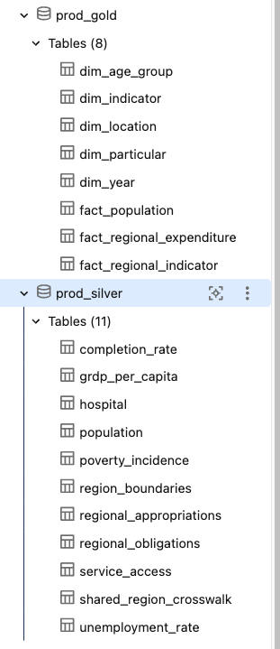

# Journal - 2026-10-30 - The Metastore Is the Governance Root, Not a Data Folder

## Today in one sentence
- I learned that a Unity Catalog metastore is the regional governance root above catalogs, while the familiar three-part table name starts one level lower at `catalog.schema.table`.

## What I learned
- My confusion started with the word **metastore**. It sounds like another storage folder, but that is not its main job. In Unity Catalog, the metastore is the top-level securable object for one cloud region. It registers catalogs and other governance objects such as storage credentials, external locations, shares, and permissions. The actual data files still live in cloud object storage.
- The hierarchy is easier for me to remember as two related views. The governance view is `metastore → catalog → schema → table/view/volume/function`. The SQL naming view is usually only `catalog.schema.object`. The metastore is not written as a fourth identifier in a table name because the workspace is already attached to a metastore.
- A workspace is not the metastore. A workspace is the working environment where I run notebooks, SQL, jobs, and pipelines. A metastore can be attached to multiple workspaces in the same region, so those workspaces can use the same governed objects. This also means my earlier mental shortcut—“workspace equals metastore”—was wrong.
- The regional rule needs careful wording. An account can have more than one metastore when it operates in multiple regions, but Databricks describes the normal model as one metastore per region. A single catalog belongs to one metastore, while one metastore can contain many catalogs. That makes the mock-test statement “multiple catalogs within a metastore” reasonable, but “one catalog associated with multiple metastores” incorrect.
- Catalogs are the first level that appears in a three-part SQL name. They are useful boundaries for isolation, ownership, and broad permissions. Schemas live inside catalogs and group tables more narrowly. For example, `pondolens.dev_gold.fact_regional_expenditure` means catalog `pondolens`, schema `dev_gold`, and table `fact_regional_expenditure`. The metastore sits above `pondolens`, even though it is not visible in that name.
- A **managed storage location** is a cloud path used for managed tables and managed volumes. It can be defined at the metastore, catalog, or schema level. The most specific available location wins: schema first, then catalog, then metastore. Therefore, a schema does not always need its own managed location. It can inherit the catalog location, and a catalog can fall back to the metastore location when one exists.
- I also learned an important modern detail: a metastore-level managed location is optional in newer automatically enabled Unity Catalog setups. If there is no metastore-level location, a standard catalog needs its own managed location before it can hold managed data. This explains why quiz answers that use absolute words like “always” and “mandatory” can be misleading.
- Managed and external tables separate governance from file ownership. For a managed table, Unity Catalog chooses and manages the storage path and data lifecycle. For an external table, Unity Catalog governs access and metadata, but the user specifies the external cloud path and manages the files outside the table lifecycle. Knowing this distinction is more useful than memorizing which screen contains a location field.

## Terms I am still learning
- **Metastore** - the regional Unity Catalog governance container that holds catalogs and other securable objects and permissions.
- **Catalog** - the first level in `catalog.schema.object` and a broad boundary for organizing and isolating data assets.
- **Schema** - a container inside a catalog that groups tables, views, volumes, functions, and other objects.
- **Three-level namespace** - the fully qualified name `catalog.schema.object`, such as `pondolens.dev_gold.fact_regional_expenditure`.
- **Managed storage location** - the cloud storage root Unity Catalog uses for managed tables and volumes, inherited from schema to catalog to metastore.
- **Managed table** - a table whose storage location and data lifecycle are managed by Unity Catalog.
- **External table** - a table whose metadata and access are governed by Unity Catalog while its files remain at a user-specified external location.

## What confused me
- I was mixing up three different ideas: the workspace where I work, the metastore that governs regional objects, and the catalog that begins a table's SQL name. The interfaces make catalogs and schemas visible every day, while metastore assignment is usually an account-level concern, so the top layer can feel invisible.
- The phrase “one metastore” also confused me because it needs a scope. It is not one metastore for every Databricks account in the world and not one metastore per workspace. The useful rule is one metastore per cloud region for an organization, with multiple workspaces in that region able to attach to it.
- I still want to understand how workspace-catalog bindings interact with ordinary grants. A user might have `SELECT`, but a catalog binding can still make that catalog unavailable from a particular workspace. That is a governance boundary I have not yet practiced directly.

## One small next step
- [ ] In Catalog Explorer, choose one PondoLens table and write down its catalog, schema, object name, table type, and which managed-storage level would apply; then verify the result with `DESCRIBE DETAIL` or the table details panel.

## Git checkpoint
- [x] I created or updated a file
- [x] I wrote a commit
- [x] I pushed my changes

## Decisions or assumptions (optional)
- I will use `metastore → catalog → schema → object` when explaining governance, but `catalog.schema.object` when explaining SQL names. Keeping those two views separate prevents me from inventing a four-part table identifier.
- I am treating `pondolens.dev_gold.fact_regional_expenditure` as a naming example from the current project discussion, not as evidence that I changed any catalog, schema, permissions, or storage configuration today.
- I did not claim a Databricks implementation result because today's verified activity was study and clarification, while the latest visible PondoLens repository commits were from October 22.

## Evidence from today (optional)
- [Unity Catalog securable object hierarchy](https://docs.databricks.com/gcp/en/data-governance/unity-catalog/securable-objects) - current Databricks documentation describing the metastore, catalogs, schemas, tables, and workspace attachment scope.
- [Managed storage locations](https://docs.databricks.com/aws/en/connect/unity-catalog/cloud-storage/managed-storage) - current rules for schema, catalog, and metastore storage inheritance.
- [PondoLens repository](https://github.com/ItsYangCoder/ph-government-budget-analysis) - the real project used for the `pondolens.dev_gold.fact_regional_expenditure` naming example.
- [Latest visible PondoLens commit](https://github.com/ItsYangCoder/ph-government-budget-analysis/commit/d684dff932dea289a8435fa2d1666990797e500f) - October 22 evidence; I found no newer repository activity to claim for today.

This privacy-safe Catalog Explorer crop makes the lower part of the hierarchy visible: the `prod_gold` and `prod_silver` schemas organize different table sets. The catalog and metastore are above this cropped view, which is exactly why I was able to confuse the layers.

## Reflection (optional)
- What felt easy today? Mapping the hierarchy to a real PondoLens name made the catalog, schema, and table levels much clearer than memorizing definitions alone.
- What felt difficult today? The storage rules have exceptions, and the product has changed over time. Statements that were once common—such as requiring metastore-level storage—are no longer universally true, so I need to check current documentation instead of trusting an old reviewer.
- What do I want to understand better next time? I want to trace one actual table from its three-part name to its catalog ownership, schema permissions, table type, and physical storage location without confusing governance metadata with the data files themselves.

## Mood or meme (optional)
- The metastore is the building policy, the catalog is the floor, the schema is the room, and the table is the labeled cabinet. I kept looking for the building policy inside the cabinet. 🗄️
