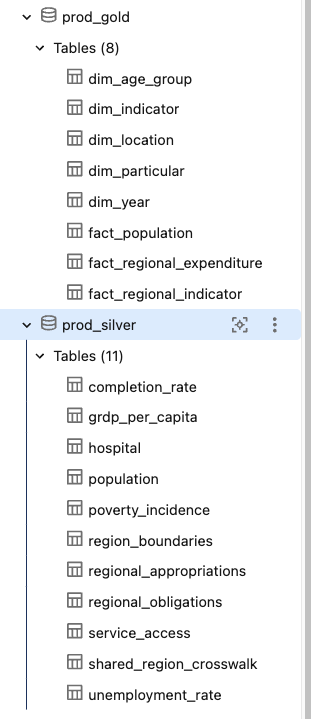

# Journal - 2026-11-02 - NULLs and Duplicates Need Different Checks

## Today in one sentence

- A useful data-quality check should explain separately whether required values are missing and whether a business entity appears more than once, because `NULL` and duplicate rows represent different failures.

## What I learned

- Today's accessible repository activity added a short Data Engineering practice prompt: “Write a data-quality check for NULL or duplicate values.” The answer section is still empty, so I am treating this as a learning reflection rather than claiming that I implemented or ran a check.
- A `NULL` check measures **completeness**. It asks whether a value that is required for the row's meaning is present. The important part is “required”: a missing `region_code` can prevent a regional record from joining to a location dimension, while a missing optional note may be acceptable. A blanket rule that rejects every `NULL` would confuse valid absence with broken data.
- A duplicate check measures **uniqueness at a declared grain**. It cannot be written correctly until I can finish the sentence “one row represents …”. For a PondoLens completion-rate table, that grain might include year, location, indicator, and sex or population group. Two rows with the same year are not automatically duplicates; two rows with the full business key may be.
- I would start with a small profile instead of immediately deleting rows:

  ```sql
  SELECT
    COUNT(*) AS total_rows,
    COUNT_IF(region_code IS NULL) AS missing_region_code,
    COUNT_IF(completion_rate IS NULL) AS missing_rate
  FROM prod_silver.completion_rate;
  ```

  This gives separate counts, preserves the evidence, and makes the rule visible. `COUNT(*)` includes every row, while `COUNT(column)` skips `NULL` values. Databricks also uses three-valued logic: comparisons such as `completion_rate = NULL` do not return `TRUE`, so an explicit `IS NULL` predicate is required.
- I would test duplicate keys with aggregation rather than `SELECT DISTINCT`. `DISTINCT` can hide the symptom by collapsing rows without telling me which key is repeated or how many records are affected:

  ```sql
  SELECT
    year,
    region_code,
    indicator_id,
    sex,
    COUNT(*) AS row_count
  FROM prod_silver.completion_rate
  GROUP BY year, region_code, indicator_id, sex
  HAVING COUNT(*) > 1;
  ```

  If this query returns rows, I still need to inspect them before choosing a fix. The cause could be replayed ingestion, a source correction, an omitted key column, an unsafe join, or genuinely separate observations that my proposed grain accidentally combined.
- The two checks should also be evaluated together. A row can have a complete key and still be duplicated. A table can have no duplicate complete keys while still containing records whose keys are partly `NULL`. SQL grouping places multiple `NULL` values into one group, so duplicate results involving missing key fields need careful interpretation.
- Declaring a primary key in Databricks does not automatically solve this validation. Databricks documents primary-key, foreign-key, and unique constraints as informational rather than enforced. The pipeline still needs explicit tests or an ingestion contract that proves uniqueness before downstream models rely on it.
- The safe existing screenshot below reminds me why the rule must be dataset-specific. PondoLens has multiple Silver tables with different grains—population, hospital, poverty incidence, regional appropriations, completion rate, and more. Reusing one key across all eleven tables would produce false failures or miss real duplicates.

## Terms I am still learning

- **Completeness** - whether the values required for a row's intended use are present.
- **Business key** - the smallest set of meaningful columns that identifies one real-world observation at the table's declared grain.
- **Uniqueness** - the rule that a business key should occur no more than once in the tested dataset or partition.
- **Three-valued logic** - SQL conditions can evaluate to `TRUE`, `FALSE`, or `UNKNOWN`; comparisons involving `NULL` normally produce `UNKNOWN`.
- **False positive** - a quality rule reports a problem even though the data is valid under the real business definition.

## What confused me

- The word “duplicate” sounds objective, but the result changes when the grain changes. I still need a confirmed key for each PondoLens Silver model before I can say that a repeated row is truly duplicated.
- I also need to distinguish an unexpected missing measurement from an expected source gap. For example, a missing rate may be valid when the official source did not publish an observation, while a missing location key is more likely to block modeling.
- My open question is where these rules should live: close to ingestion for structural problems, in dbt for model contracts and business tests, or in both with different responsibilities. My current view is that ingestion should reject or quarantine malformed identity fields, while dbt should test model-level grain and expected measurement coverage.

## One small next step

- [ ] Choose one PondoLens Silver table, write its grain in one sentence, then draft two read-only SQL queries: one for required-field `NULL` counts and one for duplicate business keys. Record the expected exceptions before deciding any pass/fail threshold.

## Git checkpoint

- [x] I created today's journal file.
- [x] I wrote a commit for the entry.
- [x] I pushed the commit directly to `main`.

## Decisions or assumptions (optional)

- I am not claiming that a data-quality query ran today. The verified activity is the creation of the practice prompt; its answer remains a placeholder.
- I will treat missingness and duplication as separate metrics instead of combining them into one vague “quality score.”
- I will not delete or deduplicate records until the business key, source behavior, and correction policy are documented.
- I will use the Asia/Manila calendar date for this entry.

## Evidence from today (optional)

- [Daily Data Engineering practice commit](https://github.com/ItsYangCoder/ItsYangCoder/commit/1ae2bd07045288943f370818576be5fdb6a02552) — created at 02:12 Asia/Manila on November 2, 2026; it contains the NULL-or-duplicate prompt and an empty answer placeholder.
- [Databricks SQL NULL semantics](https://docs.databricks.com/gcp/en/sql/language-manual/sql-ref-null-semantics) — documents `IS NULL`, three-valued comparisons, aggregate behavior, and grouping of `NULL` values.
- [Databricks constraints](https://docs.databricks.com/gcp/en/tables/constraints) — explains that primary-key, foreign-key, and unique constraints are informational rather than enforced.
- [Earlier PondoLens monitoring reflection](https://github.com/ItsYangCoder/ftw-b12-journal/blob/main/journal/2026-10-22-explainable-health-metrics.md) — prior evidence that completeness, uniqueness, validity, and mapping coverage answer different questions.



This inspected repository screenshot is safe to reuse: it shows only production table names and no credentials, private URLs, workspace identifiers, or personal data. Its eleven Silver tables make the main point concrete—quality checks need a declared grain for each dataset.

## Reflection (optional)

- The short prompt looks simple, but the SQL is the easy part. The harder work is defining which fields are required, what one row means, and which exceptions are legitimate.
- I like the discipline of returning evidence before changing data. A count and a list of offending keys are reviewable; silently applying `DISTINCT` makes the output look clean while hiding why the problem happened.
- Next time, I want to understand how to turn these profiles into dbt tests with useful failure tables and severity rules, without making expected source gaps look like pipeline failures.

## Mood or meme (optional)

- Two green zeros are meaningful only after I can explain the key and the expectation behind them. 🔍
