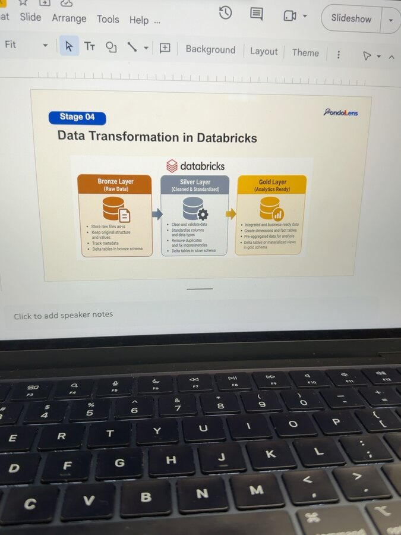

# Journal - 2026-11-03 - Loading Before Transforming Preserves Evidence

## Today in one sentence

- PondoLens helped me see that the load step is not just moving files: landing traceable source-shaped data in Bronze gives later transformations a stable input that can be tested, rerun, and audited.

## What I learned

- Today's verified GitHub activity added a practice prompt asking me to describe one ETL or ELT pipeline step and its purpose. The answer section is still a placeholder, so this entry is a learning reflection rather than evidence that I implemented a new step today.
- The step I chose is **load**, specifically the PondoLens move from prepared Google Drive files into Databricks Bronze tables. The purpose is to persist the input in the lakehouse with enough source and run metadata to identify where each record came from. Cleaning region names, converting business meanings, and building facts and dimensions belong later.
- PondoLens is a useful reminder that real pipelines do not always fit one perfect label. Official DBM and PSA reports are first downloaded and reshaped locally into the required file structure. Python then reads those prepared files through the Google Drive API and loads Bronze. After that, dbt transforms Bronze into Silver and Gold inside Databricks. There is transformation before the lakehouse because source reports need preparation, but the main modeled transformations happen after loading. Calling the whole project simply “ETL” or “ELT” hides this boundary.
- The Bronze boundary matters because it separates **source preparation** from **business transformation**. Bronze should retain the source-shaped values and tracking details. Silver standardizes types, region names, units, missing-value meanings, and dataset-specific rules. Gold connects dimensions and facts for analysis. Each layer has a different promise; mixing all three promises into the load script would make failures harder to locate.
- Loading first also improves recoverability. If a Silver rule changes, I should be able to rebuild Silver from the retained Bronze input rather than downloading and preparing every official report again. If Gold logic changes, I should be able to rebuild Gold from validated Silver tables. That is why a stored intermediate layer is operational evidence, not wasted duplication.
- A useful load audit answers concrete questions: Which dataset and file were read? Which run performed the write? How many rows were accepted, rejected, or rescued? Did this exact input already load? What final status did the run record? A simple success message is not enough because it cannot explain a partial failure or distinguish a safe rerun from a second insertion.
- This is also where **idempotency** becomes practical. Repeating the same load with the same input should not silently duplicate Bronze records. PondoLens' documented first-run flow uses a dry run before the write and asks the user to repeat an unchanged build while comparing IDs, row counts, and write metrics. The comparison proves more than “the command succeeded”; it checks whether the resulting state stayed stable.
- Databricks describes Bronze as minimally transformed, source-faithful data that supports reprocessing and auditing; Silver handles validation, deduplication, type casting, and joins; Gold serves business-level aggregations. This matches the separation in the PondoLens repository, where Python handles ingestion and dbt handles Bronze-to-Silver-to-Gold transformations.
- dbt is another clue that the project is largely transform-after-load. Databricks' dbt documentation states that dbt focuses on transformation and assumes the data is already present in the database. In PondoLens, Bronze must exist before the dbt task runs. That dependency is not a limitation; it makes ingestion and modeling separate, reviewable responsibilities.
- I should still be precise with the word **raw**. PondoLens Bronze retains the prepared source values, but the files have already been extracted and reshaped locally from official reports. Bronze is therefore the faithful starting point of this pipeline, not necessarily the untouched binary downloaded from the publisher. Complete provenance must also point to the official source, selected table or report, preparation rules, and project snapshot.

## Terms I am still learning

- **ETL** - extract data, transform it before loading, then write the transformed result to the destination.
- **ELT** - extract and load data first, then use the destination platform to transform it.
- **Landing layer** - the first durable place where incoming data is stored with enough metadata for later processing.
- **Provenance** - evidence of where data came from and what process produced the stored version.
- **Reprocessing** - rebuilding a downstream layer from retained upstream data after logic, rules, or requirements change.
- **Idempotent load** - repeating the same load does not create an unintended second copy or different final state.

## What confused me

- I used to treat ETL and ELT as mutually exclusive labels for an entire project. PondoLens shows that a pipeline can prepare difficult reports before loading while still doing its main cleaning and modeling after Bronze is stored.
- The word “raw” can be misleading. A Bronze table may preserve every field from the prepared input while still being several steps away from the publisher's original PDF, spreadsheet, or API response.
- My open question is how much local preparation should be reproducible inside the repository. The current repository documents required filenames, headers, dictionaries, and preparation rules, but it also says the source-specific extraction scripts are not included. That is honest, yet it leaves part of the lineage dependent on documentation and the retained prepared files.

## One small next step

- [ ] Choose one PondoLens dataset and write a four-line boundary map: official source, local preparation, Bronze load evidence, and Silver transformation rules. Link each line to the exact guide or code file so the full path can be reviewed without guessing.

## Git checkpoint

- [x] I created today's journal file.
- [x] I wrote a commit for the entry.
- [x] I pushed the commit directly to `main`.

## Decisions or assumptions (optional)

- I am not claiming that the blank ETL/ELT practice prompt was answered in its source repository or that a pipeline ran today.
- I will describe PondoLens as a staged pipeline instead of forcing the whole project into one ETL-or-ELT label.
- I will treat prepared Bronze data as the pipeline's durable source-shaped input while keeping the earlier official-source and local-preparation steps in its provenance.
- I will keep ingestion responsibilities in Python and modeled transformations and tests in dbt, matching the verified repository design.

## Evidence from today (optional)

- [Daily Data Engineering practice commit](https://github.com/ItsYangCoder/ItsYangCoder/commit/e5145d46da460b02c49d7125b22002b36200e976) — created on November 3 in Asia/Manila; it contains the ETL/ELT pipeline-step prompt and an empty answer placeholder.
- [PondoLens README — How the data moves](https://github.com/ItsYangCoder/ph-government-budget-analysis/blob/main/README.md#how-the-data-moves) — documents Google Drive ingestion, Bronze retention, dbt Silver/Gold transformations, testing, and orchestration.
- [PondoLens quick start](https://github.com/ItsYangCoder/ph-government-budget-analysis/blob/main/README.md#quick-start) — records the dry-run-first load and unchanged-input rerun checks.
- [Databricks medallion architecture](https://docs.databricks.com/gcp/en/lakehouse/medallion) — defines the separate responsibilities of Bronze, Silver, and Gold.
- [Databricks dbt Core connection guide](https://docs.databricks.com/aws/en/partners/prep/dbt) — explains that dbt transforms data after it has been loaded.

I inspected this existing repository photo before reuse. The slide directly supports the topic by separating raw/source-shaped Bronze data, cleaned Silver data, and analytics-ready Gold data. No credential, private URL, account name, workspace identifier, or personal data is visible.

## Reflection (optional)

- The practice question looks like it asks for one simple definition, but the useful lesson is the boundary between steps. “Load the data” becomes meaningful only when I can say what is preserved, which metadata is added, and what transformations are deliberately postponed.
- I like the idea that Bronze gives me permission to improve Silver later. Keeping source-shaped evidence means a new cleaning rule does not require pretending the earlier data never existed.
- I want to get better at drawing the line between necessary source preparation and business transformation. If that line is documented well, another engineer can reproduce the pipeline and understand why each rule belongs where it does.

## Mood or meme (optional)

- Load with evidence first; make it beautiful in the next layer. 🥉➡️🥈➡️🥇
