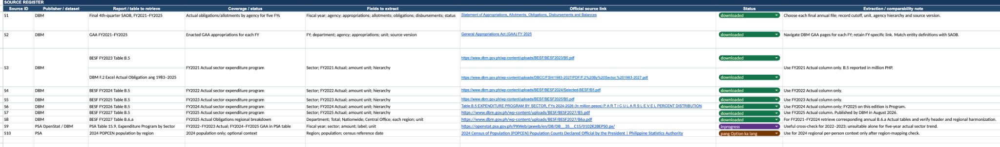

# Journal - 2026-11-04 - Source Preparation Should Be Reproducible

## Today in one sentence

- My PondoLens portfolio already documents where its data comes from, but the clearest next improvement is to make the report-to-prepared-file step reproducible instead of leaving it as a documented manual boundary.

## What I learned

- Today's verified GitHub activity added a practice prompt asking me to review one portfolio project and note one improvement. Its answer section is still empty, so this entry records a review and a proposed improvement; it does not claim that I implemented the change today.
- I reviewed PondoLens because its repository already explains the downstream path well: prepared files are uploaded to Google Drive, Python loads Bronze, dbt cleans and validates Silver, and dbt builds Gold facts and dimensions. The repository also names the official DBM and PSA sources, dataset scope, units, years, and known interpretation limits.
- The gap is earlier in the lineage. The data-source guide explicitly says that PDF extraction and source-specific reshaping scripts are not included. A reader can learn what to download and which fields are expected, but cannot fully reproduce how an official report became the exact CSV, workbook, or GeoJSON supplied to ingestion.
- Documentation and reproducibility are related but not identical. Documentation tells another engineer what I intended. Reproducible code or a precise manifest lets that engineer repeat the operation and compare the output. A pipeline can have excellent Bronze, Silver, and Gold code while still depending on an undocumented spreadsheet edit before Bronze.
- My proposed improvement is a small, dataset-level **source preparation contract**. For each input, it should record:
  - official publisher and source URL;
  - report or table title, edition, release date, and reference period;
  - original downloaded filename and a SHA-256 checksum;
  - prepared filename, expected headers, units, and row count;
  - the script or documented command that performs extraction and reshaping;
  - the Git commit or preparation version used to create the file;
  - important exceptions, such as unavailable-value markers or changing region boundaries.
- A checksum is useful because filenames are weak identity. A publisher can replace a file while keeping the same name, or two local files can share a generic name such as `Table_1.xlsx`. A SHA-256 value gives a content-based fingerprint. It does not prove that the source is correct, but it lets me detect that the bytes changed and decide whether the prepared output must be rebuilt and revalidated.
- A preparation script should be deterministic when possible: the same verified input plus the same code and configuration should produce the same prepared structure. Dates generated at runtime, workbook formatting, row order, or unstable IDs can make byte-for-byte equality difficult, so I would also compare structural evidence such as headers, row counts, unique keys, null counts, and selected control totals.
- This improvement would strengthen PondoLens without changing its architecture. Bronze would still store the prepared source-shaped data. Silver would still own standardization and business validation. Gold would still own dimensional modeling and analytics. The added preparation layer would simply make the evidence before Bronze as reviewable as the transformations after Bronze.
- The existing source register is already a good foundation. It tracks source IDs, publishers, reports to retrieve, coverage, fields to extract, official links, statuses, and extraction notes. Turning one row of that register into an executable and verifiable preparation package is a smaller and safer next step than trying to automate all datasets at once.
- I would start with one tabular dataset whose source structure is stable. The preparation folder could contain a script, a small configuration file, a README with the exact command, and tests using a tiny fixture. The test should verify required columns, accepted units, expected year coverage, and that the script fails clearly when the source layout changes.
- The improvement is also a portfolio lesson. A screenshot of a successful pipeline shows that something ran. A reproducible source-to-table path shows how another engineer can rebuild the evidence. That is stronger proof of Data Engineering work because it covers provenance, automation, testing, and failure behavior rather than only the final table.

## Terms I am still learning

- **Source manifest** - a structured record identifying input files, publishers, versions, checksums, and preparation outputs.
- **Checksum** - a content-derived fingerprint used to detect whether a file's bytes changed.
- **Deterministic transformation** - a transformation that produces the same logical output when its input, code, and configuration are unchanged.
- **Fixture** - a small controlled input used by an automated test to exercise transformation behavior.
- **Control total** - a known count or sum used to check that extraction or reshaping did not silently lose or duplicate data.
- **Reproducibility** - the ability for another person to repeat a process from recorded inputs, code, configuration, and instructions and obtain the expected result.

## What confused me

- I am still deciding where source preparation should live. Putting it inside the ingestion package makes the flow easier to discover, while a separate preparation folder keeps publisher-specific extraction away from the generic Google Drive loader.
- A downloaded spreadsheet can contain formatting, hidden sheets, formulas, merged cells, and footnotes that are difficult to reproduce with one generic parser. I should not promise full automation when a dataset still needs a reviewed manual selection.
- My open question is what level of evidence is enough for a manually prepared file. A checksum and row count prove identity and size, but they do not prove that I selected the correct worksheet, year, unit, or measure. Control totals and dataset-specific assertions are still needed.

## One small next step

- [ ] Add a draft preparation manifest for one PondoLens dataset containing its official source URL, report/table title, reference period, original filename, SHA-256 checksum, prepared filename, expected columns, row count, and the exact preparation command or documented manual steps.

## Git checkpoint

- [x] I created today's journal file.
- [x] I wrote a commit for the entry.
- [x] I pushed the commit directly to `main`.

## Decisions or assumptions (optional)

- I am treating reproducible source preparation as a proposed portfolio improvement, not as completed work.
- I will preserve the current separation of responsibilities: source-specific preparation before ingestion, Python for loading Bronze, and dbt for Silver and Gold transformations and tests.
- I will begin with one stable tabular source instead of promising automation for every PDF, spreadsheet, and GeoJSON input.
- I will use both content identity and semantic checks; a matching checksum alone cannot prove that the correct business data was selected.

## Evidence from today (optional)

- [Daily Data Engineering practice commit](https://github.com/ItsYangCoder/ItsYangCoder/commit/9512efdc9f1dca54dcc0c590cca70bf9e65ff2c0) — created on November 4 in Asia/Manila; it contains the portfolio-review prompt and an empty answer placeholder.
- [PondoLens data-source guide](https://github.com/ItsYangCoder/ph-government-budget-analysis/blob/main/docs/data_sources.md) — identifies official sources and preparation requirements, and explicitly states that PDF extraction and source-specific reshaping scripts are not included.
- [PondoLens README — Prepare source files locally](https://github.com/ItsYangCoder/ph-government-budget-analysis/blob/main/README.md#prepare-source-files-locally) — documents the current official-source-to-Google-Drive boundary.
- [PondoLens ingestion guide](https://github.com/ItsYangCoder/ph-government-budget-analysis/blob/main/docs/ingestion.md) — documents the loader configuration, dry-run behavior, and failure recovery after files are prepared.

I inspected this existing repository screenshot before reuse. It shows the real source-register structure that can become the starting point for a reproducible manifest. Its links are public DBM and PSA sources; it contains no credentials, private URLs, account details, or personal information.

## Reflection (optional)

- The portfolio-review prompt is useful because the strongest improvement is not always another dashboard feature or another model. Sometimes the missing piece is the ability to rebuild the inputs confidently.
- PondoLens already makes many source decisions visible, which makes this gap easier to name. The next level is to turn one documented decision path into a repeatable command with tests and retained evidence.
- I want to become more disciplined about treating every manual data-preparation step as part of the pipeline. If a step changes the data before ingestion, it deserves versioning, validation, and an owner even when it happens outside Databricks.

## Mood or meme (optional)

- “It is in the spreadsheet” is a location; “here is the input, checksum, command, and test” is reproducibility. 🔎
