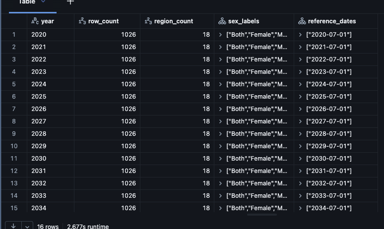

# Journal - 2026-11-05 - GROUP BY Defines the Grain; HAVING Tests the Group

## Today in one sentence

- PondoLens showed me that `GROUP BY` is not only for reporting totals: it defines the grain I expect, while `HAVING` can turn that grain into a practical duplicate-key quality gate.

## What I learned

- Today's verified GitHub activity added an ANSI SQL practice prompt asking for a query that uses `GROUP BY` and `HAVING`. The answer section is still empty, so this entry explains the concept with existing PondoLens code instead of claiming that I completed or executed the exercise today.
- `GROUP BY` changes the level of detail of a query. If I group PondoLens expenditure data by `year_id`, `location_id`, and `particular_id`, each result row represents one year-location-particular combination. That matches the declared grain of `fact_regional_expenditure`.
- `HAVING` filters those grouped results. This is different from `WHERE`, which filters individual source rows before aggregation. A useful duplicate check is:

  ```sql
  SELECT
      year_id,
      location_id,
      particular_id,
      COUNT(*) AS row_count
  FROM pondolens.dev_gold.fact_regional_expenditure
  GROUP BY year_id, location_id, particular_id
  HAVING COUNT(*) > 1;
  ```

  `WHERE COUNT(*) > 1` would be invalid because the aggregate does not exist while individual rows are being filtered. `HAVING` is evaluated after the rows have been grouped and counted.
- This exact pattern already exists in the current PondoLens Gold model. It is used more than once: to detect duplicate source keys after canonical name mapping, duplicate mapped business keys after resolving dimensions, duplicate keys in the existing target, and duplicate keys after the final upsert. The model wraps the grouped result in `ASSERT_TRUE(COUNT(*) = 0, ...)`, so any returned duplicate group stops the pipeline.
- The important part is not the syntax alone. The selected grouping columns must represent the true business grain. If I group only by `year_id` and `location_id`, legitimate rows for different agencies or budget particulars would look like duplicates. If I add a column that should not be part of identity, such as `processed_at`, actual duplicate observations might appear unique.
- An empty duplicate query is good evidence only when the surrounding checks are also sound. A query can return no duplicates because the table is empty, because the wrong partition was selected, or because the proposed key contains too many columns. The PondoLens model separately checks that inputs contain rows, identifiers are present, dimensions resolve, expected counts are preserved, and financial totals still match Silver.
- `HAVING` also supports business thresholds, not just duplicate detection. For example, I could group records by year and geographic level, then retain only groups with missing obligations above a reviewed threshold. However, a threshold should come from a documented expectation. Writing `HAVING missing_count > 10` simply because ten looks reasonable would create a rule without business meaning.
- The grouped population screenshot below shows another use of aggregation. Each row summarizes one year with a row count, region count, observed sex labels, and reference dates. That is a coverage profile: it compresses many detailed records into a small result that makes changes across years visible. The same idea can reveal whether a new source year has fewer regions or an unexpected category set.
- `COUNT(*)`, `COUNT(column)`, and `COUNT(DISTINCT column)` answer different questions. `COUNT(*)` counts every row. `COUNT(column)` skips `NULL` values. `COUNT(DISTINCT column)` counts distinct non-null values. I need to choose deliberately, especially when missing values are meaningful rather than errors.
- If a grouped query identifies a failing key, it does not yet show every differing field. I may need to join the failing key back to the source table, or use a window function such as `COUNT(*) OVER (PARTITION BY ...)`, to inspect all contributing rows without collapsing them.
- This is also useful for interview explanations. Instead of saying only “I performed data-quality checks,” I can describe one concrete rule: “For the Gold expenditure fact, I grouped by its year-location-particular business key and failed the build when any group contained more than one row.” That sentence communicates the table grain, the SQL behavior, and the reason for the test.

## Terms I am still learning

- **Aggregation** - combining detailed rows into group-level values such as counts, sums, minimums, or maximums.
- **Grain** - the exact real-world meaning represented by one row in a table or query result.
- **Business key** - the meaningful column combination that should identify one observation.
- **HAVING clause** - a SQL filter applied to groups after aggregation.
- **Cardinality** - the number of distinct values or combinations in a column set.
- **Window function** - a calculation across related rows that keeps the original rows visible instead of collapsing them into one group.

## What confused me

- `HAVING` can reference aggregate expressions, but SQL engines differ on whether a select-list alias can be reused inside `HAVING`. Repeating the aggregate expression is clearer when I want portable ANSI-style SQL.
- A duplicate query is easy to write after the grain is known, but deciding the correct grain is a modeling problem, not a syntax problem. I still need to verify whether category belongs in a source key when the Gold fact ultimately uses `particular_id`.
- I also need to be careful with `NULL` keys. `GROUP BY` puts null values into the same group, but a non-null business-key rule should normally fail before duplicate analysis so missing identity is not mixed with repeated identity.

## One small next step

- [ ] Fill the blank practice-log answer with the PondoLens duplicate-key query and a three-sentence explanation of the result grain, why `HAVING COUNT(*) > 1` is used, and what an empty result does and does not prove.

## Git checkpoint

- [x] I created today's journal file.
- [x] I wrote a commit for the entry.
- [x] I pushed the commit directly to `main`.

## Decisions or assumptions (optional)

- I am using the existing PondoLens Gold model as learning evidence; I am not claiming that I ran the SQL or completed the separate practice prompt today.
- I will define the expected business grain before writing a duplicate check.
- I will pair an empty duplicate result with non-empty input, required-key, row-count, and reconciliation checks.
- I will use `WHERE` for row-level conditions and `HAVING` for conditions that depend on grouped or aggregated values.

## Evidence from today (optional)

- [Daily Data Engineering practice commit](https://github.com/ItsYangCoder/ItsYangCoder/commit/e6a182753e6cb11f67bdd34a6ef6842cb83060d5) — created on November 5 in Asia/Manila; it contains the ANSI SQL `GROUP BY` and `HAVING` prompt with an empty answer placeholder.
- [PondoLens `fact_regional_expenditure` model](https://github.com/ItsYangCoder/ph-government-budget-analysis/blob/main/dbt/models/gold/fact_regional_expenditure.sql) — contains the verified `GROUP BY ... HAVING COUNT(*) > 1` gates for source, mapped, existing, and final business keys.
- [PondoLens data model](https://github.com/ItsYangCoder/ph-government-budget-analysis/blob/main/docs/data_model.md) — documents the Gold fact's intended grain and dimensional relationships.



I inspected this existing repository screenshot before reuse. It contains only grouped dataset-profile results and no credential, private URL, workspace identifier, account detail, or personal information. It supports the main lesson by showing how grouping converts detailed records into year-level coverage evidence.

## Reflection (optional)

- The practice prompt looks like a small SQL exercise, but the PondoLens model makes it more meaningful. `HAVING COUNT(*) > 1` is only one line; knowing why those exact columns form the key is the real Data Engineering work.
- A good quality query should be explainable in plain language. If I cannot say what one group represents, I probably should not trust the alert or the green result.
- I want to practice moving between the technical query and the human explanation. That will help both in code reviews and in interviews, where naming the rule and its purpose is stronger than listing tools.

## Mood or meme (optional)

- `GROUP BY` asks “one row per what?”; `HAVING` asks “which groups need attention?”
