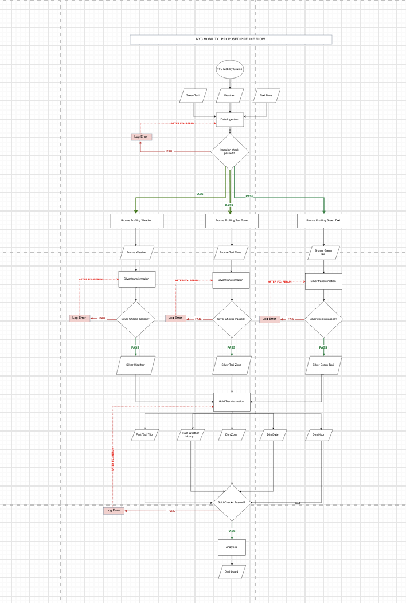

# Journal - 2026-11-06 - S3 Compatibility Is an Interface, Not a Provider

## Today in one sentence
- I clarified that Cloudflare R2 is cloud object storage and can speak an S3-compatible API, but using it does not automatically mean that I have worked with Amazon S3 or the wider AWS platform.

## What I learned
- The question that made me stop and think was whether the R2 storage used in my data engineering work should count as “Cloud.” The honest answer is yes, with a precise scope: R2 is a managed cloud object-storage service. In the NYC Mobility ingestion repository, the public `.env.example` expects an R2 endpoint, access-key ID, secret access key, bucket name, and object prefix. That is concrete evidence that the pipeline was designed to connect to remote object storage. It is not evidence that I provisioned AWS infrastructure, managed IAM in AWS, or operated Amazon S3 itself.
- Object storage is different from a relational database or a normal local filesystem. A file-like payload is stored as an **object**. The object is addressed by a **key** inside a **bucket**, and it can carry metadata. A key such as `groups/week09/team-name/trips.parquet` may look like folders, but the storage system treats it as a name in a flat key space. This is a useful model for ingestion because raw CSV or Parquet files can land unchanged, then downstream code can read them by bucket and key.
- “S3-compatible” describes an interface. Cloudflare documents that existing S3 SDKs and tools can work with R2 by using the R2 endpoint. That portability is valuable: code can keep familiar operations such as listing, getting, putting, and deleting objects while configuration supplies the provider-specific endpoint and credentials. The endpoint is therefore not a minor detail. It tells the client which service will receive the request.
- Compatibility is not identity. R2 implements many S3 API operations, but Cloudflare’s compatibility table also lists operations and features that are not implemented or behave differently. A client that only performs common object reads and writes may move cleanly. A pipeline that depends on AWS-specific encryption headers, ACLs, object locking, tagging, region behavior, or another unsupported feature needs an explicit compatibility check. “The SDK call looks the same” is not enough proof that two providers are operationally identical.
- This distinction also improves how I describe the experience in an interview. A defensible statement is: “I used Cloudflare R2 as S3-compatible cloud object storage for a data ingestion project, with the endpoint, bucket, prefix, and credentials kept in configuration.” I should not shorten that to “I have AWS experience.” The first statement names the service and the work boundary; the second implies broader provider experience that the evidence does not support.
- Configuration is part of pipeline design. The repository’s `.env.example` exposes names but leaves credential values blank, which is the correct public-repository pattern. The pipeline should receive secrets at runtime, never commit them. Separating `R2_ENDPOINT_URL`, `R2_BUCKET_NAME`, and `R2_PREFIX` from transformation logic also makes the ingestion code easier to test and potentially easier to adapt to another S3-compatible service.
- The diagram below helps me place storage in the larger system. The important flow is not simply “cloud equals AWS.” Data moves from sources into ingestion, is validated, and then continues through Bronze, Silver, Gold, analytics, and a dashboard. Object storage can be the landing boundary for source files, while validation and transformation remain separate responsibilities.

## Terms I am still learning
- **Cloud object storage** - a managed service that stores data as objects in buckets and makes those objects available through an API.
- **Bucket** - a named container for objects. It is a storage boundary, not the same thing as a database table.
- **Object key** - the name used to locate an object inside a bucket. Slashes can organize names, but they do not necessarily create real folders.
- **Endpoint** - the network address a client sends API requests to. Changing the endpoint can point a compatible client from Amazon S3 to R2.
- **S3-compatible API** - an interface that implements supported parts of Amazon S3’s request model so existing S3 tools and SDKs can communicate with another service.
- **Prefix** - the beginning of an object key used to group or filter related objects, such as a team or dataset path.

## What confused me
- My main confusion was treating the word “S3” in an SDK or API as proof that the backing provider must be AWS. I now see three separate layers: the client library, the API contract, and the service provider. They can be related without being the same thing.
- I still want a clearer inventory of exactly which R2 operations the NYC Mobility ingestion path uses. The public configuration proves the intended connection boundary, but it does not by itself prove every runtime operation, retry behavior, or permission that was exercised.
- I also need to be careful with the word “experience.” Using a managed storage service in a project is real cloud-storage experience. It is not the same scope as designing a production cloud account, networking, IAM, monitoring, cost controls, and incident response.

## One small next step
- [ ] Trace one file from its source to the R2 bucket/key and then into the ingestion reader, and write down the exact API operations and configuration fields used without exposing credential values.

## Git checkpoint
- [x] I created or updated a file
- [x] I wrote a commit
- [x] I pushed my changes

## Decisions or assumptions (optional)
- I am treating today as a learning reflection, not claiming that I deployed or reran the R2 ingestion path today.
- I will describe R2 as cloud object-storage experience and S3-compatible API experience, while reserving “AWS experience” for work that actually used AWS services.
- I will keep provider details in configuration and keep secrets outside Git. A public `.env.example` may document variable names, but it must not contain live endpoints tied to a private account or real credentials.

## Evidence from today (optional)
- [NYC Mobility `.env.example`](https://github.com/ItsYangCoder/nyc-mobility-ingestion-pipeline/blob/main/.env.example) documents the R2 endpoint, access-key ID, secret access key, bucket, and prefix variables with blank secret values.
- [Cloudflare R2 S3 getting-started documentation](https://developers.cloudflare.com/r2/get-started/s3/) explains that S3 SDKs, libraries, and tools can interact with R2 by using the R2 endpoint.
- [Cloudflare R2 S3 API compatibility table](https://developers.cloudflare.com/r2/api/s3/api/) is the source I should check instead of assuming that every Amazon S3 feature is available.
- The image is the existing safe repository asset [`assets/2026-09-24-pipeline-quality-gates.png`](https://github.com/ItsYangCoder/ftw-b12-journal/blob/main/assets/2026-09-24-pipeline-quality-gates.png). I inspected it before reuse; it shows the NYC Mobility ingestion and medallion flow without credentials, private URLs, or personal data.

The diagram keeps the storage discussion grounded in the full pipeline: landing an object is only the start, and each later layer still needs its own checks and contracts.

## Reflection (optional)
- What felt easy today? Once I separated provider, interface, and configuration, the terminology became much cleaner. The repository variables gave me a concrete way to explain the boundary.
- What felt difficult today? The difficult part was resisting an answer that sounds stronger but is less accurate. “AWS experience” is shorter, but it would blur an important distinction.
- What do I want to understand better next time? I want to map the exact read/write/list operations used by the ingestion code and compare them with R2’s current compatibility table, including retries, permissions, and failure handling.

## Mood or meme (optional)
- Same API shape, different cloud: compatibility is a bridge, not an identity card. ☁️
