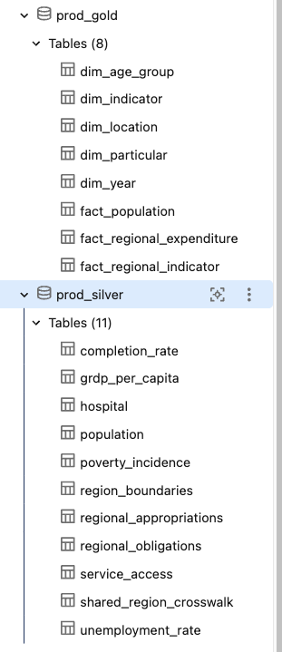

# Journal - 2026-11-07 - The Denominator Defines the Data Quality Claim

## Today in one sentence
- With no new Data Engineering implementation verified today, I revisited PondoLens and learned why a quality percentage is only trustworthy when its denominator, exclusions, unresolved rows, and assessment scope remain visible.

## What I learned
- A statement such as “the dataset is 95% complete” sounds precise, but it is incomplete until I can answer: 95% of what? The denominator might mean every stored row, only rows with complete business keys, all expected region-year combinations, or only rows where a source was supposed to publish a measurement. Those are different populations, so they produce different claims.
- The PondoLens Silver health implementation makes this explicit. Each result is one dataset plus one metric and includes **numerator**, **denominator**, **percentage**, **observed_rows**, **excluded_rows**, **unresolved_rows**, **invalid_rows**, **missing_expected_rows**, **source_unavailable_rows**, **unclassified_rows**, **exception_rows**, and **assessment_status**. This is more useful than a single green score because it preserves the reason behind the number.
- The calculation uses NULLIF on a zero denominator. This prevents division by zero, but the more important meaning is that an empty eligible population must not become a fake 100% pass. If there are no rows to assess, the status becomes “Not assessed - empty eligible population.” Zero failing rows and zero assessed rows are not proof of quality.
- **Observed rows** and **expected keys** answer different questions. Observed rows tell me what arrived. Expected-key coverage checks what should have arrived according to an independent contract. If I derive the expected set from the rows already present, a missing region or year disappears from both numerator and denominator, and the metric can look perfect while data is missing.
- PondoLens has concrete expected-key scopes for datasets such as completion rate, population, unemployment rate, service access, and regional boundaries. By contrast, expected-key coverage for the budget-detail tables is marked not assessed until an independent reference exists. That is a good limitation to publish. Inventing an expected denominator would create a confident-looking but unsupported score.
- A present row does not guarantee an available measurement. A placeholder can satisfy expected-key coverage because the region-year key exists, while measurement availability still decreases because the source did not report a usable value. Keeping these metrics separate prevents “the row exists” from being misread as “the value exists.”
- Zero is also not the same as missing. For a count or amount, zero may be a valid reported measurement. A blank, dash, source marker, or NULL may mean unavailable, not applicable, or unresolved depending on the source contract. The health rules therefore inspect both the value and its status instead of replacing every empty-looking value with zero.
- Exceptions need labels, not silent removal. PondoLens has historical NIR rules and an approved Nationwide (NW) mapping for specific budget data. These rows should not be mixed with truly invalid region codes. Reporting **exception_rows** and **unresolved_rows** separately makes the rule reviewable and stops a valid project-specific exception from hiding unrelated mapping failures.
- Different quality percentages should not be averaged into one overall score. Required-field completeness, business-key uniqueness, measurement availability, value validity, canonical-code membership, year applicability, and expected-key coverage have different denominators and meanings. An average would hide which contract failed. A dashboard should compare datasets within the same metric and show the numerator and denominator beside the percentage.
- A live quality view also needs freshness context. The PondoLens view reads current Silver rows when queried, so its **assessed_at** time is not automatically the time of the last successful pipeline build. A later failed job can leave an existing view queryable. Data-health results should therefore be read together with build status, ingestion freshness, and failure notifications.

## Terms I am still learning
- **Numerator** - the number of records that satisfy the rule being measured.
- **Denominator** - the exact population eligible for that rule; it defines what the percentage actually claims.
- **Eligible population** - the rows or expected keys that are valid candidates for a particular check after documented exclusions.
- **Expected-key coverage** - the share of independently expected business keys that are present, whether or not every measurement is available.
- **Measurement availability** - the share of assessed rows containing a usable reported value according to the source’s value-status rules.
- **Unresolved row** - a row that cannot yet be classified as valid, invalid, or an approved exception without more evidence.
- **Assessment status** - a label that explains whether a metric was assessed, not assessed, or needs review instead of forcing every result into pass or fail.

## What confused me
- The hardest distinction is between “missing expected row” and “present row with a missing measurement.” Both reduce usable information, but they describe different pipeline problems. The first points to ingestion or source coverage; the second may reflect a real source limitation.
- I also have to remember that **assessed_at** describes when the view was queried, not necessarily when the underlying pipeline last completed successfully.
- I still need practice deciding which exclusions belong outside a denominator and which records should remain inside it as failures. If exclusions are too broad, the percentage becomes artificially high; if they are too narrow, the metric may punish records that the source contract says are not applicable.

## One small next step
- [ ] Choose the PondoLens **service_access** measurement-availability metric and write one plain-English sentence defining its numerator, denominator, exclusions, and unresolved rows before interpreting its percentage.

## Git checkpoint
- [x] I created or updated a file
- [x] I wrote a commit
- [x] I pushed my changes

## Decisions or assumptions (optional)
- I am treating this as a concept reflection based on existing PondoLens code; I am not claiming that I ran a new dbt build or changed the health view today.
- I will not call an empty eligible population a pass.
- I will keep coverage, availability, validity, uniqueness, and mapping metrics separate instead of averaging them into a single health score.
- I will show counts and rule descriptions with percentages so another person can reproduce the interpretation.

## Evidence from today (optional)
- [PondoLens Silver health metrics commit](https://github.com/ItsYangCoder/ph-government-budget-analysis/commit/d684dff932dea289a8435fa2d1666990797e500f) contains the metric definitions, dbt macro, documentation, and offline test fixtures used for this reflection.
- [Silver health dashboard query](https://github.com/ItsYangCoder/ph-government-budget-analysis/blob/main/analytics/data_quality/silver_health.sql) exposes the numerator, denominator, exclusions, unresolved rows, invalid rows, missing expected rows, source limitations, exceptions, status, rule, and assessment time.
- [Silver health macro](https://github.com/ItsYangCoder/ph-government-budget-analysis/blob/main/dbt/macros/silver_health.sql) handles zero denominators and assigns a not-assessed status to an empty eligible population.
- The image is the existing safe repository asset [assets/2026-10-22-silver-health-coverage.png](https://github.com/ItsYangCoder/ftw-b12-journal/blob/main/assets/2026-10-22-silver-health-coverage.png). I inspected it again before reuse; it shows the eleven PondoLens Silver datasets and related Gold tables without credentials, private URLs, or personal data.

The image grounds the reflection in the actual Silver scope: a health result is calculated per dataset and per metric, not as one unsupported score for the whole project.

## Reflection (optional)
- What felt easy today? The numerator-over-denominator formula is simple to read.
- What felt difficult today? The real work is defining the eligible population honestly and explaining exclusions without hiding failures.
- What do I want to understand better next time? I want to trace one service-access row through expected-key coverage, measurement availability, value validity, and mapping checks to see how the same row can affect several metrics for different reasons.

## Mood or meme (optional)
- A percentage without its denominator is a headline, not evidence.
