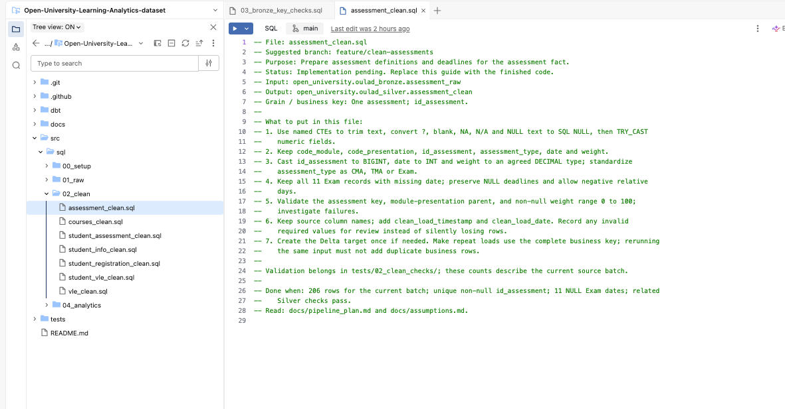

# Journal - 2026-11-08 - Repeated Keys Need Meaning Before Deduplication

## Today in one sentence
- With no new Data Engineering implementation verified today, I revisited the OULAD VLE profiling evidence and learned why repeated source keys can require aggregation instead of deletion.

## What I learned
- The word “duplicate” is dangerous when it is used before defining the grain. In the OULAD student VLE source, the documented candidate daily key is **code_module + code_presentation + id_student + id_site + date**. The source contains 10,655,280 rows but only 8,459,320 unique combinations of that key. That proves the daily key repeats; it does not prove that the repeated rows are useless copies.
- The profiling document records 1,614,505 repeated-key groups and 2,195,960 repeated or excess rows. The arithmetic is consistent: 10,655,280 source rows minus 8,459,320 unique daily keys equals 2,195,960 excess rows at the proposed daily grain. This is a row-count reconciliation, not yet a reason to discard data.
- The intended Clean-layer rule is to group by the complete candidate key and calculate **SUM(sum_click)**. After grouping, one row represents one student’s interaction with one VLE site on one date within one module presentation. The expected Clean output is 8,459,320 daily interaction rows.
- This transformation changes the table’s grain. Bronze preserves every source row because those rows are the evidence received from the source. Clean converts several source observations that belong to the same daily event into one daily record. The row count becomes smaller, but the total clicks should remain the same if the transformation is correct.
- A generic **drop duplicates** operation would be unsafe. It could keep one arbitrary row and delete the other rows in the same daily-key group. If those rows contain separate click counts, the result would undercount engagement. Even removing fully identical rows needs a documented source rule because identical values do not automatically prove accidental replay.
- The correct response depends on what the repeated columns mean. If two rows share the target key but their click counts represent separate observations, aggregation is correct. If the entire source record was duplicated by a failed retry, summing would double-count. If the proposed key is missing a meaningful field, grouping would combine different events. Profiling identifies the pattern, but domain and source knowledge decide the treatment.
- A good aggregation check needs more than the expected output row count. I would compare the click total before and after grouping, confirm that the Clean key is unique, check that no key fields became NULL unexpectedly, and verify that every module, presentation, student, site, and date remains within the intended scope. Row-count reduction and measure preservation must both be true.
- The total-click reconciliation should be performed at more than one level. A global equality check can pass even if one partition loses clicks while another partition gains the same amount. Comparing by module and presentation, and possibly by student or date range, makes offsetting errors easier to find.
- The relationship checks in the OULAD profiling document also matter. The source reported zero tested orphan rows between student VLE interactions and both the VLE resource and student information tables. That supports joining the daily fact to its related entities using documented keys, but it does not replace the uniqueness and total-preservation checks.
- This example also clarifies the difference between a business key and a physical row. A source file can contain many physical rows for one analytical event. The business key defines the event I want the model to represent. The measure aggregation explains how the source rows contribute to that event.
- The safest explanation is not “I removed duplicates.” It is: “I profiled repeated daily keys, retained all source rows in Bronze, grouped the Clean data at the documented student-site-date grain, summed the click measure, and reconciled the output row count and click totals.” That wording exposes both the transformation and the evidence needed to trust it.

## Terms I am still learning
- **Grain** - the exact meaning of one row in a table. For the proposed Clean VLE table, one row represents one student, one VLE site, and one date within a module presentation.
- **Candidate key** - a set of columns that may uniquely identify a record at the intended grain and must be validated against the data.
- **Repeated-key group** - two or more physical rows that share the same proposed business key.
- **Aggregation** - combining several rows into a higher-level row by applying a rule such as SUM, COUNT, MIN, or MAX.
- **Additive measure** - a numeric value that can be safely summed across compatible rows and dimensions. Click counts are intended to be summed within the documented daily key.
- **Reconciliation** - proving that a transformation preserved the expected totals, coverage, or relationships even when its row count changed.
- **Orphan row** - a child record whose parent key is missing from the related reference table.

## What confused me
- The confusing part is that repeated keys can look exactly like a duplicate problem in a quick profile. The same count can mean valid separate observations, retry duplication, or an incomplete candidate key.
- I still need evidence for whether every repeated OULAD row is a separate click observation or whether any exact source replays exist. The documented SUM rule defines the accepted project treatment, but it does not prove that every upstream repetition has the same cause.
- I also need to remember that matching global click totals is necessary but not sufficient. Incorrect grouping can move clicks between keys while leaving the grand total unchanged.

## One small next step
- [ ] Write one partition-level reconciliation query for a single OULAD module presentation that compares source rows, unique daily keys, total source clicks, Clean rows, total Clean clicks, and duplicate Clean keys.

## Git checkpoint
- [x] I created or updated a file
- [x] I wrote a commit
- [x] I pushed my changes

## Decisions or assumptions (optional)
- I am treating this as a learning reflection based on existing OULAD profiling documentation; I am not claiming that I reran the transformation or validation today.
- I will reserve “duplicate” for records proven to be unintended copies. Repeated target keys will be described separately until their meaning is established.
- Bronze should retain the received source rows, while the Clean layer may aggregate them using a documented grain and measure rule.
- I will require both key uniqueness and click-total reconciliation before calling the daily aggregation correct.

## Evidence from today (optional)
- [OULAD source profiling results](https://github.com/ItsYangCoder/oulad-data-engineering-pipeline/blob/main/docs/source_assessment.md) records the 10,655,280 source rows, 8,459,320 unique daily keys, 1,614,505 repeated-key groups, 2,195,960 excess rows, complete candidate key, SUM rule, expected Clean row count, and relationship checks.
- [OULAD documentation commit](https://github.com/ItsYangCoder/oulad-data-engineering-pipeline/commit/09c7760945bec6395d66483736b36402d7baf683) provides a stable commit reference for the profiling document used in this reflection.
- The image is the existing safe repository asset [assets/oulad-project-setup.png](https://github.com/ItsYangCoder/ftw-b12-journal/blob/main/assets/oulad-project-setup.png). I inspected it again before reuse; it shows the OULAD project tree and an explicit Clean-layer implementation guide without credentials, private URLs, or personal data.

The screenshot is not evidence of a November 8 pipeline run. It illustrates the project’s contract-driven structure: each Clean transformation should declare its grain, inputs, keys, treatment rules, and definition of done before code is accepted.

## Reflection (optional)
- What felt easy today? The difference between the two verified row counts is straightforward to calculate and matches the documented excess-row count.
- What felt difficult today? The harder part is explaining why fewer output rows can be correct without using the misleading shortcut “we removed duplicates.”
- What do I want to understand better next time? I want to inspect a few repeated daily-key groups and trace exactly how their click values become one Clean record.

## Mood or meme (optional)
- Same key does not always mean same event; define the grain before reaching for deduplication.
