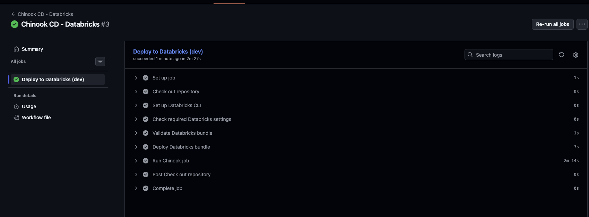

# Journal - 2026-11-09 - Code Review and CI Protect Different Boundaries

Use this version only if you want more structure. The basic `entry.md` is enough for most days.

## Today in one sentence
- Today’s interview preparation made me clarify that reviewing a teammate’s code and running automated CI are complementary forms of Data Engineering quality control: one evaluates meaning and risk, while the other applies repeatable technical gates.

## What I learned
- I did not implement a new pipeline change today. The concrete activity I can support is the leadership discussion in which I described delegating work, aligning the team, helping unblock delivery, and reviewing teammates’ code during FTW projects. I used the merged [OULAD CI pull request #44](https://github.com/ItsYangCoder/oulad-data-engineering-pipeline/pull/44) to turn that discussion into a more precise technical reflection.
- **Human code review** is the deliberate examination of a change by another person. In Data Engineering, the important questions go beyond formatting: What is the row grain? Are the join keys valid? Could the transformation duplicate or discard records? Does a metric still represent the business definition? Is a destructive operation justified? A reviewer can connect the code to the data contract and the intended analytical result.
- **Continuous integration (CI)** is an automated process that runs defined checks whenever code changes. OULAD PR #44 replaced a skipped CI guide with an actual pull-request validation workflow. The current [workflow file](https://github.com/ItsYangCoder/oulad-data-engineering-pipeline/blob/main/.github/workflows/ci.yml) scans committed files for secrets, blocks newly added destructive SQL patterns, rejects disabled dbt data tests, validates YAML, parses Databricks SQL, installs dbt packages, and runs `dbt parse`.
- The workflow also contains a negative test: it creates deliberately invalid YAML and expects the validator to reject it. This matters because a command that exits successfully on every input would produce a green result without proving anything. A negative test checks that the gate can detect a known failure, not only that it can accept a valid file.
- The OULAD workflow is intentionally **parse-only**. Its placeholder Databricks values allow dbt to read the profile, but the job does not connect to Databricks or modify tables. Parsing can prove that project configuration, dependencies, and templated SQL can be understood. It cannot prove that production source data exists, a join preserves the expected row count, or a business metric is correct.
- That limitation is why a green CI result is necessary but not sufficient. For example, a SQL parser may accept a query that joins two tables with a many-to-many relationship. The syntax is valid, yet the result can inflate measures. A human reviewer must still inspect the grain, key uniqueness, null behavior, filters, and expected cardinality.
- The division of responsibility is clearer to me now. CI is strongest when the rule is deterministic and repeatable: “No committed secret,” “YAML must parse,” or “New destructive SQL is blocked.” Human review is strongest when the question needs context: “Is this the correct measure?”, “Does this fallback hide missing data?”, or “Is this deletion behavior consistent with the source contract?”
- Good code review is also a leadership practice. It should not mean taking the task away from the author or approving everything to keep the project moving. A useful review comment identifies the file or behavior, explains the risk, states the expected outcome, and suggests a way to verify it. That helps a teammate make the decision and keeps ownership clear.
- I also need to separate blockers from suggestions. A possible data-loss path, exposed credential, incorrect grain, or untested destructive change can block a merge. A naming preference or optional refactor may be a suggestion. Treating every preference as a blocker adds friction; treating every semantic risk as optional creates false confidence.
- OULAD’s CI design includes several details that support trustworthy review: read-only GitHub permissions, pinned action revisions, a timeout, concurrency cancellation, and narrow compatibility exceptions for SQLFluff. The exceptions are documented and applied only to temporary copies, so repository SQL is not silently rewritten. Even so, a reviewer should understand what the parser intentionally skips because every exclusion creates a boundary around what the green check actually proves.
- My leadership answer should therefore stay specific. I can say that I delegated tasks, aligned the team, helped unblock delivery, and reviewed code in five projects and the capstone. I should not turn that into a claim that I managed a production team or that every reviewed change was correct. The stronger answer is the accurate one: I used review and coordination to help the team deliver while still relying on automated checks for repeatable validation.

## Terms I am still learning
- **Code review** - a structured human check of a proposed change for correctness, clarity, safety, and alignment with the intended data behavior.
- **Quality gate** - a condition that must pass before a change moves forward, such as a secret scan, parser check, or required data test.
- **Static analysis** - checking code without executing the full production workload, for example parsing SQL or inspecting added lines for unsafe statements.
- **Parse-only validation** - proving that tools can understand the project’s syntax and configuration without connecting to the live data platform.
- **Negative test** - a test that supplies a known bad input and confirms that the validator rejects it.
- **Least privilege** - giving a workflow only the permissions it needs; OULAD CI uses read-only repository contents permission.
- **False confidence** - believing that a green check proves more than the check was designed to verify.

## What confused me
- I am still working out where a reviewer’s responsibility ends when the available CI is parse-only. If the syntax, YAML, secret scan, and dbt parse all pass, but the reviewer cannot run a representative dataset, approval still depends on explicit assumptions and evidence from the author.
- I also want to understand how much validation is enough before a semantic concern becomes a merge blocker. A reviewer should not demand unrelated work, but should not ignore a credible duplication, null-handling, or data-loss risk just because the build is green.
- The SQLFluff compatibility exclusions are another useful tension. They are narrow and documented, but they remind me that every automated checker has blind spots. I need to read the gate itself, not only its final status.

## One small next step
- [ ] Write a five-item review checklist for my next Data Engineering pull request: grain and keys, data preservation, secrets or destructive changes, tests including failure evidence, and the exact operational scope of CI.

## Git checkpoint
- [ ] I created or updated a file
- [ ] I wrote a commit
- [ ] I pushed my changes

## Decisions or assumptions (optional)
- I am treating today as a concept reflection because I found evidence of interview preparation and earlier project work, but no verified new Data Engineering implementation for November 9.
- I will describe a passing CI run as evidence for its stated checks, not as proof of live data correctness.
- I will treat human review and CI as layered controls: automated gates handle repeatable rules, while reviewers examine semantics, scope, and trade-offs.
- I will keep leadership claims tied to actions I can support—delegation, alignment, unblocking, and code review—without implying formal production management experience.

## Evidence from today (optional)
- [OULAD PR #44: Add real pull-request validation](https://github.com/ItsYangCoder/oulad-data-engineering-pipeline/pull/44) - merged evidence for the CI design and its stated validation scope.
- [Current OULAD pull-request validation workflow](https://github.com/ItsYangCoder/oulad-data-engineering-pipeline/blob/main/.github/workflows/ci.yml) - source for the secret scan, destructive-SQL gate, YAML negative test, SQL parsing, and dbt parse behavior.
- [Existing journal image asset](https://github.com/ItsYangCoder/ftw-b12-journal/blob/main/assets/ci-cd-databricks-dev-success.png) - an inspected, privacy-safe repository screenshot showing an automated Databricks deployment job with each step completed.

The image is an existing repository asset rather than a newly uploaded screenshot. It makes the distinction visible: the green steps show that the configured automation completed, while the workflow definition and human review determine what those steps actually guarantee.

## Reflection (optional)
- What felt easy today? Explaining the difference between repeatable machine checks and contextual human judgment felt natural because the OULAD workflow gives concrete examples of both.
- What felt difficult today? The difficult part was keeping the leadership story honest. “I reviewed code” is meaningful, but it does not automatically mean I owned production operations or proved every result correct.
- What do I want to understand better next time? I want to practice writing one concise review comment that names a semantic risk, explains its impact, and proposes a focused verification step without taking ownership away from the author.

## Mood or meme (optional)
- A green check says the gate ran; a reviewer still has to ask whether it was the right gate. 🟢🔍
