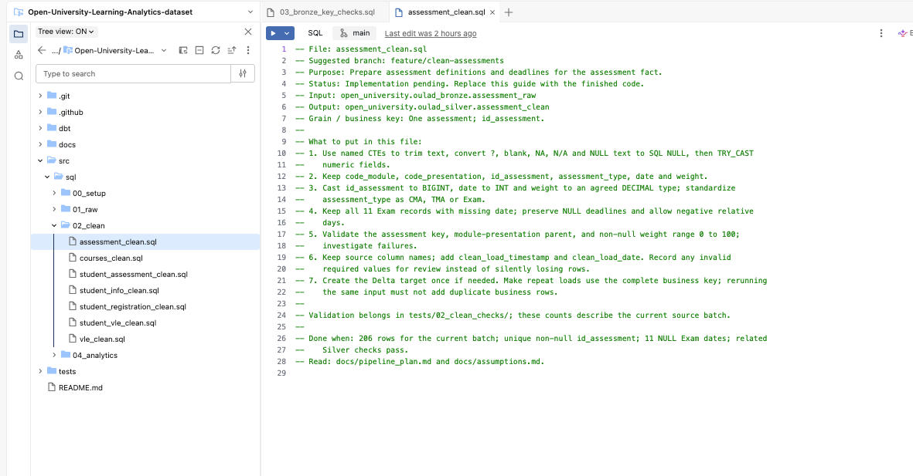

# Journal - 2026-11-10 - Generic and Singular dbt Tests Protect Different Contracts

Use this version only if you want more structure. The basic `entry.md` is enough for most days.

## Today in one sentence
- With no verified new Data Engineering implementation today, I reviewed the existing OULAD dbt project and learned that reusable YAML tests and custom SQL tests answer different quality questions even though both pass only when their test queries return no failing rows.

## What I learned
- Today’s visible conversation was about salary negotiation, not pipeline implementation, and the checked Data Engineering repositories had no November 10 commit. I am therefore treating this as a learning reflection based on code that already exists in the OULAD project, not as a claim that I added tests today.
- A **dbt data test** is an assertion about the data produced by a model, source, seed, or snapshot. The important execution rule is simple: the test query selects records that violate the assertion. Zero returned rows means the test passes; one or more returned rows means the assertion found failures.
- OULAD uses **generic data tests** in [`facts.yml`](https://github.com/ItsYangCoder/oulad-data-engineering-pipeline/blob/main/dbt/models/facts/facts.yml). These are reusable test definitions attached to models or columns. The fact models use built-in checks such as `not_null`, `unique`, `relationships`, and `accepted_values`, plus `dbt_utils.accepted_range`.
- The generic checks are a good fit for repeated column-level contracts. For example, `vle_interaction_key` must be present and unique, foreign keys must match dimension keys, and `sum_click` must be non-null and at least zero. Writing those common rules in YAML keeps the model contract close to its documentation and avoids rewriting similar SQL for every column.
- A **singular data test** is a complete custom SQL query saved under the project’s test path. OULAD’s [VLE grain test](https://github.com/ItsYangCoder/oulad-data-engineering-pipeline/blob/main/dbt/tests/fact_vle_interactions_grain.sql) groups by the complete business key: module, presentation, student, VLE site, and relative day. It returns a row if any key component is null or if the group count is not exactly one.
- That grain rule is more specific than checking one surrogate key for uniqueness. A generated key could be unique while the table still contains two physical rows representing the same analytical event. The singular test protects the meaning of one fact row, not only the technical uniqueness of one column.
- OULAD’s [VLE click reconciliation test](https://github.com/ItsYangCoder/oulad-data-engineering-pipeline/blob/main/dbt/tests/vle_click_reconciliation.sql) goes further. It compares Silver and Gold at three scopes: the daily business key, each module presentation, and the whole dataset. It checks both row counts and total clicks, and it uses full outer joins so keys missing from either side become visible failures.
- This showed me why row-count equality alone is weak evidence. Two datasets can have the same number of rows while containing different keys. Total-click equality alone is also weak because one group can lose clicks while another group gains the same amount. Reconciliation at several levels reduces the chance that offsetting errors hide each other.
- Generic and singular tests are therefore not competitors. Generic tests efficiently cover common invariants; singular tests express project-specific relationships across several columns, rows, models, or aggregation levels. A strong model can use both: generic tests for the basic shape, then singular tests for the business meaning.
- I also need to separate `dbt parse` from `dbt test`. Parsing validates the project structure and builds dbt’s understanding of resources without proving the warehouse data. Running data tests requires the relevant relations and executes queries against the target platform. A parse-only CI job can confirm that a test is defined correctly enough for dbt to understand, but it cannot claim that the data passed that test.
- A passing test has a precise scope. It means the implemented query returned no violations for the selected target and data state at that run. It does not prove that every important contract has a test, that the source was fresh, or that the test’s logic matches the business requirement.
- An empty model is an important edge case. Many tests can return zero failing rows because there are no rows to inspect. If a model is expected to contain data, a separate non-empty or reconciliation rule is needed. “No violations found” and “expected records were produced” are different claims.
- dbt tests also detect problems; they are not automatically database constraints that prevent every invalid write. Their protective value depends on when they run and what the workflow does with a failure. If the deployment process ignores the result, the test becomes documentation rather than a gate.
- For interviews, I can explain this with a concrete OULAD example: “We used reusable YAML tests for nulls, uniqueness, relationships, accepted values, and ranges, then custom SQL tests for the fact grain and Silver-to-Gold reconciliation.” That is more defensible than only saying, “We had 125 tests,” because it explains what risks the tests were designed to catch.

## Terms I am still learning
- **Data test** - a query-based assertion about the records produced by a dbt resource; failing rows are the evidence that the assertion is false.
- **Generic data test** - a reusable parameterized check referenced from YAML, such as `not_null`, `unique`, `relationships`, or `accepted_values`.
- **Singular data test** - one custom SQL query that expresses a project-specific rule and returns the records that violate it.
- **Business key** - the combination of fields that identifies the real analytical event represented by one row.
- **Reconciliation** - comparing data across layers or systems to prove that expected keys, counts, and measures were preserved.
- **Invariant** - a condition that should remain true whenever the model is considered valid.
- **Test coverage** - the set of important risks and contracts that the implemented tests actually check; a large test count does not automatically mean complete coverage.

## What confused me
- I am still deciding when a repeated custom rule should stay as a singular test and when it should become a reusable generic test. Reuse reduces duplication, but a highly specific business rule can become harder to understand if it is hidden behind too many parameters.
- I also need to be careful with the phrase “the model passed.” A passing `dbt test` result is tied to a target, selection, and point in time. It does not automatically describe another environment or a later data load.
- Failure evidence is another open question. A failing query can identify bad rows, but a useful production workflow also needs to preserve enough context—run ID, target, test name, timestamps, and affected keys—to investigate and rerun safely.

## One small next step
- [ ] Make a small OULAD test map with three columns—contract, generic or singular test, and failure meaning—for the VLE interaction fact.

## Git checkpoint
- [x] I created or updated a file
- [x] I wrote a commit
- [x] I pushed my changes

## Decisions or assumptions (optional)
- I am recording a concept reflection because I found no verified November 10 implementation commit in the checked Data Engineering repositories.
- I will use generic tests for repeated column-level rules and singular tests for multi-column grain, cross-model reconciliation, or project-specific business logic.
- I will describe a passing data test only within its executed target and data state.
- I will not treat `dbt parse` as proof that warehouse data passed the project’s data tests.
- I will judge testing strength by the contracts covered and the failure evidence produced, not only by the number of tests.

## Evidence from today (optional)
- [OULAD fact-model YAML tests](https://github.com/ItsYangCoder/oulad-data-engineering-pipeline/blob/main/dbt/models/facts/facts.yml) - shows the actual reusable null, uniqueness, relationship, accepted-value, and range checks.
- [OULAD VLE grain test](https://github.com/ItsYangCoder/oulad-data-engineering-pipeline/blob/main/dbt/tests/fact_vle_interactions_grain.sql) - returns rows when the complete daily interaction key is missing or duplicated.
- [OULAD Silver-to-Gold click reconciliation](https://github.com/ItsYangCoder/oulad-data-engineering-pipeline/blob/main/dbt/tests/vle_click_reconciliation.sql) - compares keys, row counts, and click totals at daily, presentation, and dataset levels.
- [dbt data-test documentation](https://docs.getdbt.com/docs/build/data-tests) - explains generic and singular data tests and the zero-failing-row convention.
- [Existing OULAD project image](https://github.com/ItsYangCoder/ftw-b12-journal/blob/main/assets/oulad-project-setup.png) - inspected repository asset showing the OULAD project structure and a Clean-layer implementation contract.

I reused this inspected repository image because the recent Library files were award or interview-related images rather than technical dbt evidence. The screenshot contains no credential, private URL, account detail, or local filesystem path. Its visible implementation checklist reinforces the same idea as dbt testing: a model needs an explicit grain, validation rules, and a definition of done.

## Reflection (optional)
- What felt easy today? The easiest distinction to explain was that generic tests handle repeatable rules while singular tests handle a specific business assertion.
- What felt difficult today? The harder part was recognizing that “zero failing rows” is not enough by itself when a model could be unexpectedly empty or when an important contract was never encoded.
- What do I want to understand better next time? I want to understand how to store failing records and attach run metadata so a test result becomes useful operational evidence, not only a red status.

## Mood or meme (optional)
- Zero failing rows is good news only after I know the right rows and the right rule were tested.
