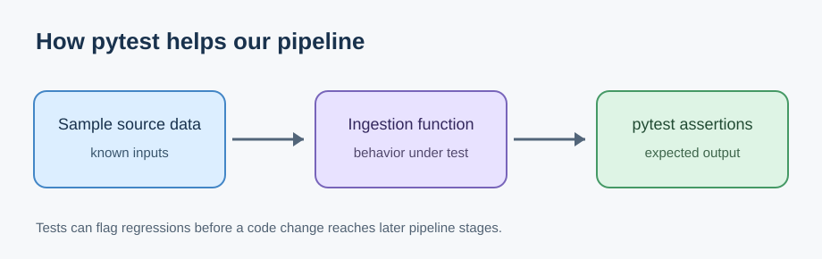

# Journal - 2026-11-11 - Persisting dbt Failures Turns Status into Evidence

Use this version only if you want more structure. The basic `entry.md` is enough for most days.

## Today in one sentence
- A new portfolio-review prompt led me to identify a concrete OULAD improvement: persist useful dbt failure rows and run context so a red test becomes evidence I can inspect, while being clear that I have not implemented this improvement yet.

## What I learned
- The verified activity today is a new practice-log commit containing the prompt, “Review one portfolio project and note one improvement.” Its answer section is still blank, so I cannot honestly say that I completed a portfolio review or changed a pipeline. I used the prompt as a starting point for a learning reflection instead.
- The OULAD project already contains a strong singular data test, `vle_click_reconciliation.sql`. A **singular test** is a SQL query that returns the rows that violate an expectation. This test compares Silver and Gold at daily, presentation, and global levels, and it checks both row counts and click totals. The full outer joins are useful because they can expose a key that exists on only one side.
- A failing status and a diagnosable failure are different things. A status answers, “Did the contract pass?” A useful failure record answers, “Which comparison failed, what values disagreed, and in which run did this happen?” That second layer is part of **observability**: the evidence that helps explain a system's behavior after it runs.
- dbt can persist the rows returned by a failing data test when `store_failures` is enabled. By default, dbt writes these results to an audit schema, usually based on the target schema plus `dbt_test__audit`. That would let me query the failed records instead of relying only on a CI log or a failure count.
- I found no `store_failures` setting in the current searchable default-branch OULAD code or in its `dbt_project.yml`. This makes persisted failure evidence a real, specific portfolio improvement to consider, but it is only a proposal today.
- Persisting failures does not automatically create a durable history. dbt replaces the stored result for the same test on a later run, including when a later run has no failures. If I want a trend such as “this contract failed in three of the last ten runs,” I would need an append-only history process or another artifact that captures each invocation.
- The current reconciliation query returns useful fields such as `check_level`, module, presentation, row counts, and click totals. Its daily comparison joins on student, site, and date, but the final daily failure output does not include those keys. That protects some detail, but it may also make a daily mismatch hard to locate. A careful improvement would select only the minimum safe diagnostic keys—perhaps approved or hashed identifiers—rather than copying an entire sensitive student-level row.
- Run context matters as much as row context. A failure table is more trustworthy when I can connect it to a test name, target environment, execution time, code or manifest version, and invocation identifier. dbt's `run_results.json` artifact can supply execution metadata, but I still need to design how it would be joined to or recorded beside warehouse failure rows.
- Permissions and retention are part of the design. The CI or service identity must be able to create and query the audit schema, while analysts should receive only the access they need. Failure data should also have a cleanup rule, because diagnostic tables can become stale and may contain sensitive keys.
- A small acceptance test would make this improvement concrete: introduce a controlled reconciliation mismatch, verify that one safe diagnostic row is stored, verify that a clean rerun produces no current failure rows, and document the behavior of any historical capture. Until those checks exist, I should not mark the feature complete.

## Terms I am still learning
- **failure row** - a record returned by a test query that shows exactly how a data expectation was violated.
- **`store_failures`** - a dbt configuration or command option that saves failing test records in a warehouse table for inspection.
- **audit schema** - a separate database schema used for diagnostic or control data rather than business-facing models.
- **invocation metadata** - details that identify one execution, such as its run ID, target, timestamp, status, and code version.
- **observability** - the ability to understand what a pipeline did by examining its logs, metrics, artifacts, and diagnostic data.
- **retention** - the rule for how long operational evidence is kept before it is archived or deleted.
- **least privilege** - granting a user or service only the permissions required for its job.

## What confused me
- The main open question is how to preserve useful history when dbt replaces a test's stored failure table on each run. An append-only table could solve that, but it would need a reliable invocation ID and duplicate-handling rule.
- I also need to decide how much row-level context is safe to persist. Student and activity keys can make debugging faster, but storing unnecessary identifiers would increase privacy and access risk.
- A parse-only CI job can validate dbt structure without connecting to a warehouse, while persisted failure rows require a warehouse-connected test run. I need a clear boundary between those two gates instead of treating them as the same check.

## One small next step
- [ ] Draft a one-page failure-evidence design for `vle_click_reconciliation.sql`: list the safe diagnostic columns, audit schema, permissions, retention period, invocation metadata, and one controlled acceptance test.

## Git checkpoint
- [ ] I created or updated a file
- [ ] I wrote a commit
- [ ] I pushed my changes

## Decisions or assumptions (optional)
- I am recording this as a proposed portfolio improvement, not as completed OULAD work.
- I would persist a limited diagnostic projection rather than the complete source row.
- I would not treat dbt's current failure table as historical evidence because later test runs replace it.
- I would keep parse-only CI separate from a warehouse-connected data-quality run.
- I would require both access controls and a retention rule before persisting student-level diagnostic keys.

## Evidence from today (optional)
- [Daily practice-log commit created today in Manila time](https://github.com/ItsYangCoder/ItsYangCoder/commit/2049356c32bec0fcff2fba42507bee8ea4da05a3)
- [Current OULAD dbt project configuration](https://github.com/ItsYangCoder/oulad-data-engineering-pipeline/blob/main/dbt/dbt_project.yml)
- [OULAD Silver-to-Gold VLE click reconciliation test](https://github.com/ItsYangCoder/oulad-data-engineering-pipeline/blob/main/dbt/tests/vle_click_reconciliation.sql)
- [dbt documentation: storing data-test failures](https://docs.getdbt.com/reference/resource-configs/store_failures)
- [dbt documentation: customizing the failure schema](https://docs.getdbt.com/reference/resource-configs/schema)
- [dbt documentation: run-results artifact](https://docs.getdbt.com/reference/artifacts/run-results-json)

This existing safe NYC Mobility diagram shows the general testing chain from a controlled input to behavior and assertions. It uses pytest rather than dbt, but the evidence principle is the same: an assertion detects a regression, while preserved diagnostic context makes the failure easier to investigate. The image contains no secrets, private URLs, or personal data.

## Reflection (optional)
- **What felt easy today?** I do not have evidence about my mood, but the clearest reasoning step was separating a test's pass/fail signal from the evidence needed to diagnose it.
- **What felt difficult today?** The difficult design tradeoff is preserving enough row context to make a failure actionable without keeping unnecessary student-level information.
- **What do I want to understand better next time?** I want to understand the smallest reliable way to link stored failure rows to immutable invocation metadata and retain a useful history without creating an unbounded audit table.

## Mood or meme (optional)
- A red test tells me to stop; a good failure record tells me where to look.
