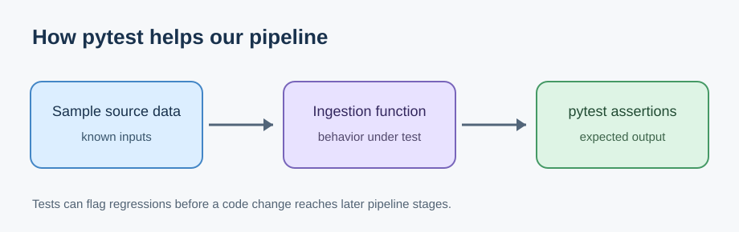

# Journal - 2026-11-12 - Filtering Before Grouping Can Hide Missing Data

Use this version only if you want more structure. The basic `entry.md` is enough for most days.

## Today in one sentence
- A SQL practice prompt that landed today made me revisit a PondoLens quality risk: filtering out missing measurements before aggregation can remove the very groups that a quality check is supposed to report.

## What I learned
- The only verified technical activity today is a commit that created a November 11 practice file with the prompt, “Write an ANSI SQL query using GROUP BY and HAVING.” The answer section is still blank. I am therefore treating this as a learning reflection, not evidence that I ran a query or changed a pipeline today.
- `WHERE` and `HAVING` operate at different stages. `WHERE` removes individual input rows before groups are formed. `GROUP BY` defines the result grain. Aggregate functions calculate one result per group. `HAVING` then keeps or removes complete groups based on an aggregate condition.
- This order matters for missing data. A query such as the following counts only available measurements, but a region containing only NULL values disappears before grouping:

```sql
SELECT
    region_code,
    COUNT(*) AS available_rows
FROM service_access
WHERE value IS NOT NULL
GROUP BY region_code;
```

- That query can answer, “How many non-NULL rows survived?” It cannot prove that every expected region is healthy. A region with zero available values and a region that never arrived can both be absent from the output. An empty result may therefore mean “no bad groups were returned,” “no input rows existed,” or “the filter removed all evidence.” Those meanings must not be treated as the same result.
- PondoLens uses a safer pattern for measurement availability. Its Silver-health macro keeps the observed population and calculates conditional counts such as `COUNT_IF(measurement_state='available')`. This allows the same aggregate row to show `observed_rows`, `available_rows`, source-unavailable rows, and unclassified rows. Missing values remain visible in the denominator instead of being silently removed.
- `COUNT(*)` and `COUNT(value)` also answer different questions. `COUNT(*)` counts stored rows, including rows whose measurement is NULL. `COUNT(value)` ignores NULL values in that column. For service-access quality, `COUNT(*)` can represent observed rows while a conditional count represents usable measurements. Naming both counts clearly is more reliable than writing a generic column such as `total`.
- Conditional aggregation still cannot detect a completely absent region if the query starts only from observed data. To detect missing groups, I need an independent expected set—for example, the approved combinations of year, region, service measure, breakdown type, and breakdown value—and then compare it with the observed table.
- The PondoLens macro does this separately for expected-key coverage. It builds expected service-access keys for the project scope and checks whether each key exists in the Silver model. That preserves an important distinction:
  - **Measurement availability:** the expected or observed row exists, but its value may be unavailable.
  - **Expected-key coverage:** the required business-key row itself may be missing.
- `HAVING` is useful after the correct group population exists. For example, `HAVING COUNT_IF(value IS NULL) > 0` can return observed groups that contain missing measurements. But `HAVING` cannot recover rows already removed by `WHERE`, and it cannot invent expected groups that were never present.
- The safest quality design uses two layers. First, retain observed rows and use conditional aggregates for completeness or availability. Second, generate expected keys independently and compare them with observed keys. This prevents a clean-looking report from being caused by missing evidence.
- The visual testing idea is the same as a pytest fixture: define the known input population first, execute the behavior, and assert the expected output. In SQL quality checks, the expected-key set is the fixture. Without that reference, the query may validate only what happened to arrive.

## Terms I am still learning
- **query evaluation order** - the logical sequence in which SQL filters rows, forms groups, calculates aggregates, and filters grouped results.
- **conditional aggregation** - counting or summarizing only rows that satisfy a condition while keeping the full group population visible.
- **observed population** - the records that actually arrived in the table being checked.
- **expected set** - an independent list of business keys that should exist according to the project or source contract.
- **empty-set false pass** - a quality check that appears successful only because there were no rows left to test.
- **measurement availability** - whether a stored business-key row contains a usable reported value.
- **expected-key coverage** - whether every required business-key combination is present, regardless of whether its measurement is usable.

## What confused me
- A result with zero failing groups looks reassuring, but it is not enough by itself. I still need to know whether the input population was nonempty and whether every expected group was represented.
- `COUNT(value)` is concise, but it hides the reason a value was not counted. PondoLens distinguishes source-unavailable and unclassified rows, so a single non-NULL count can lose useful meaning.
- I need to be careful when joining expected keys to observed data. Joining only on region would multiply rows because service access also has year, measure, breakdown type, and breakdown value in its business grain.
- I also need to remember that a `HAVING` rule is only as trustworthy as the `GROUP BY` grain. Grouping by region alone may hide a missing service measure inside an otherwise populated region.

## One small next step
- [ ] Write one review query for PondoLens `service_access` that groups at its full business grain and returns three explicit counts: expected keys, present keys, and available measurements.

## Git checkpoint
- [x] I created or updated a file
- [x] I wrote a commit
- [x] I pushed my changes

## Decisions or assumptions (optional)
- I am recording a concept reflection based on existing PondoLens code; I am not claiming a new SQL execution or implementation today.
- I will not filter out NULL measurements before calculating availability.
- I will use an independent expected-key set to identify completely missing groups.
- I will keep missing rows and missing measurements as separate failure types.
- I will name aggregate columns by their exact meaning instead of using an ambiguous label such as `count` or `total`.

## Evidence from today (optional)
- [Practice-log commit that landed on November 12 in Manila time](https://github.com/ItsYangCoder/ItsYangCoder/commit/8b0407f62d741be3496db114a589fc54ec6f4370)
- [PondoLens Silver-health macro](https://github.com/ItsYangCoder/ph-government-budget-analysis/blob/main/dbt/macros/silver_health.sql) contains the conditional aggregates, service-access business key, and independently generated expected-key scope discussed here.
- [PondoLens Silver-health dashboard query](https://github.com/ItsYangCoder/ph-government-budget-analysis/blob/main/analytics/data_quality/silver_health.sql) exposes numerator, denominator, observed, missing, unavailable, and unresolved counts instead of one unsupported score.
- [Databricks SQL NULL semantics](https://docs.databricks.com/aws/en/sql/language-manual/sql-ref-null-semantics) documents that `COUNT(*)` includes rows containing NULL while other aggregates generally ignore NULL inputs.
- [Databricks SQL `count_if`](https://docs.databricks.com/gcp/en/sql/language-manual/functions/count_if) documents conditional counting within a group.



This existing NYC Mobility diagram was inspected before reuse. It contains no credentials, private URLs, or personal data. Although it shows pytest, it illustrates the same principle used in the SQL reflection: define a known input population before checking behavior and expected output.

## Reflection (optional)
- **What felt easy today?** I do not have evidence about my mood, but the clearest part of the reasoning was that `WHERE` changes the input population before any group exists.
- **What felt difficult today?** The harder part is proving that an entirely absent group should have existed; that requires an external expected set, not another aggregate over the incomplete table.
- **What do I want to understand better next time?** I want to trace one full service-access business key through expected-key coverage and measurement availability, then confirm that the two checks produce different but compatible evidence.

## Mood or meme (optional)
- If I filter away the missing rows first, my quality report becomes clean by losing the evidence.
