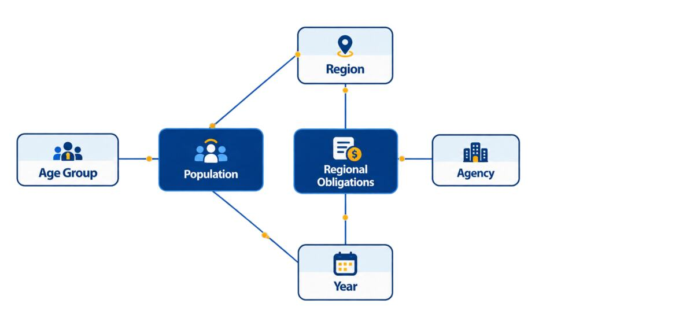

# Journal - 2026-11-13 - Conformed Dimensions Connect Facts Without Multiplying Them

Use this version only if you want more structure. The basic `entry.md` is enough for most days.

## Today in one sentence
- A fact-versus-dimension practice prompt led me to revisit why PondoLens uses shared Year and Location dimensions across separate facts—and why I must aggregate each fact to a compatible grain before comparing budget and development measures.

## What I learned
- The verified technical activity today is a commit that created a November 12 practice file with the prompt, “Explain the difference between a fact table and a dimension table.” Its answer section is still blank. I am using the prompt for a model-design reflection, not claiming that I completed a new implementation today.
- A **fact table** records measurable observations at a declared grain. A **dimension table** gives those observations reusable context for filtering, grouping, and labeling. The distinction is about responsibility, not only column type: a dimension can contain numbers such as age bounds, while a fact can contain descriptive status fields that explain whether a measure is reported, missing, or invalid.
- In the current PondoLens Gold schema, `fact_regional_expenditure` has a grain of `year_id × location_id × particular_id`. One row represents one year, one location, and one canonical agency or fund. Its measures include appropriation and obligation amounts, while value-status columns preserve whether each amount was reported, zero, missing from a source, or otherwise unavailable.
- The fact does not repeat the full year, region name, geographic level, category, and agency name on every row. Instead, its foreign keys point to dimensions:
  - `dim_year` has one row per year.
  - `dim_location` has one row per location code and carries the location label, geographic level, and optional geometry.
  - `dim_particular` has one row per canonical category-and-particular combination and preserves stable IDs for agency or fund names.
- PondoLens is closer to a **fact constellation** than one isolated star. `fact_regional_expenditure`, `fact_regional_indicator`, and `fact_population` are separate fact tables. They share dimensions such as Year and Location, but each fact keeps its own measurement-specific grain and context dimensions.
- A shared dimension is **conformed** when the same key and meaning can be reused consistently across facts. Because expenditure and indicators both use `year_id` and `location_id`, I can align them by year and region without copying different spellings of region names into every fact. This is one reason the region crosswalk and canonical location IDs matter.
- Shared dimensions do not make a direct fact-to-fact join automatically safe. At a single region-year, the expenditure fact can contain many agencies or funds, while the indicator fact can contain many measures. Joining both raw facts only on `year_id` and `location_id` creates a many-to-many fanout: every expenditure row can match every indicator row. The output may look detailed while budget totals and row counts are multiplied.
- The safe pattern is to choose a business question and a common comparison grain first. For example:
  1. Filter the expenditure fact to the intended budget scope and aggregate it to one row per year and location.
  2. Filter the indicator fact to one approved measure and aggregate or validate it to one row per year and location.
  3. Join the two prepared result sets on `year_id` and `location_id`.
  4. Use `dim_year` and `dim_location` for readable labels and geographic rules.
  5. Reconcile row counts and financial totals before and after the join.
- If the business question asks for one agency, then `particular_id` should be filtered deliberately before the common-grain join. If the question asks for all agencies, the expenditure amounts should be aggregated first. Keeping `particular_id` in one side while dropping it from the join condition would silently duplicate the indicator value across agencies.
- The same caution applies to PondoLens geography. `dim_location` can represent regional and non-regional codes, while a choropleth may require only mapped regions. A technically valid foreign key does not prove that every location belongs in every analysis. The query still needs a clear geographic scope.
- PondoLens validates the model boundaries in code. The fact transformation checks uniqueness at `year_id × location_id × particular_id`, verifies that dimension keys resolve, and compares saved financial totals with Silver sources. The Gold schema also declares relationship tests from fact keys to the Year, Location, and Particular dimensions. These checks protect the model structure, but an analytical query must still protect its chosen join grain.
- This helped me separate two questions that sound similar:
  - **Can these facts be related?** Yes, through conformed dimensions.
  - **Can these raw fact rows be joined directly?** Only if their grains and filters guarantee one compatible match; otherwise I must aggregate first.

## Terms I am still learning
- **fact table** - a table of measurable observations stored at one declared business grain.
- **dimension table** - a table of reusable descriptive context used to label, filter, and group facts.
- **grain** - the exact real-world meaning of one row, defined by its business-key combination.
- **foreign key** - a key in a fact that refers to one row in a dimension.
- **surrogate key** - a controlled identifier such as `location_id` that represents a dimension row independently of the source label.
- **conformed dimension** - a dimension whose keys and meaning are shared consistently by multiple fact tables.
- **fact constellation** - a model containing multiple fact tables that share some dimensions.
- **fanout** - unintended row multiplication caused by joining tables at incompatible grains.

## What confused me
- A star or constellation diagram can make two facts look safely connected because lines meet at the same dimensions. The diagram shows possible relationships, but it does not show whether a specific query will create a many-to-many join.
- I still need to decide when an indicator should be filtered to one `indicator_id` and when several indicators should remain as separate rows. Summing unrelated indicators would be meaningless even though they share the same fact table.
- Stable surrogate keys simplify joins, but they do not remove the need to check business meaning. A Nationwide or Central Office location can resolve to a valid key and still be outside a regional comparison.
- I also need to remember that status fields belong in the analysis. A NULL amount with a source-status explanation is different from a reported zero and should not be silently converted before aggregation.

## One small next step
- [ ] Draft one PondoLens comparison query that aggregates reported obligations and one selected development indicator separately to `year_id × location_id`, joins the two result sets, and proves that expenditure totals did not change after the join.

## Git checkpoint
- [x] I created or updated a file
- [x] I wrote a commit
- [x] I pushed my changes

## Decisions or assumptions (optional)
- I am documenting existing model behavior and a safe query pattern; I am not claiming a new dbt build or dashboard update today.
- I will treat the fact table's documented grain as a contract, not just a comment.
- I will not join raw expenditure and indicator facts only because they share Year and Location keys.
- I will filter or aggregate each fact to an explicitly compatible grain before joining.
- I will preserve reported-zero and missing-value statuses instead of replacing every NULL with zero.
- I will exclude non-comparable geography deliberately rather than assuming every valid Location key belongs in a regional analysis.

## Evidence from today (optional)
- [Practice-log commit that landed on November 13 in Manila time](https://github.com/ItsYangCoder/ItsYangCoder/commit/6dd5614d5e65508fb3b0547fcada3707a517008b)
- [PondoLens Gold schema](https://github.com/ItsYangCoder/ph-government-budget-analysis/blob/main/dbt/models/gold/schema.yml) documents every dimension and fact grain plus the relationship and uniqueness tests.
- [Regional-expenditure fact transformation](https://github.com/ItsYangCoder/ph-government-budget-analysis/blob/main/dbt/models/gold/fact_regional_expenditure.sql) resolves dimension keys, protects the `year_id × location_id × particular_id` grain, and reconciles financial totals.
- [Location dimension](https://github.com/ItsYangCoder/ph-government-budget-analysis/blob/main/dbt/models/gold/dim_location.sql) provides the shared location key and geographic context.
- [Particular dimension](https://github.com/ItsYangCoder/ph-government-budget-analysis/blob/main/dbt/models/gold/dim_particular.sql) provides stable canonical agency and fund definitions.

This inspected repository image shows two separate facts sharing Region and Year context, with Age Group describing Population and Agency describing Regional Obligations. It contains no credentials, private URLs, signatures, or personal information. The new Library images were not used because one was an unrelated LinkedIn profile form and the award photo displayed names and signatures.

## Reflection (optional)
- **What felt easy today?** I do not have evidence about my mood, but the easiest distinction to state is that facts hold measurements while dimensions explain how to slice and label them.
- **What felt difficult today?** The harder reasoning is at query time: two facts can share dimensions and still multiply each other when joined below a compatible grain.
- **What do I want to understand better next time?** I want to build one small reconciliation example that shows the incorrect fanout result beside the correctly pre-aggregated result, including unchanged obligation totals.

## Mood or meme (optional)
- Shared keys make a relationship possible; compatible grain makes the result trustworthy.
