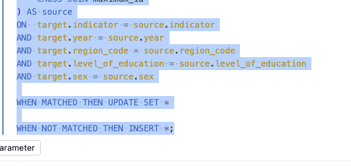

# Journal - 2026-11-14 - LEFT ANTI JOIN Direction Changes the Question

Use this version only if you want more structure. The basic `entry.md` is enough for most days.

## Today in one sentence
- A blank SQL JOIN practice prompt led me to study a real pattern already present in PondoLens: reversing the left and right inputs of a `LEFT ANTI JOIN` changes whether I am asking “Which source keys are new?” or “Which target keys disappeared from the source?”

## What I learned
- The only new SQL activity I can verify today is a practice-log commit with the prompt “Practice one SQL JOIN and describe the expected result.” Its answer section is still blank, so I am treating this as a learning reflection rather than claiming that I ran or completed a query.
- A **join** combines or compares rows according to a condition called the join predicate. An inner join keeps matching pairs. A left join keeps every row from the left side and adds matching columns from the right. A `LEFT ANTI JOIN` is different: it returns only left-side rows for which no matching right-side row exists. It is useful for answering a set-difference question.
- The important part is the direction. In the PondoLens regional expenditure fact model, one anti join starts from the existing target table and checks it against the current mapped source. That asks: “Which keys are already in the warehouse but are absent from this source result?” The model excludes a documented retired key and asserts that no other rows unexpectedly disappear.
- A second anti join reverses those inputs. It starts from the current mapped source and checks the existing target. That asks: “Which source keys do not yet exist in the warehouse?” Those rows are the genuinely new business keys that need generated fact IDs before the merge.
- These two queries can use the same logical operator and still answer opposite questions:
  - `target LEFT ANTI JOIN source` finds target keys missing from the current source.
  - `source LEFT ANTI JOIN target` finds source keys missing from the current target.
- The comparison must use the full business grain. In this model, the fact grain is `year_id × location_id × particular_id`. If I compared only `year_id` and `location_id`, two different expenditure particulars could look like the same row. A partial predicate could hide a new key or make a missing row appear matched.
- An anti join proves only that a matching key is absent from one side. It does **not** prove why the key is absent. A source row can disappear because of a delayed extract, an incomplete snapshot, a scope change, an upstream failure, or a real deletion. PondoLens therefore does not interpret source omission as an automatic delete. It stops on an unexpected omission so the cause can be investigated.
- Null handling matters before the comparison. SQL equality does not treat `NULL = NULL` as true. If key columns were allowed to remain null, a row could appear unmatched even when both sides contain incomplete versions of the same business record. The model first validates that its mapped dimension IDs are non-null, which makes the anti-join result more trustworthy.
- Anti joins compare presence at the chosen key grain; they do not detect every change. If a row keeps the same `year_id`, `location_id`, and `particular_id` but its amount changes, neither anti join will return it. The later `MERGE` and post-load count and sum reconciliations handle that separate question.
- This distinction makes the load easier to reason about. Key reconciliation answers whether records are new or missing. Measure reconciliation answers whether values changed or totals drifted. Keeping those checks separate prevents a single “no missing rows” result from being mistaken for full data correctness.
- The model also uses a `FULL OUTER JOIN` earlier to combine appropriations and obligations at the same business grain. That operator is appropriate when records may exist on either source side. The anti joins later serve a different purpose: comparing the prepared source set with the current target state.
- For an idempotent pipeline, this pattern is valuable because rerunning the same complete input should not allocate new IDs again. Existing keys match the target, only genuinely new source keys pass the source-to-target anti join, and the merge updates or inserts deterministically.

## Terms I am still learning
- **join predicate** - the columns and conditions SQL uses to decide whether two rows match.
- **left anti join** - rows from the left input that have no match in the right input; it returns no right-side columns.
- **set difference** - the members present in one set but absent from another.
- **composite key** - a key formed from several columns because no single column identifies the business record.
- **snapshot semantics** - the rule that says whether a source extract is a complete current view or only a partial/change view.
- **orphan candidate** - a target row whose business key is no longer found in the current source comparison.
- **upsert** - update an existing matched row or insert a new unmatched row.
- **reconciliation** - comparing keys, row counts, or totals across stages to confirm that a load preserved the intended data.

## What confused me
- The SQL syntax is compact, but the meaning depends heavily on which dataset is on the left. Reading only “anti join” without naming the left-side question makes the query easy to misinterpret.
- A missing key is evidence, not a deletion instruction. I still need the source contract to know whether an absent row is expected, temporarily missing, retired, or truly deleted.
- A clean bidirectional key comparison can still miss changed measures. A row with the same composite key and a different amount is not “new” or “missing,” so it needs merge logic and value-level reconciliation.
- A `NULL` measure and an absent business key are also different states. One means the record exists without a value; the other means the record itself did not match. I need to preserve that distinction in tests and documentation.

## One small next step
- [ ] Draft a three-row SQL fixture containing one new source key, one target key missing from source, and one matched key with a changed amount; predict the result of both anti-join directions and the later merge before running it.

## Git checkpoint
- [x] I created or updated a file
- [x] I wrote a commit
- [x] I pushed my changes

## Decisions or assumptions (optional)
- I am recording a concept reflection today because the practice prompt is verified but its answer is blank; I am not claiming a query execution or implementation result.
- I will describe every anti join as a question whose subject is the left input, rather than treating “anti join” as a directionless operation.
- I will compare the complete composite business key and validate non-null key components before trusting a missing/new-key result.
- I will not turn a source omission into a delete unless the source contract explicitly defines the input as authoritative and complete.
- I will keep key reconciliation separate from measure reconciliation because they detect different classes of change.

## Evidence from today (optional)
- [SQL JOIN practice-log commit `4b521d0`](https://github.com/ItsYangCoder/ItsYangCoder/commit/4b521d0d36ccbba52895938ecac943e2318c43bf) - verifies the prompt and also shows that the answer section is still empty.
- [PondoLens regional expenditure fact model](https://github.com/ItsYangCoder/ph-government-budget-analysis/blob/main/dbt/models/gold/fact_regional_expenditure.sql) - contains the two opposite `LEFT ANTI JOIN` checks, ID allocation for new keys, the merge, and post-load reconciliation.
- [PondoLens gold model schema](https://github.com/ItsYangCoder/ph-government-budget-analysis/blob/main/dbt/models/gold/schema.yml) - documents the gold-layer models and tests around their expected structure.
- Existing journal asset used below: [composite merge-key screenshot](https://github.com/ItsYangCoder/ftw-b12-journal/blob/main/assets/2026-10-19-completion-rate-merge-key.png). It comes from related Data Engineering work and illustrates a multi-column `MERGE` predicate; it is not evidence that today’s practice query was executed.

The highlighted predicate is a useful visual reminder that the match question is only as precise as the columns included in the business key. The exact PondoLens fact key is different—`year_id`, `location_id`, and `particular_id`—but the same principle applies.

## Reflection (optional)
- What felt easy today? The mechanical rule is concise: a left anti join keeps unmatched rows from the left side.
- What felt difficult today? The harder part is deciding what absence means operationally. SQL can show the difference, but it cannot decide whether the source is late, partial, changed in scope, or authoritatively deleting a record.
- What do I want to understand better next time? I want to make the source snapshot contract explicit, then connect each possible anti-join result to a tested pipeline action: insert, investigate, retire, or reject.
- I do not have evidence about my mood or how the exercise felt in the moment. The most honest human takeaway is that a small change in query direction can encode a large change in business meaning, so naming the question before writing the SQL is worth the extra sentence.

## Mood or meme (optional)
- Same join, opposite left side, opposite question. ↔️
