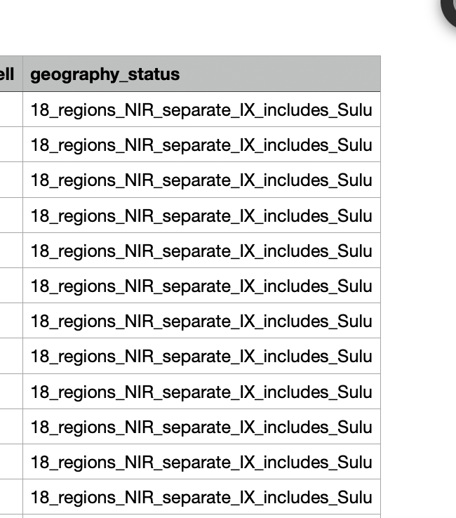

# Journal - 2026-11-15 - Delta Lake and Concurrent Writers

Use this version only if you want more structure. The basic `entry.md` is enough for most days.

## Today in one sentence
- A blank Databricks practice prompt led me back to a real PondoLens limitation: the Bronze Delta merge is verified for an identical rerun with one writer, but concurrent writers still need a focused test and an explicit retry policy.

## What I learned
- The only new Data Engineering activity I can verify today is a practice-log commit asking me to explain one Databricks Delta Lake concept in two or three sentences. Its answer section is still blank, so this entry is a learning reflection rather than evidence that I ran a new Databricks job.
- The Delta Lake concept I chose is **optimistic concurrency control**. In simple words, Delta lets writers begin work without locking the entire table. A write reads a consistent table snapshot when needed, stages new data files, then validates at commit time whether another transaction changed data that conflicts with its work. If the validation succeeds, Delta records a new table version atomically. If it detects a conflict, the operation fails instead of silently producing a corrupted table.
- “Optimistic” does not mean Delta assumes conflicts are impossible. It means the system allows work to proceed on the expectation that many operations will not overlap, then checks that expectation before committing.
- This directly connects to the PondoLens Bronze ingestion helper. The helper creates deterministic `record_id` values, compares them with the target, and runs an insert-only Delta `MERGE` using `target.record_id = source.record_id`. The verified first run loaded 840 rows, and the identical rerun found zero candidate new rows. That is good evidence of logical idempotency for one exact revision with one writer.
- Logical idempotency and concurrency safety are related but different:
  - A deterministic key helps repeated input identify the same business record.
  - A merge condition decides whether a record is already present.
  - Delta transaction handling decides whether a proposed write can safely commit beside another writer.
  - A retry policy decides what the application does after a conflict.
- The repository documentation explicitly limits the verified claim: other revisions and concurrent writers remain unverified. I should preserve that boundary. The one-writer result does not prove what happens when two jobs read the same pre-write snapshot and both try to merge the same `record_id` at nearly the same time.
- Current Databricks documentation describes three broad phases for a Delta write: **read**, **write**, and **validate and commit**. During validation, Delta checks for commits made after the transaction’s snapshot. A conflicting operation can raise a concurrent-modification exception. A non-conflicting operation becomes a new versioned snapshot.
- Databricks uses `WriteSerializable` as the default Delta isolation level. This makes writes serializable while allowing more concurrency than the stronger `Serializable` level. Choosing stronger isolation is not automatically better; it can increase conflicts and reduce throughput. The correct setting depends on what outcomes the pipeline must forbid.
- Two concurrent `MERGE` operations can conflict when they may touch overlapping data. The exact behavior can also depend on table features such as row-level concurrency and on whether the operations can be proven to affect disjoint rows or files. Therefore, “Delta supports concurrent writers” is not the same as “every pair of concurrent merges will both succeed.”
- A conflict exception is a safety result, not necessarily a data-quality failure. It means Delta refused to commit an operation whose assumptions may no longer be valid. The pipeline still needs to record the failed attempt, identify the source revision and target, and decide whether a retry is safe.
- Retrying should repeat the whole decision from a fresh snapshot. Reusing a stale count such as “840 candidate rows” after another writer commits would be misleading. A safe retry should reread the target, recalculate candidate rows, rerun the merge, and reconcile the committed result against the same immutable manifest and processing key.
- A successful retry also needs idempotent side effects outside the Delta table. If the job sends notifications, writes audit rows, or advances a checkpoint before the table commit is confirmed, repeating the transaction could duplicate those side effects even if the table itself remains correct.
- The transaction log and the job log answer different questions. Delta history can show committed table versions and operations. Job logs can also show attempts that failed before commit, including the conflict exception and retry. To investigate concurrency, I need both.
- The existing source-profile image below is relevant because concurrent safety starts before the write: both writers must be processing the same clearly identified revision and assumptions. A transaction layer can protect table commits, but it cannot decide whether two different source vintages should be treated as the same logical batch.

## Terms I am still learning
- **optimistic concurrency control** - allowing transactions to work without broad locks, then checking for conflicting intervening commits before accepting a write.
- **snapshot** - a consistent version of a table that a reader or writer uses as its starting view.
- **atomic commit** - a transaction becomes visible as one complete change or not at all.
- **isolation level** - the rules controlling which concurrent transaction outcomes are allowed.
- **WriteSerializable** - Databricks’ default Delta isolation level, which makes table writes serializable while allowing more concurrency than full Serializable isolation.
- **conflict exception** - a failure raised when Delta cannot safely commit a transaction after another writer changed overlapping data or metadata.
- **retry policy** - the application rule for deciding when and how a failed operation should be attempted again.
- **deterministic record ID** - an identifier derived from stable source fields so the same record receives the same ID on every run.
- **processing key** - the identifier for one exact source and parser revision, used to keep ingestion evidence reproducible.

## What confused me
- “Multiple writers are supported” first sounds like all concurrent operations should succeed. The more accurate interpretation is that Delta coordinates concurrent work safely; a safe outcome can be either a committed version or a detected conflict that the application must handle.
- I still need to determine the expected PondoLens behavior when two jobs merge the same `record_id`. Should one succeed and the other retry to a zero-new-row result, or should orchestration enforce one writer before Delta sees the race?
- The default isolation level is not a substitute for a business rule. Delta can serialize valid writes, but it cannot decide whether two different processing keys represent independent revisions, a correction, or an accidental duplicate submission.
- Row-level concurrency may reduce unnecessary conflicts, but table features, runtime support, the merge predicate, and the physical data layout affect the result. I should not recommend enabling a feature without testing the actual table and runtime.
- A table history with one successful merge does not show the full story if another attempt failed before commit. I need job-run evidence alongside Delta history to reconstruct the race.

## One small next step
- [ ] Create a disposable Delta test table with one `record_id`, launch two controlled merge attempts against that same key, and capture both job results plus `DESCRIBE HISTORY`; do not apply the experiment to a production table.

## Git checkpoint
- [x] I created or updated a file
- [x] I wrote a commit
- [x] I pushed my changes

## Decisions or assumptions (optional)
- I am documenting a concept reflection because today’s Delta Lake practice answer is empty; I am not claiming that I executed the proposed concurrency test.
- I will keep the verified PondoLens statement narrow: 840 rows on the first helper run, zero candidate new rows on the identical rerun, one exact revision, and one writer.
- I will treat deterministic IDs and insert-only merge logic as idempotency controls, not as proof of concurrent-writer behavior.
- A conflict should trigger a fresh read, recomputation, and reconciliation against the same immutable source revision before any retry.
- I will retain both job-attempt evidence and Delta commit history because failed attempts do not become table versions.
- I will not change the table isolation level until a test demonstrates an unacceptable outcome under the default behavior.

## Evidence from today (optional)
- [Databricks Delta Lake practice prompt commit `92c4899`](https://github.com/ItsYangCoder/ItsYangCoder/commit/92c4899a6775350ecab29db2e983a160db84e620) - verifies today’s prompt and shows that the answer section is still empty.
- [PondoLens Bronze helper verification commit](https://github.com/ItsYangCoder/ph-government-budget-analysis/commit/dcbe09edbcf1a364966d99523f4be991377290bf) - documents the 840-row first run, zero-new-row identical rerun, and explicit single-writer limitation.
- [PondoLens Bronze Delta loading commit](https://github.com/ItsYangCoder/ph-government-budget-analysis/commit/f024e097155718e590f29a51ac05bec188be7ce4) - contains deterministic record IDs, the insert-only Delta merge, and two-way reconciliation.
- [Databricks: ACID guarantees and optimistic concurrency](https://docs.databricks.com/aws/en/lakehouse/acid) - explains the read, write, and validate-and-commit phases.
- [Databricks: isolation levels and write conflicts](https://docs.databricks.com/aws/en/optimizations/isolation) - documents concurrent-write behavior and conflict handling.
- Existing journal asset used below: [Bronze source-profile screenshot](https://github.com/ItsYangCoder/ftw-b12-journal/blob/main/assets/2026-10-05-bronze-source-profiling.png). It was inspected for this entry and contains no secrets or personal data. It is older project evidence, not proof of a concurrency run today.

The screenshot shows a source assumption carried as explicit data. For a concurrent-ingestion test, this kind of revision context matters: two writers should be traceable to the exact same manifest and processing key before their table results are compared.

## Reflection (optional)
- What felt easy today? The high-level three-stage model is understandable: read a snapshot, stage changes, then validate before committing.
- What felt difficult today? The difficult boundary is between database guarantees and application responsibility. Delta protects the table transaction, while the job still owns retries, audit records, source identity, and side effects.
- What do I want to understand better next time? I want concrete evidence of how the current PondoLens merge behaves when two writers target the same key, including which attempt commits, which attempt fails or retries, and what appears in table history.
- I do not have evidence about my mood during the original practice prompt. The honest human takeaway is that “safe concurrency” may include a visible failure; a rejected conflicting write can be more trustworthy than two unexplained green jobs.

## Mood or meme (optional)
- Optimistic does not mean careless: trust the first snapshot, verify before commit. 🔁
