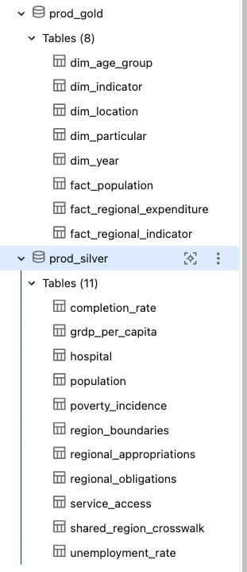

# Journal - 2026-11-16 - Data Tests Should Return Actionable Failing Rows

Use this version only if you want more structure. The basic `entry.md` is enough for most days.

## Today in one sentence
- An unanswered NULL-or-duplicate practice prompt led me to study a stronger pattern already used in OULAD: a data test should return the exact failing business-key groups and enough context to explain the failure, not only produce a red status or one total count.

## What I learned
- The only new technical activity I can verify today is a practice-log commit asking for a data-quality check for NULL or duplicate values. Its answer section is still blank, so this is a concept reflection grounded in existing project code rather than a claim that I wrote or executed a new query.
- A useful NULL check begins with a contract: which columns are required for the row to have identity or meaning? In the OULAD `fact_vle_interactions` model, the documented grain is one row per student, module presentation, VLE resource, and relative day. The complete business key is `code_module × code_presentation × id_student × id_site × relative_day`.
- A duplicate check must use that whole grain. Grouping only by student and day could combine separate modules or VLE resources. Grouping by every physical column would have the opposite problem: two rows could represent the same analytical event but escape detection because a non-key field differs.
- OULAD’s singular dbt test groups by the five business-key columns, calculates `count(*) as row_count`, and returns groups where any key component is NULL or `row_count <> 1`. In dbt, that shape is intentional: a data test passes when its query returns zero failing rows and fails when unwanted rows are returned.
- Returning the failed keys is more useful than returning only a scalar such as `duplicate_count = 7`. A failed row can show which module, presentation, student, site, and day need investigation, while `row_count` shows how many physical rows were found for that analytical event.
- The number of rows returned by a grouped duplicate test is the number of **failing groups**, not necessarily the number of problematic source rows:
  - A key with `row_count = 4` produces one returned group.
  - Four physical rows are involved in that group.
  - Three rows are excess beyond the expected one.
  These are three different metrics: `duplicate_groups`, `rows_in_duplicate_groups`, and `excess_rows`.
- NULLs and duplicates remain separate failure types even when one SQL test returns both. A group with one NULL key and `row_count = 1` fails because its identity is incomplete. A complete key with `row_count = 3` fails because the identity is repeated. The diagnostic output should make that difference visible instead of forcing the reviewer to infer it.
- OULAD also declares generic `not_null` tests for each key column and a `unique` test for the generated interaction key. That overlaps with the composite-grain test on purpose:
  - Generic tests quickly identify which individual column contract failed.
  - The singular test protects the complete multi-column business grain.
  - Reconciliation tests verify that correct key shape did not hide lost or inflated measures.
- Uniqueness alone is not enough for a fact table. The OULAD reconciliation test compares Silver and Gold at daily, presentation, and global levels using row counts and `sum_click`. A table can contain one row per key and still be wrong if clicks were dropped, doubled, or assigned to the wrong presentation.
- The reconciliation test uses a full outer join so keys that exist on only one side become failures. It also uses Spark SQL’s null-safe equality operator, `<=>`, for totals. That matters because ordinary equality with NULL evaluates to unknown, which can make a mismatch condition behave differently from the intended “these values are equal, including two NULLs” comparison.
- A good failing-row query should include enough context to debug but not every available column. Wide failure records are harder to read and can copy unnecessary sensitive data into logs or audit tables. For this fact, the business key, failure type, and row count are usually a better diagnostic contract than selecting `*`.
- Current dbt documentation also allows failing records to be stored for inspection. That can shorten debugging, but it creates an operational decision: stored failures need an appropriate schema, access controls, retention rule, and deliberate column selection. A convenient audit table should not become an uncontrolled copy of source data.
- Severity should come from the contract, not from the convenience of the query. A NULL in a required key or a repeated fact grain is normally blocking because identity is ambiguous. A NULL in an optional measure can be legitimate source missingness and may need a status field or availability metric instead of a blanket error.
- The inspected PondoLens image below shows eleven Silver tables feeding the quality layer. This scale makes context important: a top-level “2 failures” message is not useful unless it also identifies the dataset, check, key, and denominator.

## Terms I am still learning
- **business grain** - the exact real-world meaning of one row, expressed through the columns that identify that event or entity.
- **failing row** - a record returned by a data-test query because it disproves the test’s assertion.
- **failing group** - one grouped business key that violates the expected count or required-key rule.
- **excess rows** - the rows beyond the expected one in each duplicate group, often calculated as `row_count - 1`.
- **singular data test** - a project-specific SQL query whose returned records are treated as failures by dbt.
- **generic data test** - a reusable test definition such as `not_null`, `unique`, `relationships`, or `accepted_values`.
- **null-safe equality** - a comparison that considers two NULL values equal while still detecting one-sided or different non-null values.
- **failure context** - the selected keys and diagnostic fields needed to understand and reproduce a quality problem.
- **reconciliation** - comparing keys, row counts, and measures across stages to prove that a transformation preserved the intended data.

## What confused me
- A grouped test can return one row for a key that appears four times. If a dashboard labels that as “one duplicate,” the wording is ambiguous: it could mean one duplicate group, four affected rows, or three excess rows.
- Grouping NULL keys together is useful for surfacing them, but it can combine several incomplete records into one failing group. The generic column-level `not_null` tests provide a clearer count of affected records.
- A zero-row duplicate result does not prove that the model is correct. The input could be empty, the key could be too wide, or a measure could have been aggregated incorrectly while the key remained unique.
- I still need a consistent rule for which failure columns are safe to persist. Student identifiers help debugging, but stored test failures should expose only the minimum necessary context.
- I also need to decide when a recognized missing measure should produce a warning, an informational availability metric, or no failure at all. That choice belongs in the data contract, not in a universal “no NULLs” rule.

## One small next step
- [ ] Build a five-row fixture with one valid key, one key repeated three times, and one row containing a NULL key component; predict the failing groups, affected rows, and excess rows before running the OULAD grain test against it.

## Git checkpoint
- [x] I created or updated a file
- [x] I wrote a commit
- [x] I pushed my changes

## Decisions or assumptions (optional)
- I am writing a learning reflection because today’s practice answer is empty; I am not claiming that I executed a new NULL or duplicate query.
- I will define the business grain before selecting columns for a duplicate check.
- I will keep required-key failures separate from repeated-key failures in diagnostics, even if one singular test surfaces both.
- I will report duplicate groups, affected rows, and excess rows with explicit labels rather than calling all three “duplicates.”
- I will pair grain checks with non-empty-input and measure-reconciliation checks so a zero-failure result is not overinterpreted.
- If failing records are persisted, I will select only necessary diagnostic columns and apply an explicit access and retention policy.

## Evidence from today (optional)
- [NULL-or-duplicate practice prompt commit `fc88bf1`](https://github.com/ItsYangCoder/ItsYangCoder/commit/fc88bf1906d8654fd6ba3fc93580751b57f650fb) - verifies today’s prompt and shows that the answer section is still empty.
- [OULAD VLE grain test](https://github.com/ItsYangCoder/oulad-data-engineering-pipeline/blob/main/dbt/tests/fact_vle_interactions_grain.sql) - returns composite-key groups whose key is incomplete or whose row count is not exactly one.
- [OULAD fact-model tests](https://github.com/ItsYangCoder/oulad-data-engineering-pipeline/blob/main/dbt/models/facts/facts.yml) - declares the model grain plus individual not-null, uniqueness, relationship, accepted-value, and range contracts.
- [OULAD Silver-to-Gold click reconciliation](https://github.com/ItsYangCoder/oulad-data-engineering-pipeline/blob/main/dbt/tests/vle_click_reconciliation.sql) - compares keys, row counts, and click totals at daily, presentation, and global levels.
- [dbt data-test documentation](https://docs.getdbt.com/docs/build/data-tests) - documents the zero-failing-row convention and adding diagnostic context to singular tests.
- Existing journal asset used below: [PondoLens Silver and Gold table inventory](https://github.com/ItsYangCoder/ftw-b12-journal/blob/main/assets/2026-10-22-silver-health-coverage.png). It was inspected for this entry and contains no credentials, private URLs, or personal data. It is older project context, not proof of a new run today.

The inventory explains why failure context matters. With eleven Silver datasets, a single global failure count cannot tell me whether the issue belongs to completion rates, population, budgets, geography, or another source; the test output needs a dataset and a business key.

## Reflection (optional)
- What felt easy today? Writing `GROUP BY ... HAVING COUNT(*) > 1` is mechanically simple once the grain is known.
- What felt difficult today? The harder work is choosing the correct grain, defining which NULLs are invalid, and making the failure output useful without copying unnecessary data.
- What do I want to understand better next time? I want to compare dbt’s reported failure count with the business-facing metrics I would put on a dashboard: failing groups, affected rows, excess rows, and percentage of eligible keys.
- I do not have evidence about my mood during the original prompt. The practical human lesson is that a red test is only the start of debugging; the returned rows should make the next question obvious.

## Mood or meme (optional)
- “Something failed” is an alert. “This key failed for this reason” is engineering. 🔎
