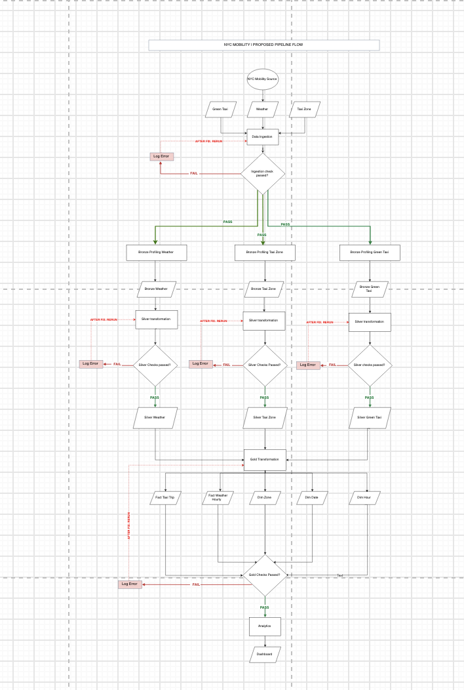

# Journal - 2026-11-17 - Schema Validation Is a Deliberate Pipeline Gate

Use this version only if you want more structure. The basic `entry.md` is enough for most days.

## Today in one sentence
- An unanswered ETL/ELT practice prompt led me to examine one concrete PondoLens step: validating the incoming DataFrame schema against the existing Bronze Delta table before the merge so structural changes stop for review instead of silently changing the target.

## What I learned
- The only new Data Engineering activity I can verify today is a practice-log commit asking me to describe one ETL or ELT pipeline step and its purpose. Its answer section is empty, so this entry is a learning reflection based on existing project code rather than evidence that I ran a new pipeline.
- The step I chose is **schema validation before loading**. Its purpose is to confirm that the incoming data still has the expected columns and data types before it is merged into a persistent table.
- In the PondoLens Bronze loader, the source is first read from a verified Parquet package. The notebook validates the manifest, file hashes, row counts, processing key, source ID, source-file hash, record IDs, and extraction results before reaching the Delta write.
- If the target table does not yet exist, the loader creates an empty Delta table from the source schema using `df.limit(0)`. This establishes a typed destination without preloading the records. Later runs can compare new input with that stored contract.
- Before the merge, the code builds two ordered lists:
  - `source_types = [(field.name, field.dataType) ...]`
  - `target_types = [(field.name, field.dataType) ...]`
  If those lists differ, the loader raises `Target schema needs review` and does not continue to the merge.
- That comparison is intentionally stricter than simply hoping the write will work. Delta Lake also enforces schema rules on write, but a project-level precheck can produce a clearer failure at the exact boundary where the mismatch is discovered.
- The custom check compares column names, order, and Spark data types. It deliberately does not compare nullability because the code notes that Spark storage can change nullability metadata. This teaches me that a schema contract must define which differences are meaningful; comparing every metadata detail can create false failures.
- Ordered-list equality also means a harmless column reordering will fail even if all names and types are otherwise the same. That may be desirable for a stable Bronze contract, but it is still a design decision. If order has no downstream meaning, comparing a normalized name-to-type mapping could be more appropriate.
- A matching schema does not prove correct data. A column called `amount` can remain `DecimalType` while changing from pesos to thousands of pesos. A year can remain an integer while moving outside the supported range. Schema validation protects structure, while business tests protect meaning.
- A failed schema check is not automatically evidence that the source is bad. It can indicate several different situations:
  - an upstream publisher added a useful field;
  - a parser renamed or reordered columns;
  - a numeric field widened from integer to decimal;
  - a column disappeared unexpectedly;
  - the wrong source package was routed to the target;
  - or the target table no longer matches the documented contract.
- **Schema enforcement** and **schema evolution** answer different questions. Enforcement asks whether the incoming write fits the current target. Evolution intentionally changes the target contract to accept a supported change. Automatically evolving every mismatch would make the pipeline flexible, but it could also let accidental source changes propagate into downstream models.
- Current Databricks guidance supports operation-level schema evolution for selected writes and recommends deliberate control instead of enabling broad session-wide evolution. For this Bronze loader, the existing fail-for-review approach makes sense because the source packages are versioned and the project wants changes to be traceable.
- A good review after schema drift should record the old schema, proposed new schema, affected source revision, compatibility decision, downstream impact, and migration method. Only then should the table evolve or the parser be corrected.
- The pipeline diagram below reinforces the placement of this step. A validation gate belongs before a downstream state change, with a visible failure path. Passing the gate allows processing to continue; failing it should produce evidence and stop the affected path rather than quietly publishing incompatible data.
- Schema validation is part of ETL and ELT even though it does not transform a business measure. Pipeline reliability depends on control steps—validation, lineage, reconciliation, and error handling—as much as on the extract, load, and transform operations themselves.

## Terms I am still learning
- **schema** - the structural contract of a dataset, including column names, order, data types, and sometimes nullability or nested fields.
- **schema enforcement** - rejecting or controlling writes that do not fit the target table’s expected structure.
- **schema evolution** - intentionally changing a table schema to support approved new columns, reordered fields, renames, or compatible type changes.
- **schema drift** - an unplanned or newly observed difference between the incoming data structure and the expected contract.
- **type widening** - changing a data type to a broader compatible type, such as integer to long or decimal with greater capacity.
- **structural validation** - checking the shape of the data rather than its business values.
- **business validation** - checking whether values, relationships, ranges, units, and meanings satisfy the domain rules.
- **fail fast** - stopping at the earliest reliable evidence of an unsafe condition so later stages do not publish misleading results.
- **migration** - a reviewed change that moves stored data and downstream logic from one schema contract to another.

## What confused me
- Delta Lake can safely cast some compatible values during a write, while the PondoLens precheck rejects any different Spark data type. The stricter rule improves predictability, but I still need to decide which type changes should be reviewed versus automatically accepted.
- Column order is included in the current equality check. I am not yet sure whether PondoLens downstream logic depends on order or whether name-and-type equality would be sufficient.
- Ignoring nullability avoids storage-related false mismatches, but it also means required-versus-optional behavior must be tested separately. A structural match does not tell me whether a formerly required field has started arriving as NULL.
- A newly added column may be valuable rather than erroneous. The difficult part is distinguishing a legitimate contract version from accidental drift without making the pipeline either too fragile or too permissive.
- Schema evolution can make ingestion continue, but downstream dbt models, tests, documentation, and dashboards may still need coordinated changes. A successful write is not proof that consumers understand the new field.

## One small next step
- [ ] Create four tiny DataFrames—exact match, reordered columns, one added column, and one widened numeric type—and document which cases the current PondoLens comparison rejects before deciding whether the rule should remain order-sensitive.

## Git checkpoint
- [ ] I created or updated a file
- [ ] I wrote a commit
- [ ] I pushed my changes

## Decisions or assumptions (optional)
- I am writing a concept reflection because today’s practice answer is empty; I am not claiming that I executed a new schema-drift test.
- I will treat a schema mismatch as a review event, not automatically as bad source data or an approved table evolution.
- I will keep structural checks separate from business-value checks because matching names and types do not prove correct units, ranges, or meaning.
- I will prefer schema evolution at the individual write or reviewed migration boundary instead of enabling unrestricted session-wide evolution.
- I will retain the source package and manifest when a load is blocked so the mismatch can be reproduced after the contract decision.
- I will not mark the proposed four-case fixture complete until its queries and observed results exist.

## Evidence from today (optional)
- [ETL/ELT pipeline-step prompt commit `454ca3c`](https://github.com/ItsYangCoder/ItsYangCoder/commit/454ca3c39fc37aea3c4df74117a35ff490ef776a) - verifies today’s prompt and shows that the answer section remains empty.
- [PondoLens Bronze loader commit](https://github.com/ItsYangCoder/ph-government-budget-analysis/commit/f024e097155718e590f29a51ac05bec188be7ce4) - contains manifest validation, empty Delta table creation, source-target schema comparison, merge logic, and post-load reconciliation.
- [Current PondoLens Bronze notebook](https://github.com/ItsYangCoder/ph-government-budget-analysis/blob/main/databricks/01_load_bronze.py) - shows the live schema gate before the Delta merge.
- [Databricks schema-enforcement documentation](https://docs.databricks.com/aws/en/tables/schema-enforcement) - explains write-time column and data-type validation for Delta tables.
- [Databricks schema-evolution documentation](https://docs.databricks.com/aws/en/tables/update-schema) - explains reviewed schema changes and operation-level evolution options.
- Existing journal asset used below: [NYC Mobility pipeline quality-gates diagram](https://github.com/ItsYangCoder/ftw-b12-journal/blob/main/assets/2026-09-24-pipeline-quality-gates.png). It was inspected for this entry and contains no credentials, private URLs, local paths, or personal data. It is older project context, not evidence of a new run today.

The diagram shows why a schema check is a pipeline step rather than an afterthought. Each layer has a decision gate and a failure path, so incompatible input can stop before it becomes a downstream table or dashboard result.

## Reflection (optional)
- What felt easy today? The purpose of the gate is straightforward: compare the incoming structure with the expected target before changing persistent data.
- What felt difficult today? The hard part is deciding whether a difference is harmless reordering, a compatible evolution, a breaking contract change, or evidence that the wrong data reached the step.
- What do I want to understand better next time? I want evidence from controlled fixtures showing which schema differences the current implementation catches and whether those choices match the project’s real downstream dependencies.
- I do not have evidence about my mood during the original practice prompt. The human takeaway is that a pipeline becomes easier to trust when it stops with a specific review question instead of either crashing late or silently accepting a change.

## Mood or meme (optional)
- New column detected: welcome feature, breaking change, or wrong file? Stop first, decide second. 🚧
