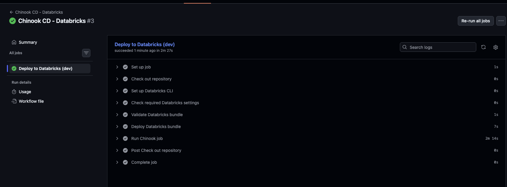

# Journal - 2026-11-18 - Turning a Portfolio Improvement into an Acceptance Criterion

Use this version only if you want more structure. The basic `entry.md` is enough for most days.

## Today in one sentence
- A portfolio improvement becomes useful only when I can describe the current gap, the expected behavior, and the evidence that will prove the change works.

## What I learned
- Today's verified practice log asks me to review one portfolio project and note one improvement, but the answer section is still blank. I should treat that as an open exercise rather than evidence that I completed a review.
- A useful review is a **gap analysis**: I compare the current state with a desired state. For a data pipeline, the gap should be concrete. “Improve reliability” is too broad; “fail the Silver job when a required Bronze column disappears, and record the rejected schema” is specific enough to discuss, test, and review.
- The next step is to turn the gap into an **acceptance criterion**. An acceptance criterion is a condition that must be true before I call the improvement complete. A strong criterion names the trigger, the expected result, and the evidence. Example: “Given a Bronze input without `pickup_datetime`, when the Silver transformation runs, then the job fails before writing output and the test result is visible in CI.”
- The historical CI screenshot below is useful because it shows an evidence chain rather than only a green label: repository checkout, Databricks CLI setup, settings checks, bundle validation, deployment, and a job run. It does not prove anything ran today, but it illustrates the level of observable evidence I should request from a future portfolio improvement.
- I also learned to separate three kinds of work during review: a **feature** adds capability, **technical debt** makes future change harder or riskier, and **observability** makes pipeline state and failures visible. This separation helps me avoid choosing the most interesting idea when the most valuable gap may be a missing test, recovery check, or run record.

## Terms I am still learning
- **Gap analysis** - comparing what a project currently demonstrates with what it should demonstrate, then naming the missing part.
- **Acceptance criterion** - a testable statement that defines when a change is complete.
- **Observability** - the logs, metrics, lineage, and run evidence that help me understand what a pipeline did and why it failed.
- **Definition of done** - the shared completion rules for a task, including code, tests, documentation, and evidence where applicable.

## What confused me
- I am still unsure how to rank a feature gap against a reliability or documentation gap when all three would improve a portfolio project. A useful rule may be to prefer the gap that reduces the largest unproven risk, but I need to apply that rule to one real repository before I know whether it is practical.
- I also need to be careful not to confuse a configured check with a verified check. A workflow file can contain validation steps, but the acceptance criterion is not satisfied until a real run produces inspectable evidence.

## One small next step
- [ ] Open the NYC Mobility repository and write one improvement card with exactly four fields: current gap, expected behavior, acceptance criterion, and evidence link.

## Git checkpoint
- [ ] I created or updated a file
- [ ] I wrote a commit
- [ ] I pushed my changes

## Decisions or assumptions (optional)
- I chose a concept-focused reflection because the only new verified activity was the practice-log commit and its answer remained blank.
- I will not describe a portfolio review, code change, test run, or deployment as completed without repository or run evidence.
- I will use the historical CI image only as an example of observable evidence, not as evidence of activity on November 18.

## Evidence from today (optional)
- [Daily practice-log commit `3a0c070`](https://github.com/ItsYangCoder/ItsYangCoder/commit/3a0c0701d9c2bf3399837957e8788297da61b3aa) - created the prompt “Review one portfolio project and note one improvement”; the answer section is still the template placeholder.
- No new Data Engineering project commit or safe new Library image was available for November 18 at the time of this entry.

This existing repository image is safe to reuse and shows what inspectable end-to-end evidence can look like. It is historical context, not a run from today.

## Reflection (optional)
- The prompt sounds simple, but “one improvement” can hide several decisions: what problem matters, what proof is missing, and what outcome would be enough.
- The blank answer is an honest boundary. It gives me a learning direction without pretending that I reviewed a project or implemented a change.
- I want to get better at writing acceptance criteria that are narrow enough to finish in one small change but strong enough to prove something meaningful about data quality or reliability.

## Mood or meme (optional)
- A green check is comforting; a testable reason for the green check is better.
