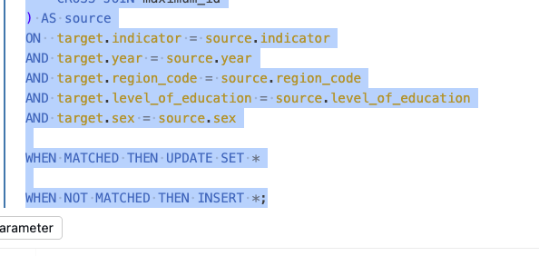

# Journal - 2026-11-19 - HAVING Checks the Group Grain

Use this version only if you want more structure. The basic `entry.md` is enough for most days.

## Today in one sentence
- `WHERE` decides which rows enter an aggregation, while `HAVING` decides which completed groups are important enough to return.

## What I learned
- Today's verified practice log asks for an ANSI SQL query using `GROUP BY` and `HAVING`, but its answer section is still blank. I am treating the prompt as a learning direction, not as evidence that I wrote or executed a query.
- `GROUP BY` changes the result's **grain**. If I group the completion-rate data by `indicator`, `year`, `region_code`, `level_of_education`, and `sex`, then one output row represents one combination of those five values. Every selected column must either belong to that grouping key or be reduced with an aggregate such as `COUNT`, `SUM`, `MIN`, or `MAX`.
- `WHERE` is evaluated before the grouping step, so it filters detail rows. `HAVING` is evaluated after groups and aggregate values exist, so it can filter with expressions such as `COUNT(*) > 1`. That distinction matters because moving a condition between the two clauses can change both which rows participate and the final aggregate.
- A practical Data Engineering use of `HAVING` is validating business grain. The learning query below asks which completion-rate keys occur more than once. I have not run it, so it is an example rather than a reported result:

```sql
SELECT
    indicator,
    year,
    region_code,
    level_of_education,
    sex,
    COUNT(*) AS row_count
FROM silver_completion_rate
WHERE region_code IS NOT NULL
GROUP BY
    indicator,
    year,
    region_code,
    level_of_education,
    sex
HAVING COUNT(*) > 1;
```

- If this query returns rows, it does not automatically prove the data is wrong. It proves that the assumed five-column key is not unique for the filtered data. The next investigation would be to check whether another dimension is missing, whether duplicate source records exist, or whether national and regional rows were mixed at the same grain.
- `HAVING COUNT(*) > 1` is useful for investigation, but a production quality check should make the expected behavior explicit: zero duplicate groups, a documented exception list, or a threshold with a clear reason. Otherwise a query can reveal a problem without defining when the pipeline should fail.

## Terms I am still learning
- **Grain** - what one row represents, including the complete set of dimensions needed to identify it.
- **Aggregate** - a value calculated from multiple rows, such as a count, sum, minimum, or maximum.
- **Predicate** - a condition that evaluates to true or false and is used to filter data.
- **Business key** - one or more meaningful columns that should identify a record at the intended business grain.

## What confused me
- I still need to verify whether `indicator + year + region_code + level_of_education + sex` is the complete Silver business key or only the merge key shown in earlier work. A merge condition is evidence of an intended match rule, but it is not proof that the source data is unique at that grain.
- I also need to remember that excluding null `region_code` values with `WHERE` would remove possible national rows before grouping. That may be correct for a regional duplicate check, but it would be wrong if the question is about the entire table.

## One small next step
- [ ] Run the duplicate-group query against the completion-rate Silver model, record the actual number of returned groups, and decide whether national rows need a separate grain check.

## Git checkpoint
- [x] I created or updated a file
- [x] I wrote a commit
- [x] I pushed my changes

## Decisions or assumptions (optional)
- I used the five columns visible in the historical merge-key screenshot as a concrete learning example; I am not claiming that they have been verified as the final business key.
- I kept the example ANSI-style and avoided engine-specific shortcuts so the `GROUP BY` and `HAVING` logic remains portable.
- I will not mark the SQL exercise complete until there is evidence that the query was written, run, and interpreted against an actual model.

## Evidence from today (optional)
- [Daily practice-log commit `5811e1f`](https://github.com/ItsYangCoder/ItsYangCoder/commit/5811e1fdcfd22a54b5bd64c5bfe18372bbd1adb1) - created the prompt “Write an ANSI SQL query using GROUP BY and HAVING”; the answer remains the template placeholder.
- No newer completed Data Engineering project change or safe new Library image was available for November 19 at the time of this entry.



This inspected repository image is safe to reuse. It grounds the example grouping columns in earlier completion-rate modeling work, but it does not show that today's query was executed.

## Reflection (optional)
- The interesting part of this prompt is not the SQL syntax alone. The harder question is whether the columns describe the correct business grain.
- A duplicate query is most useful when I write down the assumption it tests. Without that sentence, a non-empty result can be misread as a pipeline failure when it may actually reveal an incomplete key.
- I want to become more deliberate about separating row filters, grouping keys, aggregate conditions, and the data-quality decision that follows.

## Mood or meme (optional)
- `GROUP BY` builds the boxes; `HAVING` decides which boxes need attention.
