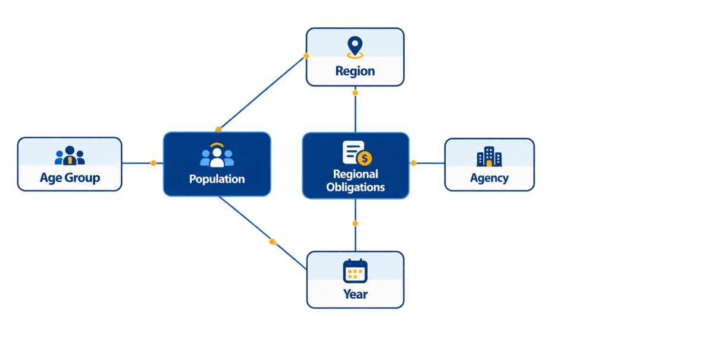

# Journal - 2026-11-20 - Facts Carry Measurements and Dimensions Set Context

Use this version only if you want more structure. The basic `entry.md` is enough for most days.

## Today in one sentence
- A fact table stores observations at a declared grain, while dimensions give those observations reusable context—and the measure type determines how I am allowed to aggregate the facts.

## What I learned
- Today's verified practice log asks me to explain the difference between a fact table and a dimension table, but its answer section is still blank. I am using the prompt as a learning reflection rather than claiming that I completed the exercise.
- A **fact table** records measurable events or observations at a specific grain. A **dimension table** describes the entities used to filter, group, and label those observations. In PondoLens, `fact_regional_expenditure` represents a year, location, and budget particular, while the Year, Region, and Agency or Particular dimensions provide the readable context.
- The distinction is not simply “numbers go in facts and text goes in dimensions.” A dimension can contain numeric attributes such as an age-group boundary. A fact can contain a descriptive status such as `match_status`. The correct question is whether a column describes the observation, identifies its context, or measures something about it.
- Measures also behave differently. PondoLens appropriation and obligation amounts are generally **additive** across compatible regions, agencies, and years. I can sum them when the grain and filters are clear. An execution rate is different because it is a ratio. Averaging row-level rates gives every row equal weight even when their budget amounts are very different.
- For a regional or yearly summary, the safer calculation is usually a weighted ratio from the underlying facts:

```sql
SELECT
    y.fiscal_year,
    SUM(f.obligation_amount) AS total_obligation,
    SUM(f.appropriation_amount) AS total_appropriation,
    SUM(f.obligation_amount)
        / NULLIF(SUM(f.appropriation_amount), 0) AS execution_rate
FROM fact_regional_expenditure AS f
JOIN dim_year AS y
    ON f.year_id = y.year_id
GROUP BY y.fiscal_year;
```

- This query is a learning example and was not executed today. Its main idea is that facts provide the numerator and denominator, while the dimension controls the reporting slice. The rate is calculated after aggregation so large and small budget rows contribute according to their amounts.
- A dimension join can also change results if its key is not unique. If one `year_id` matches two dimension rows, the fact rows can be multiplied before aggregation. This is why primary-key uniqueness in dimensions and foreign-key relationships from facts are data-quality requirements, not only modeling conventions.
- The inspected diagram below shows a small fact constellation: Population and Regional Obligations are separate facts that share Region and Year dimensions. They can be compared through conformed dimensions, but I should first aggregate each fact to a compatible grain rather than joining detailed fact rows directly.

## Terms I am still learning
- **Fact table** - a table of measurable observations stored at a declared grain.
- **Dimension table** - a table of descriptive context used to identify, filter, group, and label facts.
- **Additive measure** - a measure that can be summed across all intended dimensions when the grains are compatible.
- **Semi-additive measure** - a measure that can be summed across some dimensions but not all, such as a balance that should not be added across time.
- **Conformed dimension** - a shared dimension used consistently by multiple fact tables.
- **Fan-out** - accidental row multiplication caused by a join where one key matches multiple rows.

## What confused me
- I still need to decide how the project should document `execution_rate`: as a stored convenience value, a reporting calculation, or both. Storing it can make row-level inspection easy, but higher-level reports should still recompute the ratio from summed amounts.
- I also need to be precise about which directions are valid for adding financial measures. Summing across agencies or regions can answer a business question, while summing a ratio or mixing national and regional grains can produce a number that looks valid but has no clear meaning.

## One small next step
- [ ] Run one PondoLens query that compares `AVG(execution_rate)` with `SUM(obligation_amount) / SUM(appropriation_amount)` for a single fiscal year, then document why the results match or differ.

## Git checkpoint
- [x] I created or updated a file
- [x] I wrote a commit
- [x] I pushed my changes

## Decisions or assumptions (optional)
- I focused on measure behavior because the basic fact-versus-dimension definition was already covered in earlier journal entries.
- I used the documented PondoLens Gold model as the concrete example and did not claim that the sample query was executed.
- I excluded today's invitation-letter images because they are unrelated to Data Engineering and contain personal document information.
- I reused one existing technical repository image after inspecting it for relevance and sensitive information.

## Evidence from today (optional)
- [Daily practice-log commit `e24dbe7`](https://github.com/ItsYangCoder/ItsYangCoder/commit/e24dbe7aaefce9cdd134abc45df6fc8337c119f3) - created the prompt “Explain the difference between a fact table and a dimension table”; its answer remains the template placeholder.
- [PondoLens data-model guide](https://github.com/ItsYangCoder/ph-government-budget-analysis/blob/main/docs/data_model.md) - documents the Gold facts, dimensions, grains, and reporting rules.
- No newer completed Data Engineering implementation was verified for November 20 at the time of this entry.



This inspected repository image is safe to reuse. It shows how separate facts can share dimensions; it is historical model context, not evidence of a new implementation today.

## Reflection (optional)
- This prompt looks basic, but the practical difference between facts and dimensions appears when I write a report. The dimension decides the slice; the fact provides the measurements; and the measure type decides whether the calculation is valid.
- A clean schema does not protect me from a mathematically wrong aggregation. I still need to understand what each measure means and which dimensions can be combined.
- I want to become more careful with percentages and rates because they can look reasonable even when the aggregation method is wrong.

## Mood or meme (optional)
- Facts hold the numbers; dimensions explain which numbers I am looking at.
