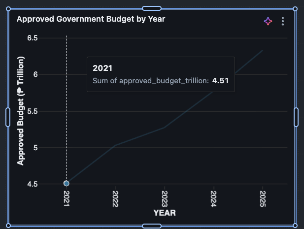

# Journal - 2026-11-21 - Full Outer Joins Preserve Reconciliation Evidence

Use this version only if you want more structure. The basic `entry.md` is enough for most days.

## Today in one sentence
- A full outer join is valuable in reconciliation because it keeps matched records and exposes keys that exist on only one side instead of silently dropping them.

## What I learned
- Today's verified practice log asks me to practice one SQL join and describe its expected result, but the answer section is still blank. I am using the prompt for a learning reflection and not claiming that I executed a new query.
- I chose a **full outer join** because it matches a real PondoLens modeling problem. Regional appropriations and regional obligations describe related budget records, but a business key can appear in both sources, in appropriations only, or in obligations only. An inner join would keep only the matched intersection and hide the unmatched evidence.
- The expected output of a full outer join is the union of keys from both inputs. A matched key has columns from both sides. A left-only key has nulls for the right-side columns. A right-only key has nulls for the left-side columns. Those nulls are not automatically data errors; they show which source did not provide a match.
- A reconciliation query can preserve the complete key with `COALESCE` and explain the source relationship with a status:

```sql
SELECT
    COALESCE(a.fiscal_year, o.fiscal_year) AS fiscal_year,
    COALESCE(a.region_code, o.region_code) AS region_code,
    COALESCE(a.particular_code, o.particular_code) AS particular_code,
    a.appropriation_amount,
    o.obligation_amount,
    CASE
        WHEN a.particular_code IS NOT NULL
         AND o.particular_code IS NOT NULL THEN 'MATCHED'
        WHEN a.particular_code IS NOT NULL THEN 'APPROPRIATION_ONLY'
        ELSE 'OBLIGATION_ONLY'
    END AS match_status
FROM silver_regional_appropriations AS a
FULL OUTER JOIN silver_regional_obligations AS o
    ON  a.fiscal_year = o.fiscal_year
    AND a.region_code = o.region_code
    AND a.particular_code = o.particular_code;
```

- This is a learning example and was not run today. Its expected result is one combined row for each distinct business key, with amounts from whichever sources contain that key and a status that makes the relationship explicit.
- Filter placement is important. If I add `WHERE o.obligation_amount IS NOT NULL` after the join, appropriation-only rows disappear and the result behaves more like a right-side-preserving join. If I need to filter the obligations source while retaining unmatched appropriation keys, I should filter the obligations input before the full outer join, usually in a CTE.
- Duplicate keys are another risk. If either source contains two rows for the same join key, one row can match multiple rows and create a **fan-out**. Before trusting the joined amounts, I should validate uniqueness at the intended grain or aggregate each source to that grain first.
- The historical dashboard image below shows a yearly approved-budget result. A chart can look complete even if unmatched source rows were removed upstream, so the reporting layer should be backed by match-status counts and source-to-Gold reconciliation—not only by a visually reasonable trend.

## Terms I am still learning
- **Full outer join** - a join that retains matched rows plus unmatched rows from both inputs.
- **Intersection** - the keys present in both datasets.
- **Set difference** - keys present in one dataset but absent from the other.
- **COALESCE** - a function that returns the first non-null value and can preserve a key from either side of an outer join.
- **Fan-out** - unexpected row multiplication when one join key matches multiple rows.
- **Reconciliation** - proving how source keys, row counts, and measures are represented after transformation.

## What confused me
- I still need to verify the exact canonical business key used by the current PondoLens appropriations and obligations models. The example uses year, region, and particular code, but the production key may require additional normalized fields.
- I also need to distinguish a genuine missing match from a naming or mapping problem. Two records may describe the same agency or budget item but fail to join because their codes, labels, geographic levels, or year formats were standardized differently.

## One small next step
- [ ] Run a full-outer-join diagnostic on one PondoLens fiscal year and record the counts of `MATCHED`, `APPROPRIATION_ONLY`, and `OBLIGATION_ONLY` rows before any reporting filters.

## Git checkpoint
- [x] I created or updated a file
- [x] I wrote a commit
- [x] I pushed my changes

## Decisions or assumptions (optional)
- I selected a full outer join because left anti join direction was already covered in a recent entry.
- I used PondoLens budget reconciliation as the concrete example, but I did not claim that the sample query was executed or that its example key is the final production key.
- No new Library image was available, so I inspected and reused an existing technical repository screenshot.
- I will treat unmatched rows as evidence to investigate, not as rows to delete automatically.

## Evidence from today (optional)
- [Daily practice-log commit `0db9c7d`](https://github.com/ItsYangCoder/ItsYangCoder/commit/0db9c7d9a454aebb823550cef7da8b45335248c5) - created the prompt “Practice one SQL JOIN and describe the expected result”; the answer remains the template placeholder.
- [PondoLens Gold regional-expenditure notebook](https://github.com/ItsYangCoder/ph-government-budget-analysis/blob/dev/databricks/notebook/04_gold/fact_regional_expenditure.ipynb) - project evidence for combining budget sources and preserving match status.
- No newer completed Data Engineering implementation was verified for November 21 at the time of this entry.



This inspected repository image is safe to reuse. It shows a historical reporting result that depends on trustworthy upstream joins; it is not evidence that today's example query was executed.

## Reflection (optional)
- A join is not only a way to attach columns. It decides which records survive into the next layer, so the join type is part of the data-quality policy.
- A clean dashboard can hide missing source relationships if the pipeline removes unmatched rows too early. Keeping a match status makes the uncertainty visible and reviewable.
- I want to become more consistent about writing the expected set behavior before writing the SQL: intersection only, left preservation, right preservation, or complete reconciliation.

## Mood or meme (optional)
- An unmatched row is not noise—it may be the most useful evidence in the join.
