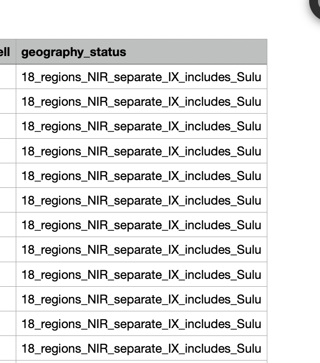

# Journal - 2026-11-22 - Delta Snapshots Keep Reads Consistent

Use this version only if you want more structure. The basic `entry.md` is enough for most days.

## Today in one sentence
- Delta Lake uses a versioned transaction log so a reader can see one committed table snapshot instead of a mixture of files from different moments.

## What I learned
- Today's verified practice log asks me to explain one Databricks Delta Lake concept in two or three sentences, but its answer section is still blank. I am using the prompt for a learning reflection rather than claiming that I completed or ran a Databricks exercise.
- The concept I chose is **snapshot isolation for reads**. For one Delta table, a read resolves a committed table version from the transaction log and uses the data files that belong to that version. If another writer commits a newer version while the read is running, the reader continues using its consistent snapshot instead of partly seeing the old state and partly seeing the new state.
- The **transaction log** is what makes the table more than a folder of Parquet files. Each successful commit creates a new table version and records which files are valid for that version. A data file written during a failed transaction does not become part of the table state unless the transaction log commits it.
- This also explains **atomicity** in simple terms: the table change becomes visible as one committed version or it does not become visible at all. Readers should not observe half of a successful batch merely because some files were written earlier than others.
- Snapshot isolation does not mean that data never changes. It means each read has a stable view. A later query can start from a newer snapshot and return newer data. Therefore, two queries run at different times may both be correct even if their counts differ, as long as they read different committed versions.
- This matters for PondoLens profiling and reconciliation. If I profile a Bronze table and then a pipeline commits a new version before I run the next query, the second query may use a newer snapshot. To make evidence reproducible, I should record the table name, query, run time, and Delta version—or deliberately query a fixed historical version where appropriate.
- The following commands are examples only; I did not run them today:

```sql
DESCRIBE HISTORY <catalog.schema.bronze_table>;

SELECT *
FROM <catalog.schema.bronze_table>
VERSION AS OF <verified_version>;
```

- The first command helps identify committed versions and operations. The second makes the selected snapshot explicit. Before using time travel as evidence, I still need to verify that the requested version is retained and available.
- Databricks currently documents snapshot isolation for reads and WriteSerializable isolation for writes by default. These are related but different guarantees: snapshot isolation protects the reader's view, while write isolation and conflict validation control which concurrent writes may commit.

## Terms I am still learning
- **Transaction log** - versioned metadata that records committed table changes and which data files form each table state.
- **Snapshot** - one consistent committed view of a table at a specific version.
- **Snapshot isolation** - a read guarantee that keeps a query on a consistent snapshot while newer commits may occur.
- **Atomicity** - a transaction becomes visible completely or not at all.
- **Table version** - the sequential version number created by a successful Delta commit.
- **Time travel** - reading an earlier retained Delta table version by version number or timestamp.

## What confused me
- I still need to separate a Delta table snapshot from a Structured Streaming checkpoint. The Delta snapshot describes a table state; a streaming checkpoint records a query's progress and recovery information. Both involve consistency, but they solve different problems.
- I also need to remember that separate reads of multiple tables do not automatically mean one shared cross-table snapshot. If a report depends on several tables changing together, I need to understand the transaction scope and the project's orchestration rules instead of assuming all tables were frozen at one instant.

## One small next step
- [ ] Run `DESCRIBE HISTORY` on one PondoLens Bronze Delta table, record the latest version and operation, then rerun one profiling query with an explicit verified version.

## Git checkpoint
- [x] I created or updated a file
- [x] I wrote a commit
- [x] I pushed my changes

## Decisions or assumptions (optional)
- I focused on read snapshots because optimistic concurrency for writers was already covered in a recent journal entry.
- I used placeholder table identifiers in the SQL so I would not invent a current production table name.
- I did not treat the blank practice prompt as evidence of an executed Databricks task.
- No new relevant Library image was available, so I inspected and reused an existing technical repository screenshot.

## Evidence from today (optional)
- [Daily practice-log commit `af08fed`](https://github.com/ItsYangCoder/ItsYangCoder/commit/af08fed0bf32acbcfb20f17afe404411540267a0) - created the prompt “Explain one Databricks Delta Lake concept in two or three sentences”; the answer remains the template placeholder.
- [Databricks documentation: ACID guarantees](https://docs.databricks.com/aws/en/lakehouse/acid) - explains transaction-log commits, table versions, atomicity, snapshot isolation for reads, and default write isolation.
- No newer completed Data Engineering implementation was verified for November 22 at the time of this entry.



This inspected repository image is safe to reuse. It represents historical profiling evidence; it does not identify the Delta table version or prove that a snapshot query was executed today.

## Reflection (optional)
- The useful idea is that a Delta table is not simply every file currently visible in a directory. Its committed log defines the valid table state.
- A screenshot of query output is easier to trust when it also records which table version produced the result. Without that detail, a later rerun can differ and still be technically correct.
- I want to become more disciplined about capturing version information when I use profiling results as engineering evidence.

## Mood or meme (optional)
- Same table name, different committed version—both can be correct if I record the snapshot.
