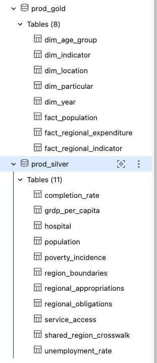

# Journal - 2026-11-23 - NULL Missingness and Duplicate Grain Need Different Rules

## Today in one sentence
- A useful data-quality rule must distinguish a missing required key, a legitimately missing measure, and a duplicate business grain instead of treating every NULL or repeated row as the same failure.

## What I learned
- Today’s verified practice prompt asks for a data-quality check for NULL or duplicate values, but the answer section is still blank. I am treating this as a learning reflection, not as evidence that I ran a query or implemented a test.
- A **NULL check** and a **duplicate check** protect different parts of a model. In a PondoLens Silver table such as `service_access`, fields that identify a record—such as year, region, and indicator—are candidate business-key fields. If one of those required fields is NULL, the row cannot be placed reliably at its intended grain.
- A duplicate check asks whether more than one row exists at the complete business grain. The important word is complete: grouping only by year and region can produce false alarms if indicator, age group, sex, or another legitimate dimension also belongs to the grain.
- NULL does not always mean bad data. A NULL measure can mean “not reported,” “not applicable,” or “unknown.” Replacing it with zero would make a stronger claim: that the measured amount is exactly none. For PondoLens, preserving this difference matters because a missing service-access or completion-rate value should not silently become a real zero.
- The safer design is conditional: require identifiers to be non-null, test uniqueness at the documented grain, and allow nullable measures only when the model contract explains their meaning. If a source provides a status or missing-reason column, that field can make the rule more explicit.
- This is the shape of the check I would write after confirming the table contract. It is illustrative SQL and was **not executed today**:

```sql
WITH null_keys AS (
    SELECT *
    FROM service_access
    WHERE year IS NULL
       OR region_code IS NULL
       OR indicator IS NULL
),
duplicate_grain AS (
    SELECT
        year,
        region_code,
        indicator,
        COUNT(*) AS row_count
    FROM service_access
    GROUP BY year, region_code, indicator
    HAVING COUNT(*) > 1
)
SELECT 'NULL_KEY' AS issue_type, COUNT(*) AS issue_count
FROM null_keys
UNION ALL
SELECT 'DUPLICATE_GRAIN', COUNT(*)
FROM duplicate_grain;
```

- For a dbt singular test, I would usually return the failing records rather than only a count. A successful test then returns zero rows, while a failure preserves the exact records needed for debugging.

## Terms I am still learning
- **missingness** - the condition and meaning of a value not being present; it is not automatically the same as zero.
- **business key** - the field or combination of fields that identifies one real-world record.
- **grain** - the exact meaning of one row, including every dimension needed to make that row unique.
- **false positive** - a test result that reports an error even though the data is valid under the real business rules.
- **quarantine** - keeping suspicious records separate so they can be investigated without contaminating trusted outputs.

## What confused me
- The SQL syntax for `IS NULL` is simple; the difficult part is deciding whether NULL is forbidden for that specific column. I still need the source contract or model documentation before declaring a nullable measure invalid.
- I also cannot assume that `year + region_code + indicator` is the full grain. A table may need another dimension, such as category or demographic group. The uniqueness test is only correct after that key is documented.

## One small next step
- [ ] Inspect one PondoLens Silver model and its schema documentation, write down the required key columns versus allowed nullable measures, then add one zero-row data-quality test for that documented rule.

## Git checkpoint
- [ ] I created or updated a file
- [ ] I wrote a commit
- [ ] I pushed my changes

## Decisions or assumptions (optional)
- I separated required identifiers from optional measures instead of recommending a blanket `not_null` rule.
- I did not claim that the example SQL passed because there is no verified execution result in today’s accessible evidence.
- No new relevant Library screenshot was available, so I reused an inspected repository image that shows the actual PondoLens Silver and Gold table inventory.

## Evidence from today (optional)
- [Daily Data Engineering Practice — 2026-11-22](https://github.com/ItsYangCoder/ItsYangCoder/commit/20257894bbbff4031bc2f3d543214411494ee801) — the newest verified activity contains the NULL-or-duplicate prompt and an empty answer section.
- [PondoLens dbt models](https://github.com/ItsYangCoder/ph-government-budget-analysis/tree/main/dbt/models) — the project context for the Silver and Gold models discussed here.
- [Repository image source](https://github.com/ItsYangCoder/ftw-b12-journal/blob/main/assets/2026-10-22-silver-health-coverage.png)



The catalog screenshot is useful evidence of the actual model inventory. It is not presented as proof that today’s illustrative SQL was executed.

## Reflection (optional)
- What felt easy today? The mechanical checks—`IS NULL` and `GROUP BY ... HAVING COUNT(*) > 1`—are straightforward to express.
- What felt difficult today? The harder reasoning is deciding what a valid row means before turning a query into a blocking test.
- What do I want to understand better next time? I want to trace one Silver table from its source columns to its documented grain, nullable measures, and Gold consumers so the quality rule protects meaning rather than only syntax.

## Mood or meme (optional)
- A data-quality test is only as smart as the contract behind it. 🔎
