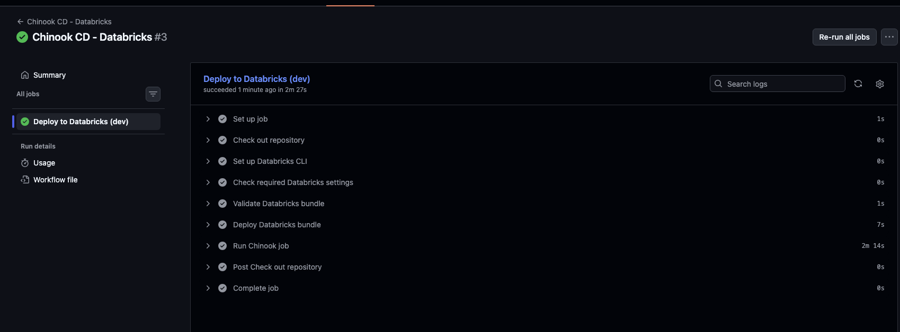

# Journal - 2026-11-24 - Reproducible Python Dependencies in CI

## Today in one sentence
- My NYC Mobility tests can be repeatable only if the code, Python version, and dependency versions are controlled together.

## What I learned
- Today’s verified practice prompt says to review one portfolio project and note one improvement, but its answer section is still blank. I reviewed the current NYC Mobility ingestion repository and found a specific improvement opportunity rather than presenting the prompt as completed work.
- The repository already makes one good reproducibility decision: both the README and GitHub Actions workflow use Python 3.12, and CI installs the same `requirements.txt` before running `pytest -q`.
- However, every entry in `requirements.txt` is currently unconstrained: `requests`, `beautifulsoup4`, `duckdb`, `pyarrow`, `boto3`, `python-dotenv`, and `pytest`. This means two clean installations on different dates can resolve different package versions even when the repository commit is identical.
- A passing CI run proves that one resolved environment worked at one moment. It does not guarantee that a later resolver will choose the same versions. A new direct or transitive release can therefore change behavior, break an import, or alter test results without any application-code change.
- A **direct dependency** is a package the project explicitly asks for. A **transitive dependency** is installed because a direct dependency needs it. Constraining only the seven direct packages reduces variation, but it does not fully describe the transitive environment.
- I see three practical levels of control:
  1. Version ranges, such as `pyarrow>=18,<19`, express compatibility but still allow different installs.
  2. Exact pins, such as `pyarrow==18.1.0`, make direct versions stable but do not necessarily pin the entire dependency graph.
  3. A generated constraints or lock file records the resolved graph, while a short input file keeps the human-maintained requirements readable.
- For this portfolio project, a small input-plus-constraints approach looks appropriate: keep the direct packages understandable, generate a Python 3.12 constraints file from a clean environment, and make local validation and CI install through the same constraint. The exact tool and versions still need to be chosen and tested.
- The intended validation sequence would be: create a clean Python 3.12 environment, resolve the dependencies, run the complete offline pytest suite, rebuild a second clean environment from the recorded versions, and run the tests again. I did **not** perform those steps today.

## Terms I am still learning
- **dependency pinning** - restricting a package to a specific version so the installer does not silently choose a newer one.
- **version constraint** - a rule that limits which versions are acceptable, such as a minimum and maximum.
- **lock file** - a generated record of exact resolved packages, often including transitive dependencies.
- **transitive dependency** - a package installed because another dependency requires it, even though the project did not list it directly.
- **reproducible build** - an environment that can be recreated from the same declared inputs with the same meaningful result.

## What confused me
- Exact pins improve repeatability, but they can also leave a project on old or vulnerable packages if updates are never reviewed. Reproducibility therefore needs a maintenance process, not only a frozen file.
- I still need to decide whether a constraints file, `pip-tools`, or another lock format best fits this repository. The correct choice depends on whether the project is treated as a deployable application or a reusable Python library.
- A single operating-system CI job may still hide platform differences. The current pipeline runs on Ubuntu, so I should not claim that one lock automatically proves compatibility with every local machine.

## One small next step
- [ ] On a feature branch, generate a Python 3.12 constraints file from the current direct dependencies, install from it in a second clean environment, and record whether the full offline pytest suite passes unchanged.

## Git checkpoint
- [x] I created or updated a file
- [x] I wrote a commit
- [x] I pushed my changes

## Decisions or assumptions (optional)
- I selected dependency reproducibility because the repository evidence shows a fixed Python version and CI tests alongside an unconstrained requirements file.
- I am recommending an experiment, not claiming that dependency locking has already been implemented.
- No new relevant Library image was available, so I reused an inspected repository screenshot of a successful Databricks CI job. It contains no credentials, private URLs, or personal information.

## Evidence from today (optional)
- [Daily practice prompt for 2026-11-24](https://github.com/ItsYangCoder/ItsYangCoder/commit/46a3d06bb63ce1094e295bdfed725943cb44e7e4) — the newest verified activity asks for one portfolio improvement and contains no completed answer.
- [NYC Mobility README](https://github.com/ItsYangCoder/nyc-mobility-ingestion-pipeline/blob/main/README.md) — documents Python 3.12, local installation, pytest, and the current main-branch scope.
- [Current requirements file](https://github.com/ItsYangCoder/nyc-mobility-ingestion-pipeline/blob/main/requirements.txt) — lists the direct packages without version constraints.
- [Current test workflow](https://github.com/ItsYangCoder/nyc-mobility-ingestion-pipeline/blob/main/.github/workflows/tests.yml) — installs that requirements file and runs pytest on Ubuntu with Python 3.12.
- [Repository image source](https://github.com/ItsYangCoder/ftw-b12-journal/blob/main/assets/ci-cd-databricks-dev-success.png)

This older repository screenshot illustrates a successful CI execution chain. It is context for why repeatable environments matter, not proof that today’s dependency-improvement experiment was run.

## Reflection (optional)
- What felt easy today? It was easy to compare the README, requirements file, and workflow because they expose the environment assumptions directly.
- What felt difficult today? The difficult part is balancing repeatability with maintainability: freezing everything prevents surprise upgrades, but a frozen environment still needs deliberate updates and security review.
- What do I want to understand better next time? I want to compare the resolved dependency graph before and after adding constraints, then see whether the repository can document a simple update routine that keeps CI stable without making dependencies stale.

## Mood or meme (optional)
- “Works on my machine” becomes less mysterious when the machine’s dependencies are part of the evidence. 📌
