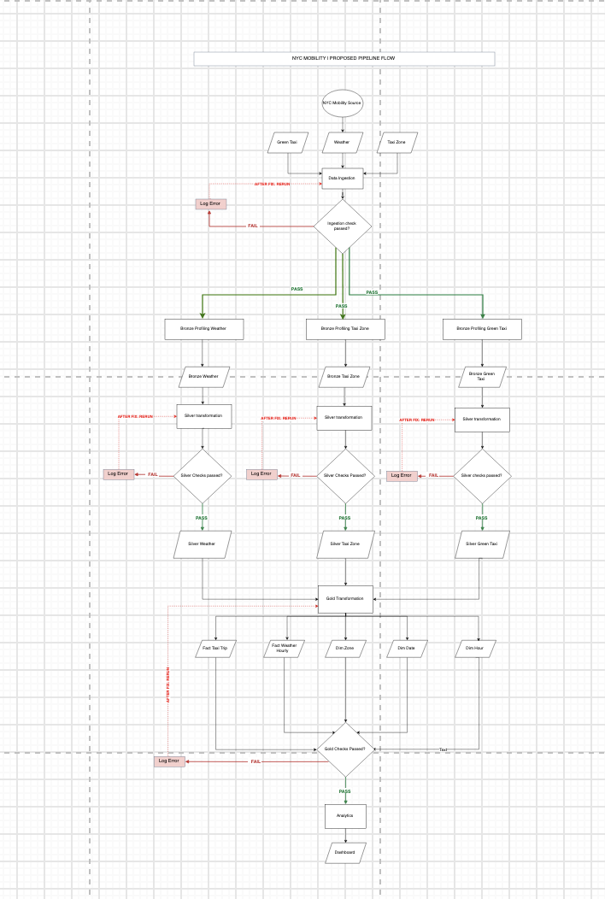

# Journal - 2026-11-25 - Offline Tests and the Databricks Boundary

## Today in one sentence
- Offline pytest coverage can prove ingestion logic without network access, but a separate Databricks smoke test is still needed to prove that the platform boundary works.

## What I learned
- I found no new Data Engineering implementation commit today, so this entry is a learning reflection based on the current NYC Mobility repository rather than a claim that I executed new tests.
- The existing offline suite has a clear purpose. It uses temporary files, blocks unexpected network calls, and substitutes controlled HTTP responses. The tests verify useful behaviors such as rejecting invalid weather timestamps, rejecting mismatched arrays, reusing a valid download, preserving an invalid existing file for investigation, rejecting bad Taxi Zone keys, rejecting an empty or wrong Green Taxi schema, and cleaning up a partial download after an interruption.
- Those checks are deterministic because they do not depend on a live API, credentials, a downloaded production dataset, or a Databricks workspace. That makes them fast and appropriate for pull-request CI.
- The same strength creates a boundary. The repository README explicitly says that the offline suite does not exercise Databricks Bronze execution or Unity Catalog Volume access. A green pytest job therefore proves the Python ingestion contract, but it does not prove workspace authentication, catalog and schema permissions, Volume paths, Spark Declarative Pipeline configuration, or actual Bronze table creation.
- I should treat these as different evidence layers:
  1. **Offline regression tests** protect pure Python behavior and file-handling rules.
  2. **Contract checks** verify expected names, schemas, configuration, and interfaces before deployment.
  3. **Platform smoke tests** run the smallest real operation in a development workspace to prove that authentication, permissions, storage, and runtime wiring work together.
  4. **End-to-end validation** proves that representative source data reaches the intended Bronze, Silver, Gold, and analytics outputs.
- A useful Databricks smoke test should be deliberately small. For example, it could validate the deployment bundle, confirm that the configured catalog, schema, and Volume are reachable, run one minimal Bronze task against a tiny controlled fixture, assert an expected row count and schema, and then clean up the test object. This is a proposed design, not something I ran today.
- The test should fail with a useful message at the boundary that broke. “Pipeline failed” is less helpful than “Volume path is not readable,” “catalog USE permission is missing,” or “Bronze schema does not match the contract.”
- The existing CI workflow currently runs only on pull requests to `development` and `main`, installs the Python requirements, and runs `pytest -q`. That is good evidence for the offline layer. A future workspace smoke test should remain separate so ordinary contributors can run unit tests without Databricks credentials and so secrets are not exposed to untrusted pull-request code.

## Terms I am still learning
- **test double** - a controlled replacement for a real dependency, such as a mocked HTTP response.
- **contract test** - a check that two connected components agree on names, fields, formats, or behavior.
- **smoke test** - a small real execution that verifies the most important wiring works before deeper testing.
- **integration test** - a test that exercises multiple real components together instead of isolating one function.
- **test boundary** - the line between what a test actually exercises and what remains outside its evidence.

## What confused me
- A mocked test can verify how my code responds to an API result, but it cannot prove that the live API, storage path, or workspace permissions are currently available. I need to state that difference every time I describe test evidence.
- I still need to decide where the Databricks smoke test should run. Running it on every pull request gives fast feedback, but it introduces credential, cost, concurrency, and cleanup concerns. Running it only after merge is safer but detects platform problems later.
- Cleanup is part of the test design. A smoke test that leaves tables, files, or checkpoints behind can make a later run pass or fail for the wrong reason.

## One small next step
- [ ] Draft one minimal NYC Mobility Databricks smoke-test specification with its fixture, required permissions, expected schema and row count, cleanup action, and safe workflow trigger—without adding credentials to the repository.

## Git checkpoint
- [ ] I created or updated a file
- [ ] I wrote a commit
- [ ] I pushed my changes

## Decisions or assumptions (optional)
- I kept the current offline pytest suite as the fast pull-request gate and treated the workspace smoke test as a separate future layer.
- I did not claim that Databricks execution, Volume access, or an end-to-end run passed today.
- No new relevant Library image was available, so I reused an inspected repository image of the NYC Mobility pipeline and its quality gates. The diagram contains no credentials, private URLs, or personal data.

## Evidence from today (optional)
- [NYC Mobility README](https://github.com/ItsYangCoder/nyc-mobility-ingestion-pipeline/blob/main/README.md) — documents the implemented offline tests and explicitly excludes Databricks Bronze execution and Volume access from their scope.
- [Offline ingestion tests](https://github.com/ItsYangCoder/nyc-mobility-ingestion-pipeline/blob/main/tests/test_ingestion.py) — shows temporary files, blocked unexpected network access, mocked responses, validation failures, reuse behavior, and partial-file cleanup.
- [Pull-request test workflow](https://github.com/ItsYangCoder/nyc-mobility-ingestion-pipeline/blob/main/.github/workflows/tests.yml) — installs the Python environment and runs pytest on pull requests.
- [Repository image source](https://github.com/ItsYangCoder/ftw-b12-journal/blob/main/assets/2026-09-24-pipeline-quality-gates.png)

The diagram shows the intended sequence of checks across pipeline layers. It is architecture context, not evidence that the full flow was executed today.

## Reflection (optional)
- What felt easy today? The repository makes the offline boundary visible because the README and tests clearly say that credentials, live downloads, and Databricks are not required.
- What felt difficult today? The difficult part is designing a real platform check that is useful but still safe, inexpensive, isolated, and repeatable.
- What do I want to understand better next time? I want to define the smallest Databricks operation that proves the NYC Mobility namespace and Bronze wiring without turning every pull request into a full pipeline run.

## Mood or meme (optional)
- A green test means “the tested boundary passed,” not “every connected system is healthy.” 🧪
