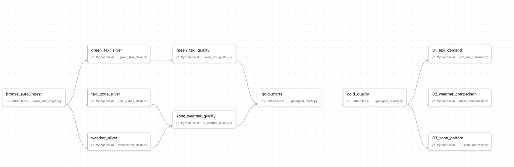

# Journal - 2026-11-26 - Expected Hours Before HAVING

## Today in one sentence
- A `GROUP BY` and `HAVING` coverage check is trustworthy only when I define the expected hours correctly, including the source timezone’s daylight-saving behavior.

## What I learned
- The newest verified practice log asks for an ANSI SQL query using `GROUP BY` and `HAVING`, but its answer section is blank. I am using it as a learning prompt and not as evidence that I executed a query today.
- NYC Mobility gives me a real case for group-level validation. The weather ingestion code requests hourly temperature, precipitation, and wind speed in the `America/New_York` timezone. It rejects missing timestamps, invalid timestamps, duplicate timestamps, and arrays whose lengths do not match the timestamp array.
- A verified project commit also added a reusable Bronze weather coverage rule. The rule compared total rows, distinct hours, the first hour, and the last hour with an expected monthly range. Its tests accepted 744 observations for March and rejected missing or duplicate interior hours.
- `GROUP BY` changes row-level weather observations into one result per validation group, such as one calendar day. `HAVING` then filters those completed groups. That is different from `WHERE`, which filters individual rows before the aggregation exists.
- A first draft might be:

```sql
SELECT
    CAST(weather_hour AS DATE) AS service_date,
    COUNT(*) AS observed_rows,
    COUNT(DISTINCT weather_hour) AS distinct_hours
FROM silver_weather
GROUP BY CAST(weather_hour AS DATE)
HAVING COUNT(*) <> COUNT(DISTINCT weather_hour)
    OR COUNT(DISTINCT weather_hour) <> 24;
```

- This query can expose duplicate hours and days that do not contain 24 distinct timestamps, but the number 24 is a business assumption. It also cannot report a completely absent day because no source row exists to create that group.
- A safer pattern starts from an independent expected calendar or hour spine:

```sql
SELECT
    expected.service_date,
    expected.expected_hours,
    COUNT(weather.weather_hour) AS observed_rows,
    COUNT(DISTINCT weather.weather_hour) AS distinct_hours
FROM expected_weather_days AS expected
LEFT JOIN silver_weather AS weather
    ON CAST(weather.weather_hour AS DATE) = expected.service_date
GROUP BY
    expected.service_date,
    expected.expected_hours
HAVING COUNT(DISTINCT weather.weather_hour) <> expected.expected_hours
    OR COUNT(weather.weather_hour) <> COUNT(DISTINCT weather.weather_hour);
```

- The left join preserves an expected day even when zero observations arrived. The first `HAVING` condition checks completeness; the second checks whether duplicate timestamps inflated the row count.
- The expected table should not blindly contain 24 for every local date. The project explicitly uses `America/New_York`, where daylight-saving transitions can change the number or identity of local wall-clock hours. I need to confirm how the source API represents those timestamps—local time, UTC, or local time with an offset—before declaring 23 or 25 observations invalid.
- This does not prove that the current tested rule is wrong. It identifies a contract question: does the project require a fixed 24 API records per date, or every real elapsed hour in the selected timezone? The correct SQL and Python check depend on that answer.
- I did not run either SQL example today. They are reviewable designs based on verified repository behavior.

## Terms I am still learning
- **hour spine** - an independent table containing every timestamp that the pipeline expects to receive.
- **wall-clock time** - the local time shown in a timezone, which can repeat or skip during daylight-saving transitions.
- **coverage check** - a rule that compares observed records with the complete set that should exist.
- **group-level predicate** - a condition evaluated after aggregation, normally written in `HAVING`.
- **contract assumption** - a rule about source behavior that must be confirmed before it becomes a test.

## What confused me
- Counting rows and counting distinct timestamps answer different questions. A missing hour plus a duplicated hour can still produce the expected total row count, so total count alone can hide two defects that cancel each other numerically.
- A day-level query over only observed data cannot distinguish “the whole day is absent” from “the date was outside the query scope.” That is why the expected date set must come from somewhere independent.
- I still do not have verified evidence for how Open-Meteo represented the March 2026 daylight-saving transition in the acquired file. I should inspect the real timestamps before changing a rule that currently expects 744 March records.

## One small next step
- [ ] Inspect the acquired March weather timestamps around the `America/New_York` daylight-saving transition, document the API’s actual timestamp contract, and compare it with the current `days × 24` expectation.

## Git checkpoint
- [x] I created or updated a file
- [x] I wrote a commit
- [x] I pushed my changes

## Decisions or assumptions (optional)
- I extended the `HAVING` prompt into a real coverage problem instead of repeating the earlier duplicate-group example.
- I kept the SQL illustrative and did not claim a successful execution or a confirmed daylight-saving defect.
- The two new Library images are salary and job-offer screenshots, so I excluded them as unrelated and sensitive to the journal topic.
- I reused an inspected repository image of the NYC Mobility file-based job graph. It contains technical task names only and no credentials, private URLs, or personal data.

## Evidence from today (optional)
- [Daily practice prompt](https://github.com/ItsYangCoder/ItsYangCoder/commit/fec022b24fbf6b28de6bdea1dd5479546746a5b0) — asks for `GROUP BY` and `HAVING`, with no completed answer.
- [Current weather ingestion code](https://github.com/ItsYangCoder/nyc-mobility-ingestion-pipeline/blob/main/ingestion/weather.py) — requests hourly variables in `America/New_York` and validates timestamp uniqueness and aligned array lengths.
- [Tested Bronze weather coverage rule](https://github.com/ItsYangCoder/nyc-mobility-data-pipeline/commit/9053247bfa2c48d7670081c6c4d6872060bdea49) — verifies total rows, distinct hours, first and last timestamps, including the 744-row March test case.
- [Repository image source](https://github.com/ItsYangCoder/ftw-b12-journal/blob/main/assets/2026-09-25-file-job-quality-gates.png)



The job graph shows where weather validation sits before Gold modeling and the weather-comparison analysis. It is architectural evidence, not proof that today’s illustrative SQL was executed.

## Reflection (optional)
- What felt easy today? Writing `GROUP BY` and `HAVING` is straightforward once the validation group is clear.
- What felt difficult today? The difficult part is defining “complete” without converting an unverified timezone assumption into a hard failure.
- What do I want to understand better next time? I want to inspect actual source timestamps and learn whether the pipeline should validate local labels, UTC instants, or both.

## Mood or meme (optional)
- Before I count missing hours, I should make sure the clock agrees with my definition of an hour. ⏱️
