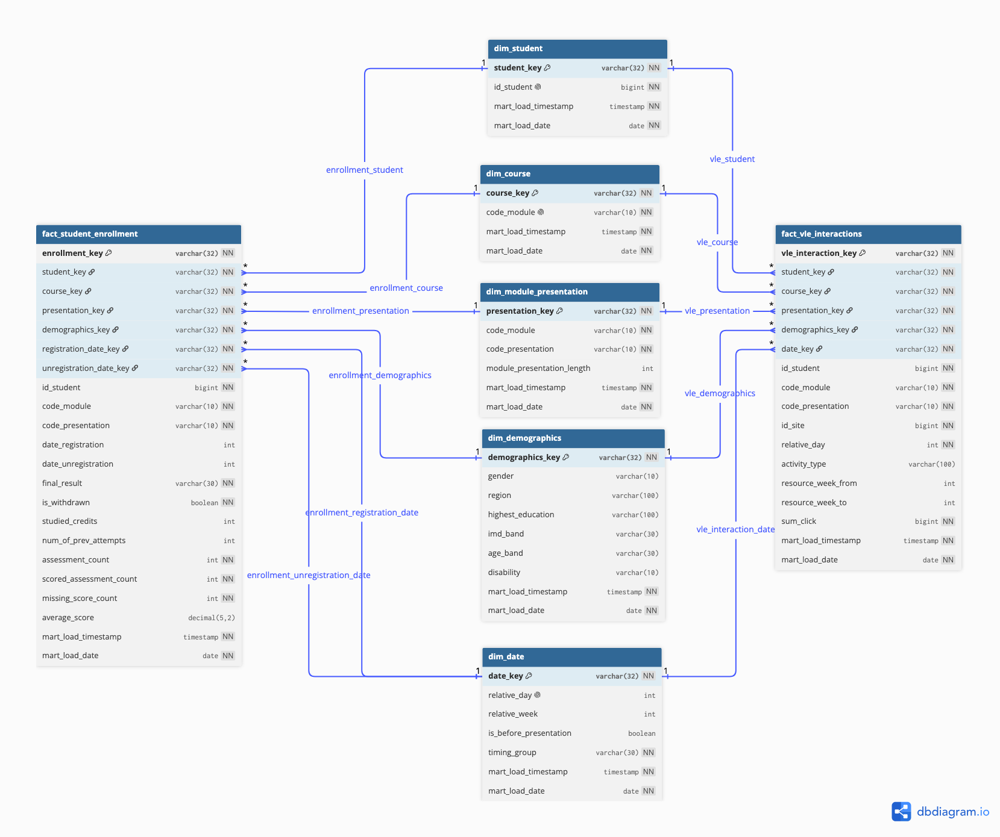

# Journal - 2026-11-27 - One Date Dimension, Three Business Meanings

## Today in one sentence
- OULAD can reuse one date dimension for registration, unregistration, and VLE activity, but each foreign key still represents a different business meaning.

## What I learned
- The newest verified practice prompt asks for the difference between a fact table and a dimension table, but its answer section is blank. I am treating it as a learning prompt and not as evidence that I completed or ran a new model today.
- I have already written about the basic rule that facts measure events and dimensions describe context, so I reviewed a more specific OULAD modeling pattern: the same `dim_date` is connected to facts in several semantic roles.
- The inspected OULAD fact-constellation ERD shows:
  - `fact_student_enrollment.registration_date_key` pointing to `dim_date.date_key`
  - `fact_student_enrollment.unregistration_date_key` pointing to the same `dim_date.date_key`
  - `fact_vle_interactions.date_key` also pointing to `dim_date.date_key`
- This is called a **role-playing dimension**. The physical dimension table is shared, but each relationship answers a different question. Registration date describes when an enrollment began. Unregistration date describes when it ended or was withdrawn. VLE interaction date describes when an engagement event occurred.
- Reusing one dimension avoids copying the same date attributes into three tables. In OULAD, `dim_date` carries relative-day context such as `relative_day`, `relative_week`, `is_before_presentation`, and `timing_group`. Those attributes can be interpreted through each role without maintaining separate physical copies.
- The SQL query must make the roles explicit with aliases:

```sql
SELECT
    enrollment.enrollment_key,
    registration.relative_day AS registration_relative_day,
    registration.timing_group AS registration_timing_group,
    unregistration.relative_day AS unregistration_relative_day,
    unregistration.timing_group AS unregistration_timing_group
FROM fact_student_enrollment AS enrollment
LEFT JOIN dim_date AS registration
    ON enrollment.registration_date_key = registration.date_key
LEFT JOIN dim_date AS unregistration
    ON enrollment.unregistration_date_key = unregistration.date_key;
```

- I did not execute this query today. It is an illustrative design based on the verified ERD.
- The aliases are not cosmetic. Without `registration` and `unregistration`, two joins to the same table become ambiguous to both the SQL engine and the reader. Clear aliases also prevent mistakes such as reporting the unregistration week as the registration week.
- Grain still belongs to the fact table. `fact_student_enrollment` remains one row per student enrollment in one module presentation, even though it references the date dimension more than once. Adding two date joins should enrich each fact row; it should not create extra enrollment rows if `dim_date.date_key` is unique.
- A useful validation is therefore row-count preservation: compare the number of fact rows before the joins with the number after the joins. If the joined result grows, the date dimension may contain duplicate keys or the join condition may be wrong. If required date context disappears, the foreign-key or unknown-date policy needs investigation.
- OULAD dates are relative offsets, not ordinary calendar dates. A value such as `relative_day = -10` means ten days before the module presentation reference point. The role-playing pattern is still valid, but the column aliases and report labels should say “relative day” rather than pretending the values are calendar dates.

## Terms I am still learning
- **role-playing dimension** - one physical dimension reused through several foreign keys, with each relationship representing a different meaning.
- **semantic role** - the business meaning a shared table has in one specific relationship.
- **table alias** - a temporary query name that makes repeated joins clear and unambiguous.
- **surrogate key** - a warehouse-generated identifier used to connect a fact row to a dimension row.
- **unknown member** - a documented dimension record used when the source does not provide a usable key or date.

## What confused me
- Two columns can both reference `dim_date.date_key` while still meaning completely different things. Matching data types do not make the business meanings interchangeable.
- I still need to confirm OULAD’s exact handling for an enrollment without a meaningful unregistration date. The model might use an unknown date member, a special source value, or another documented rule; I should not infer the policy from the ERD alone.
- A single date dimension is compact, but BI tools sometimes need separate logical views such as “Registration Date” and “Unregistration Date.” I want to understand when aliases in SQL are enough and when semantic-layer views make reporting safer.

## One small next step
- [ ] Write and run one OULAD query that joins `dim_date` as registration and unregistration roles, then verify that the enrollment row count and distinct `enrollment_key` count remain unchanged.

## Git checkpoint
- [ ] I created or updated a file
- [ ] I wrote a commit
- [ ] I pushed my changes

## Decisions or assumptions (optional)
- I used a role-playing date dimension as the learning topic because the general fact-versus-dimension and fact-constellation concepts already appear in earlier entries.
- I did not claim that the illustrative SQL ran or that OULAD’s unknown-date policy has been verified.
- Today’s new Library images contain job-offer conversations, so I excluded them as personal and unrelated.
- I inspected the existing OULAD ERD image from Library, confirmed it contains only technical schema information, and uploaded it to the journal repository as `assets/2026-11-27-oulad-fact-constellation.png`.

## Evidence from today (optional)
- [Daily practice prompt](https://github.com/ItsYangCoder/ItsYangCoder/commit/5be1ce5675e5463d654baf59cfd31b212586dbe7) — asks about fact and dimension tables, with no completed answer.
- [OULAD repository README](https://github.com/ItsYangCoder/oulad-data-engineering-pipeline/blob/main/README.md) — documents five dimensions, two facts, their grains, and the relative-day date model.
- [Uploaded journal asset](https://github.com/ItsYangCoder/ftw-b12-journal/blob/main/assets/2026-11-27-oulad-fact-constellation.png)



The ERD makes the role-playing pattern visible: registration, unregistration, and VLE activity use the same date dimension through separately named relationships.

## Reflection (optional)
- What felt easy today? The ERD makes it easy to see which tables measure activity and which tables provide reusable descriptive context.
- What felt difficult today? The difficult part is remembering that one physical dimension can carry several meanings, so a technically valid join can still produce a semantically wrong label.
- What do I want to understand better next time? I want to trace the unknown-date handling from the source through the Gold model and see how it should appear in a reporting view.

## Mood or meme (optional)
- Same date table, different hats—aliases keep the hats labeled. 🎩
