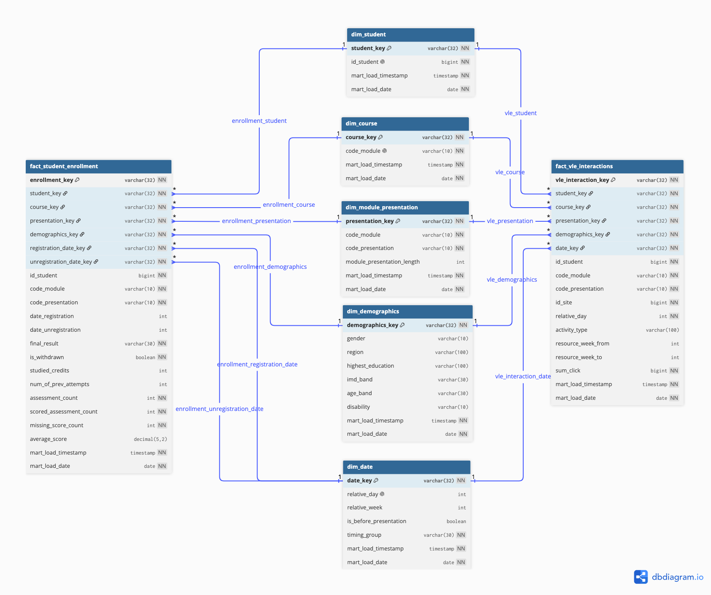

# Journal - 2026-11-28 - Predicting SQL JOIN Results from Grain and Cardinality

Use this version only if you want more structure. The basic `entry.md` is enough for most days.

## Today in one sentence
- I learned that I should be able to predict a JOIN's row count, preserved records, and possible NULLs from table grain and key cardinality before I run the SQL.

## What I learned
- The latest verified practice log asks me to practice one SQL JOIN and describe the expected result. Its answer section is still empty, so I am using it as a design reflection rather than claiming that I executed a query.
- A concrete example is joining `fact_student_enrollment` to `dim_course` in the OULAD model:

  ```sql
  SELECT
      e.enrollment_key,
      e.id_student,
      e.course_key,
      c.code_module
  FROM fact_student_enrollment AS e
  LEFT JOIN dim_course AS c
      ON e.course_key = c.course_key;
  ```

- The fact table's grain is one row per student enrollment. The diagram shows many enrollment rows pointing to one course row. If `dim_course.course_key` is truly unique, this many-to-one JOIN should keep the enrollment grain: each fact row can match at most one course row.
- I would expect a `LEFT JOIN` to return every enrollment row. A matched course adds `code_module`; an unmatched `course_key` keeps the enrollment but produces `NULL` for the course columns. This makes missing dimension references visible instead of silently removing the affected facts.
- An `INNER JOIN` answers a different question. It returns only enrollments that have a matching course dimension row. That can be correct for a report that requires valid course context, but it can also hide referential-integrity problems because orphaned facts disappear from the result.
- The important risk is **fan-out**. If `dim_course` accidentally contains two rows for the same `course_key`, one enrollment can join to both rows. The result becomes larger than the fact table, and later totals can be overstated. A JOIN can be syntactically valid while still being logically wrong.
- This gives me a practical pre-run contract:
  1. Input grain: one row per `enrollment_key`.
  2. Intended relationship: many enrollments to one course.
  3. Preserved side: all enrollment rows because the query uses `LEFT JOIN`.
  4. Expected row count: equal to the enrollment count when the dimension key is unique.
  5. Expected exception: unmatched course keys appear with `NULL` dimension attributes.
- Two checks would make that contract testable. First, verify `dim_course.course_key` has no duplicates. Second, compare the fact row count with the joined row count. If the joined count is greater, the dimension key is not unique or the join condition is incomplete. If an inner-join count is smaller, some facts have no matching course.
- I also learned that row count alone is not enough. A wrong join can keep the same count but attach the wrong course. I should also compare the business key already carried by the fact, such as `code_module`, with the value obtained from the dimension when that comparison is available.

## Terms I am still learning
- **Grain** - what one row represents; here, one student enrollment.
- **Join cardinality** - how many rows on one side are allowed to match a row on the other side, such as many enrollments to one course.
- **Fan-out** - unintended row multiplication when one source row matches multiple rows.
- **Orphaned fact** - a fact row whose foreign key has no matching dimension row.
- **Referential integrity** - the rule that a foreign key should point to a valid key in the referenced table.

## What confused me
- A relationship line in a model communicates the intended many-to-one design, but it does not prove that the stored data currently satisfies that design. I still need to separate “the schema says this key is unique” from “a data-quality query verified it today.”
- I also need to decide when missing dimension matches should fail the pipeline and when they should be retained as an “unknown” member. That decision depends on whether the missing reference is a source-data reality, a late-arriving dimension, or a transformation defect.

## One small next step
- [ ] Write the enrollment-to-course `LEFT JOIN` in a scratch SQL file, then add one duplicate-key check and one unmatched-key count before interpreting the result.

## Git checkpoint
- [ ] I created or updated a file
- [ ] I wrote a commit
- [ ] I pushed my changes

## Decisions or assumptions (optional)
- I chose `LEFT JOIN` for the example because preserving the fact table makes missing course references observable.
- I am assuming the intended dimension key is `dim_course.course_key`, based on the inspected OULAD fact-constellation diagram.
- I am not marking the SQL next step complete because the recent activity proves that the prompt was committed, not that the query or checks were run.

## Evidence from today (optional)
- [Daily practice-log commit `72531d1`](https://github.com/ItsYangCoder/ItsYangCoder/commit/72531d1a4fcf4a7e5c628d1db1be65e51f65bb95) records the SQL JOIN prompt and shows that its answer section is still blank.
- [OULAD fact-constellation asset](https://github.com/ItsYangCoder/ftw-b12-journal/blob/main/assets/2026-11-27-oulad-fact-constellation.png) shows the many-to-one links from `fact_student_enrollment` to `dim_course`, `dim_student`, `dim_module_presentation`, `dim_demographics`, and `dim_date`.

## Reflection (optional)
- The useful part of this exercise is learning to state a JOIN's expected behavior before looking at the output. That turns “the query ran” into a stronger question: “Did the query preserve the intended grain and expose the exceptions I care about?”
- I have evidence for the prompt and the model, but not for an executed query. Keeping that boundary explicit makes the journal more honest and gives me a small, verifiable task for the next session.
- I want to understand the team's preferred policy for late-arriving dimension keys: reject the fact, retain it with a NULL match, or map it to a controlled unknown member.

## Mood or meme (optional)
- “A successful JOIN is not just rows returned; it is the expected rows at the expected grain.” 🔗
- 
- The inspected diagram is useful here because the one-to-many markers make the intended JOIN cardinality visible before any SQL is written.
